<h1 align="center">
  <picture>
    <source media="(prefers-color-scheme: dark)" srcset="docs/assets/atmet-brain-logo-dark.svg">
    <source media="(prefers-color-scheme: light)" srcset="docs/assets/atmet-brain-logo.svg">
    
  </picture>
</h1>

<p align="center"><strong>The open-source company Brain for your AI agents.</strong></p>

<p align="center">
  <a href="https://www.npmjs.com/package/atmet-brain"></a>
  <a href="LICENSE"></a>
  <a href="docs/implementation-status.md"></a>
  <a href="https://github.com/Atmet-AI"></a>
</p>

<p align="center">
  Company memory. Approved workflows. Reusable skills.<br>
  One core, accessed from your terminal, Python, REST or MCP.
</p>

Atmet Brain is the open-source core for keeping business context in one place: company facts, source evidence, approved procedures and reusable task methods. Give an agent the context it is allowed to read, then keep that context current as the business changes.

Run the same core from a terminal, a Python application, REST or MCP. Your company information belongs to your installation. The repository contains the engine and fictional examples, not a preconfigured company Brain.

**Status: local/private-pilot alpha.** See the [support matrix](docs/implementation-status.md) for implemented features, tested integrations and planned capabilities.

[Start from scratch](#from-an-empty-brain-to-daily-work) · [Memory types](#what-the-brain-stores) · [Install](#install) · [Update safely](#update-an-existing-brain) · [Existing projects](#add-the-brain-to-an-existing-project) · [Agent setup](#connect-an-agent) · [Team access](#share-one-brain-with-your-team) · [All guides](#documentation) · [Changelog](CHANGELOG.md)

## From an empty Brain to daily work

A Brain starts empty. You select business sources, establish approved procedures and connect an agent. The Brain returns relevant permitted context; your agent chooses its model and performs work through separately authorized tools. Configured completion feedback can then retain the outcome and propose a reusable skill for approval.

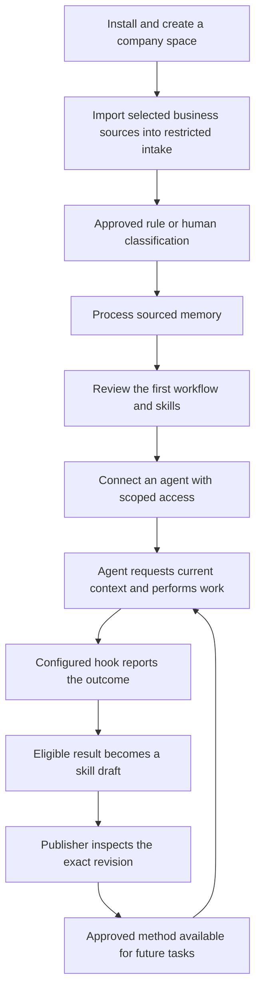

The Sales walkthrough and existing-project walkthrough are alternative starting paths. Keep each installation's home, credentials and returned IDs together. Follow the relevant path once, then use the connected agent conversationally:

1. [Install and initialize](#install) one Brain, or select an existing installation.
2. [Choose spaces](#what-your-company-builds) for departments/projects and [understand the record types](#what-the-brain-stores).
3. [Import sources and process memory](#create-a-first-company-brain), then [publish a first workflow](#save-your-first-approved-workflow).
4. [Connect your agent](#connect-an-agent), with permission to retrieve the selected space and contribute drafts.
5. [Run a task](#what-happens-when-an-agent-gets-a-task) and [enable completion feedback](#learn-from-completed-work).
6. [Maintain current information](#changes-stay-traceable), [inspect history](#inspect-history-and-restore-a-procedure) and [protect the installation](#back-up-and-recover-the-brain).

Already have code, project notes or memory files? Start with [add the Brain to an existing project](#add-the-brain-to-an-existing-project). A coding agent with terminal access can perform the setup when instructed. An ordinary chat without tools cannot install the Brain or attach it to your application. MCP settings may need to be added in the client and the client restarted.

Already set up a Brain? Run the [guided update](docs/upgrading.md) before opening existing data with the new engine, then run setup and choose Local, then Open existing. To add a department use `npx atmet-brain@latest space marketing`. Create a separate Brain only in a different private data home. See [setup recovery](docs/troubleshooting.md#setup-says-already_initialized).

For teammates on other networks and the Finance/payroll example, read [team access explained](docs/team-access-explained.md). Workspace grants control access, source audiences restrict selected information, and authentication uses individual credentials. Company-local password login and single-use invitations are available; SSO/MFA and numeric company discovery remain planned. [Employee accounts and company chooser](docs/employee-accounts.md).

## Manage the Brain through your agent

Ask your configured agent to create departments, prepare employee access or propose a salary rule. It resolves actual IDs and shows a pending change. You apply that exact change in your signed-in terminal with a private password; the agent cannot approve itself.

```bash
npx atmet-brain@latest --brain acme admin agent --name company-assistant
npx atmet-brain@latest --brain acme admin review CHANGE_ID
```

Add the generated atmet-admin MCP entry to your chosen agent app. The first command prepares the connection; the second is run by you after the agent returns a pending ID. This does not add a chat model to the CLI. Read the [complete administration and classification guide](docs/conversational-administration.md).

New and changed documents start restricted until an approved rule or a human-reviewed classification releases them. Unmatched means restricted. After an import, use admin intake and admin classify SOURCE_ID before running extraction, or configure an approved trusted ingestion rule for repeat imports. Existing active pre-upgrade documents retain their current access until changed or a policy update makes their classification stale.

Everyday presets are Reader (read), User (work/report/draft) and Editor (edit/review/publish business artifacts). Company administration is a separate privilege. Neither a department name nor a model instruction grants salary access. Schema 4 requires the [guided update or manual backup and stop/restart procedure](docs/upgrading.md) before opening an existing Brain.

## Company logins and several company Brains

Each company can have its own independent Brain on the same device. Create a catalog entry and select it explicitly:

```bash
npx atmet-brain@latest brains create acme --spaces shared,operations,finance-general,payroll
npx atmet-brain@latest --brain acme account setup --username owner
npx atmet-brain@latest --brain acme login --username owner
npx atmet-brain@latest --brain acme host
npx atmet-brain@latest --brain acme team
```

Use a fresh example company, or register your existing data home with brains add instead. Run brains for the company chooser. The team menu lets you choose an employee, set a role in each allowed workspace, prepare a single-use invitation, reset a login or disable access. Put general finance in finance-general and salaries in payroll, then grant payroll only to the intended people. Ordinary documents follow their destination workspace's readers; restricted sources can narrow access further.

Employees run join with their private invitation, choose a password, then use their saved company connection with login or agent. Passwords are entered privately and are not saved by the client. Sessions expire after 12 hours; permission changes revoke existing credentials and require sign-in again. Invitations are not public company IDs. SSO, MFA, verified email and a global company-number directory are not implemented. Each company needs its own backup/journal and a different port if several servers run on the device. [Complete employee/company walkthrough](docs/employee-accounts.md).

For an existing installation, [run the guided update before opening existing data](docs/upgrading.md). A CLI error does not close the Terminal app: recoverable wizard fields re-prompt, /cancel cancels an operation, and successful completion returns to your shell.

## What your company builds

Start with one department and one workflow. For example, a sales agent can retrieve the current catalogue, quotation instructions and approval policy before preparing a draft. A finance agent can work in a separate space with different source access.

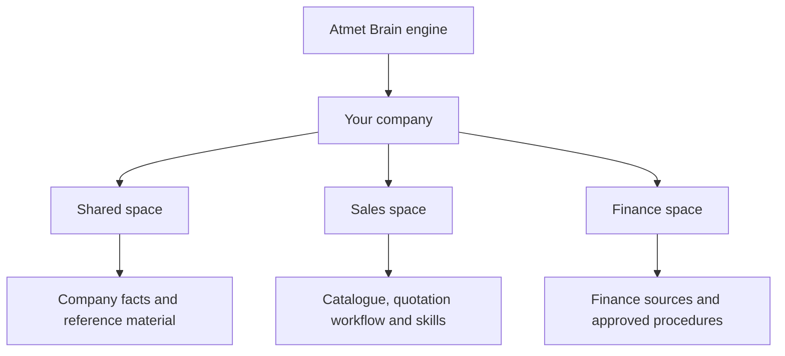

Spaces are independent permission scopes. The tree is a logical view, not a set of folders that grants access automatically. An agent reads each permitted space explicitly; shared information is not inherited across spaces. Named department agents are configurations in your chosen client/runtime, not autonomous workers created by a space name.

## What the Brain stores

"Memory" covers several different records. Original evidence, learned statements, approved instructions and reported outcomes have different authority and lifecycles.

| Type | Purpose and example | How it becomes usable |
| --- | --- | --- |
| **Source** | Captured original text, such as a product catalogue or project MEMORY.md; keeps stable identity, captured revisions and audience | Imported or synchronized with explicit access/authority. Source text is reference material, not automatically an approved instruction. |
| **Ordinary fact** | A sourced statement such as "standard delivery is five business days" | Eligible explicit Fact[key] lines from an authorized authoritative source can activate after processing. Other evidence/review rules still apply. |
| **Observation** | A sourced statement that something was reported or observed | Retained with its evidence and type. It does not establish a business policy. |
| **Inference or conflict** | A proposed conclusion, or competing current statements with the same fact key | Remains reviewable; confidence or repetition does not approve it. |
| **Policy** | An operating rule, such as obtaining approval before sending a quotation | Versioned artifact proposed and published through exact-revision review. |
| **Workflow** | A procedure with steps, inputs and outputs for preparing a quotation | Versioned reviewed artifact; can depend on exact source or skill versions. |
| **Skill** | A reusable task method with instructions, checks and optional text resources | Imported, authored or assembled from task reports as a draft; a publisher approves it. Resources are not arbitrary executable tools. |
| **Instructions and configuration** | Shared/task-specific guidance, context limits and remote-extraction restrictions | Reviewed artifacts within a space. Deployment configuration also limits what lower scopes may allow. |
| **Task report** | An authenticated agent's outcome, result, steps, corrections, checks and original evidence | Private by default and searchable with history permission. Kept outside ordinary document search/context; reported success is unverified. |
| **Automation training run** | Exact accepted inputs/outputs for a supported deterministic task | Explicitly recorded through tasks.record, separate from general task reports. Can support a reviewed recipe candidate. |
| **Automation recipe** | A supported compiled record-cleanup or grouped-total transformation | Examples are replayed, the exact artifact is reviewed, then guarded routing may use its fixed runtime. |
| **Context manifest and audit** | Which source/artifact versions a context request used, and attributable operations/review decisions | Recorded during supported operations. A manifest is not a full prompt or conversation recording. |

For example, a catalogue is a source; its delivery statement can become a fact; the quotation steps are a workflow; and "the customer needed another template" belongs in a task report. A reviewed reusable lesson from that report can become a skill.

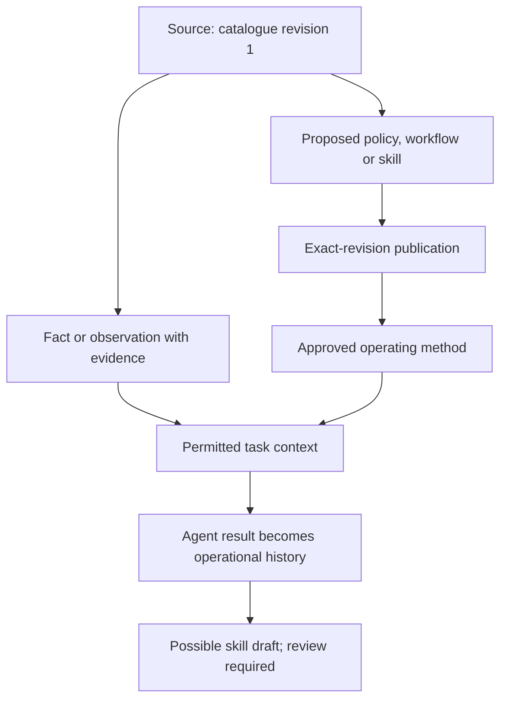

The current ingestion path accepts UTF-8 `.txt`, `.md`, `.json` and `.csv`. A brand guideline can be imported as text; arbitrary PDFs, images, audio and video are not automatically parsed or transcribed. Data is stored in the installation's SQLite records. This table describes logical record types, not separate folders or permission grants. [Memory details](docs/memory-and-learning.md) · [Artifact lifecycle](docs/versioning.md).

## One core, several ways to use it

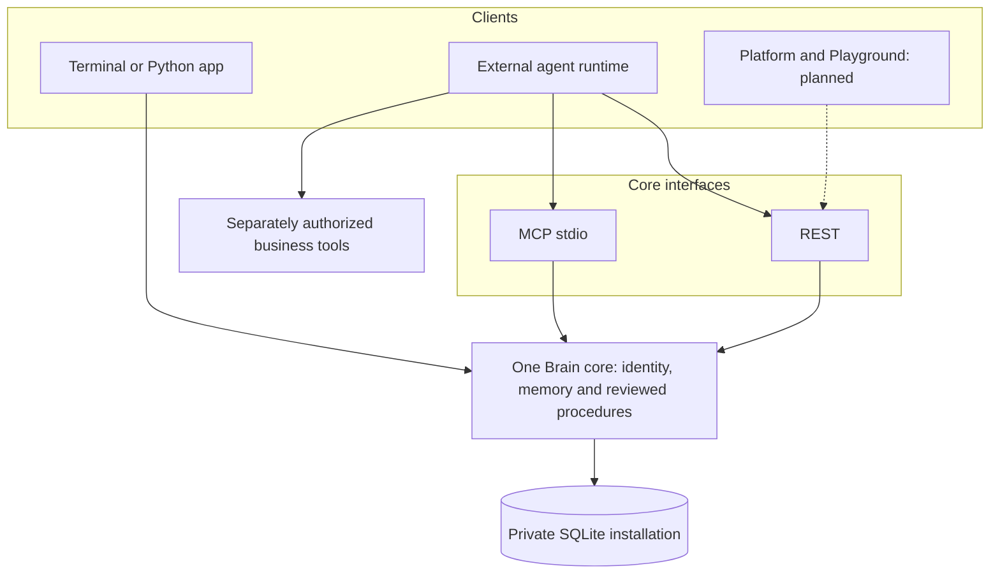

The Brain supplies context and checks access. The agent/runtime chooses its model and controls external actions. The pure recipe runner inside the core can transform bounded data; email sending, browser control and general code execution need separate runtime permissions.

## Install

With Node.js 22.14+ and npm installed, run:

```bash
npx atmet-brain@latest setup
```

Setup guides you through creating a company Brain or connecting to a company server. For a new Brain, you choose the company name and department spaces. Your information is stored in the selected Brain home.

The launcher prepares the matching Python engine in an isolated runtime, so you do not need to clone the repository or install Python manually. First use needs network access for runtime dependencies. Automatic setup supports macOS and glibc Linux on x64/arm64; Windows is not validated. See [installation](docs/install.md) for requirements, version pinning and Python use.

To use the short `atmet-brain` command in the examples below, install it once:

```bash
npm install --global atmet-brain
atmet-brain setup
```

You can also run commands through `npx atmet-brain@latest` without a global installation.

### Update an existing Brain

Run the guided updater on the device hosting your company Brain:

```bash
npx atmet-brain@latest update
```

Choose your company, close its agents and other foreground processes, then approve the update. The wizard stops unchanged Atmet-managed services, creates and verifies an encrypted snapshot plus recovery journal before opening the database with the new engine, and checks that company IDs, workspaces, records, permissions and credential/configuration files remain intact. It refreshes managed service runtime paths and restarts only services that were already running.

For a specific company, use `npx atmet-brain@latest --brain acme update`, or pass its existing `--home /absolute/company/path` before update. Each company is updated separately. The company folder stays in place; no fresh setup is required.

The terminal shows the private backup, separate decryption key and update-report paths. Keep the key protected and copy the backup/journal to independent storage. Reconnect saved MCP entries using the new runtime and their existing scoped credentials. Joined employees update their client software separately; the host administrator updates the shared Brain. See the [update guide](docs/upgrading.md) for every prompt, custom backup destinations, global shortcuts, failures and the manual fallback.

### Use the terminal

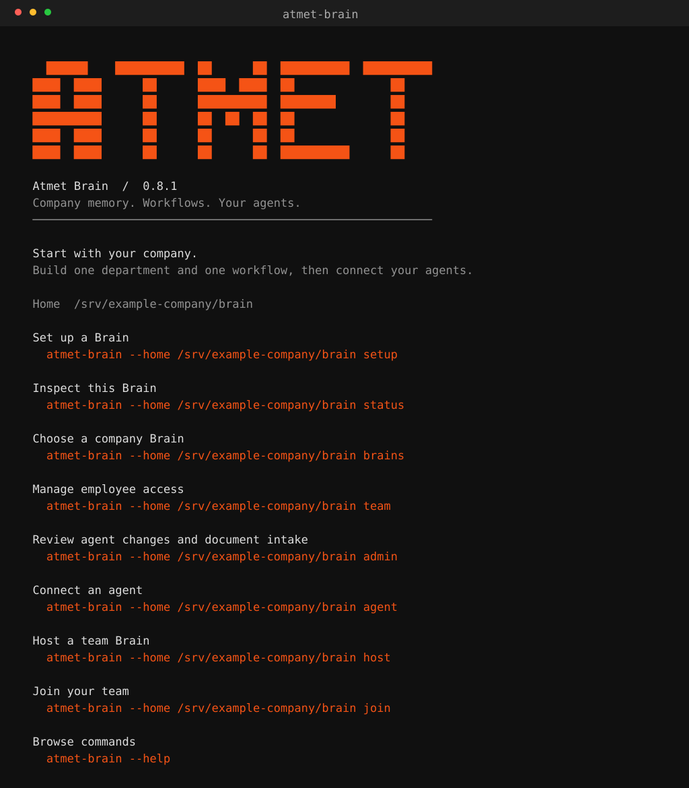

Run `atmet-brain` to see the welcome screen and entry points for setup, status and available commands. Use `atmet-brain --help` to explore the CLI, `--plain` for unstyled output and `--json` for scripts. See the [terminal guide](docs/terminal.md) for local and remote commands.

### Create a first company Brain

If `setup` already created your company and Sales space, run `atmet-brain space` to find its ID and skip the next two commands. Otherwise, use the manual path below. Initialize each data home only once.

```bash
atmet-brain init --organization example-company --owner "Company owner"
atmet-brain space sales
atmet-brain account setup --username owner
atmet-brain login --username owner
```

Save the returned space ID. Create a new private scratch directory for the fictional files below, so the walkthrough does not overwrite project documents:

```bash
export SALES_SPACE="paste-the-returned-space-id"
export GUIDE_DIR="$(mktemp -d)"
cd "$GUIDE_DIR"
printf '%s\n' 'Fact[delivery.window]: Standard delivery is five business days.' > company.md
atmet-brain ingest company.md --space "$SALES_SPACE" --external-id company-reference --authority authoritative
export COMPANY_SOURCE="paste-the-source-id-returned-by-ingest"
atmet-brain admin classify "$COMPANY_SOURCE"
atmet-brain worker --space "$SALES_SPACE"
atmet-brain context "What delivery window should a sales quotation use?" --space "$SALES_SPACE"
```

The default private data home is `~/.atmet-brain`. It starts empty. `init` creates the company, owner credential and configuration; it does not start a chat interview. `setup` adds guided company/department questions; business workflow discovery still needs sources and reviewed instructions. `context` returns structured context for an agent, not a generated customer reply. [Continue with a company workflow](docs/use-for-your-company.md).

Save the source `id` returned by ingest as COMPANY_SOURCE. Its revision is 1 in this fresh example. Only classify real sources as authoritative after the business has approved them; an ordinary import can use `--authority reference`. Ingestion captures the source, while `worker` processes learning jobs. The expected context includes the delivery statement as sourced reference evidence and a manifest ID.

### Save your first approved workflow

Continue in GUIDE_DIR after the source above has been ingested. A human can author this request, or a connected agent can draft it. Export the actual source ID and save the workflow request:

```bash
export COMPANY_SOURCE="paste-the-source-id"
cat > quotation-workflow.json <<JSON
{
  "space_id": "$SALES_SPACE",
  "kind": "workflow",
  "name": "prepare-quotation",
  "instruction_path": "departments/sales/quotations",
  "body": {
    "description": "Prepare a customer quotation draft",
    "instructions": "Use current permitted catalogue and delivery evidence. Ask about missing details. Obtain approval before sending.",
    "steps": [
      {"id": "collect", "instruction": "Check customer, items and quantities."},
      {"id": "draft", "instruction": "Prepare the quotation with current delivery evidence."},
      {"id": "review", "instruction": "Present the draft for approval before any send action."}
    ]
  },
  "evidence": [{"source_id": "$COMPANY_SOURCE", "revision": 1}],
  "expected_revision": 0,
  "reason": "Initial quotation procedure",
  "idempotency_key": "readme-quotation-initial"
}
JSON
atmet-brain propose quotation-workflow.json
```

The result is pending_review. Save its `id` as WORKFLOW_ID. As an authorized publisher, inspect and publish that exact revision:

```bash
export WORKFLOW_ID="paste-the-artifact-id"
atmet-brain rpc artifacts.get --params "{\"artifact_id\":\"$WORKFLOW_ID\",\"revision\":1}"
atmet-brain review "$WORKFLOW_ID" --revision 1 --approve --reason "Reviewed procedure, evidence and approvals"
atmet-brain context "Prepare a quotation" --space "$SALES_SPACE" --artifact "$WORKFLOW_ID" --task-path departments/sales/quotations
```

The context now includes the approved workflow and its source evidence. A pending replacement does not supersede it. Shared and applicable instruction-path prefixes can contribute constraints within this space; the path itself grants no access. Requesting context still does not send a quotation. [Full company walkthrough](docs/use-for-your-company.md) · [Workflow authoring](docs/workflows.md).

### Run the repository examples

For a disposable demonstration or code changes, use a source checkout:

```bash
git clone https://github.com/Atmet-AI/Atmet-brain.git
cd Atmet-brain
python3 -m venv .venv
source .venv/bin/activate
python -m pip install -e .
python examples/demo.py
python examples/automation_demo.py
```

Use Python 3.11 or newer. Both demos use temporary fictional data, remove their state on exit and need no model key. A wheel installation provides the library and CLI; repository examples live in the source checkout.

## Add the Brain to an existing project

Use the Brain alongside your existing repository, documentation and agent. Your code and memory files remain where they are; selected content is captured as versioned sources. The Brain data home stays outside Git, and a project space supplies an explicit access boundary.

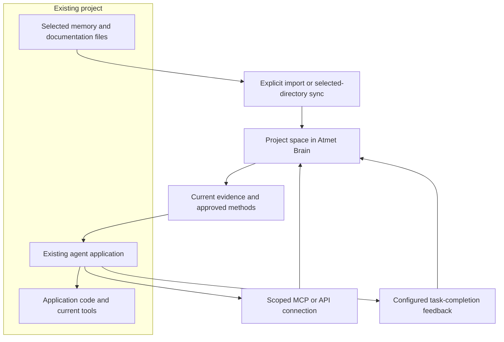

### 1. Select the installation and project space

The commands below use Bash/zsh and the installed atmet-brain command. Replace PROJECT_DIR with an existing project's absolute path. Choose the actual data home of your company Brain; the default is shown here. Do not initialize an existing home again.

```bash
export PROJECT_DIR="/absolute/path/to/your-project"
export ATMET_HOME="$HOME/.atmet-brain"
atmet-brain status
```

If status says not_initialized, run `atmet-brain setup` and create/select the company first. Once initialized, enroll/sign in to your human administrator account if not already enrolled, then list spaces:

```bash
atmet-brain account setup --username owner
atmet-brain login --username owner
atmet-brain space
```

Skip account setup when it is already enrolled. Reuse an existing project space if appropriate. Otherwise create one:

```bash
atmet-brain space website-project
```

Copy its returned ID into PROJECT_SPACE. Different project/department spaces do not share context automatically.

### 2. Import selected existing memory

This example assumes PROJECT_DIR/MEMORY.md exists. Substitute a supported file that actually exists in your project. Import it as reference material, then process and inspect it:

```bash
export PROJECT_SPACE="paste-the-project-space-id"
atmet-brain ingest "$PROJECT_DIR/MEMORY.md" --space "$PROJECT_SPACE" --external-id project-memory --authority reference
export PROJECT_SOURCE="paste-the-source-id-returned-by-ingest"
atmet-brain admin classify "$PROJECT_SOURCE"
atmet-brain worker --space "$PROJECT_SPACE"
atmet-brain search "project" --space "$PROJECT_SPACE"
atmet-brain context "Understand this project before making changes" --space "$PROJECT_SPACE"
```

Use search/context terms that occur in the selected document: current retrieval is lexical. Check returned references and warnings; an empty match is not proof that ingestion failed. The expected evidence keeps its source ID/revision, while the original MEMORY.md remains unchanged and no skill is automatically approved. Existing instructions inside a source must be proposed/published as operating artifacts before they have that authority. Imported documents retain source identity and captured versions. Another memory database/service requires a supported text export or a purpose-built adapter; there is no universal merge of external memory engines.

Keep the original source `id` and revision. To re-import an edited MEMORY.md, use the same external ID plus its current expected revision. After the first import above, an update uses `--expected-revision 1`; the new captured revision becomes 2. [Source updates](docs/memory-and-learning.md#update-an-existing-source).

### 3. Give the project agent scoped access

For the guided alternative, run `atmet-brain agent`, select the project workspace, choose reports/skill drafts if needed, and follow its next steps. If you use the wizard, skip the manual credential/configuration commands in steps 3 and 4, then verify access in step 5. [Agent wizard](docs/agent-setup.md).

Run this as an administrator. Use a new token-file destination; team-add will not overwrite an existing credential file.

```bash
export PROJECT_AGENT_TOKEN="$ATMET_HOME/website-reporter.token"
atmet-brain team-add "Website project agent" --kind service --role reporter --space "$PROJECT_SPACE" --output "$PROJECT_AGENT_TOKEN"
atmet-brain --token-file "$PROJECT_AGENT_TOKEN" rpc identity.me
atmet-brain --token-file "$PROJECT_AGENT_TOKEN" context "Understand this project" --space "$PROJECT_SPACE"
```

The reporter preset includes read, observe, contribute and history for this space. It omits publish, erase, manage and process. The owner token remains administrative. Review scope/expiry before real use; current source audiences can narrow access further.

### 4. Connect the existing agent application

Generate the MCP entry with retrieval, proposal and completion-feedback tools:

```bash
atmet-brain --token-file "$PROJECT_AGENT_TOKEN" mcp-config --allow-proposals --task-feedback
```

Add the returned mcpServers entry in your application's MCP settings and restart/reconnect that client. The configuration uses the installed Python interpreter and private token-file path. Keep that runtime available. Client settings formats vary; named external clients are not universally certified by this generic interface.

For an existing remote company connection, use `atmet-brain --connection company mcp-config --allow-proposals --task-feedback` instead, with that connection already bound to an appropriately scoped agent identity. The remote bridge uses the server's spaces and permissions; it does not copy the company database. [MCP setup](docs/mcp.md) · [REST/Python alternatives](docs/api.md).

### 5. Verify access, then work conversationally

Ask the connected agent:

> List my permitted Brain spaces. Use the project space to retrieve current context, show the source IDs/revisions you used, and tell me whether any approved workflow or skill applies. Report completed work through the configured feedback tool. Keep proposed skills pending for publisher approval.

Then ask for your actual project task. Verify a matching query actually returns the imported source ID/revision before relying on the connection. Absence of an approved workflow is a reason to propose one, not to invent a published procedure. A host file tool must read the selected file; your agent can then submit its content with brain_submit_document or use CLI/API. No MCP tool automatically scans or reads your repository.

MCP completion instructions depend on the agent following them. A host lifecycle hook provides completion delivery without per-task user commands. Both paths require complete original source evidence and deliberate safe result fields. See [automatic feedback](docs/automatic-task-feedback.md) for Python/callback setup and partial-failure retries.

### Optional: keep a selected documentation directory synchronized

Use the [file connector](docs/connectors.md#local-directory) instead of one-time ingestion for files that need ongoing reconciliation. Choose a dedicated selected directory containing supported documents. Avoid the entire repository root: hidden supported files and symlinks are rejected. Configure its root in a private JSON file outside Git:

```json
{"root": "/absolute/path/to/selected-project-documents"}
```

Save that as `$ATMET_HOME/project-files.json`, register the binding and save its returned ID as PROJECT_CONNECTOR:

```bash
atmet-brain connector-add --space "$PROJECT_SPACE" --kind files --config "$ATMET_HOME/project-files.json" --authority reference
```

```bash
export PROJECT_CONNECTOR="paste-the-connector-id"
atmet-brain sync "$PROJECT_CONNECTOR"
atmet-brain admin intake
# Run admin classify SOURCE_ID for each new/changed source, or approve a trusted connector rule first.
atmet-brain worker --space "$PROJECT_SPACE"
```

Use one import route per source file to avoid duplicate captures under different identities. Subsequent successful syncs capture edits and revoke missing files from serving. `serve` alone does not run synchronization; use explicit sync or an operator-managed scheduler. Current Gmail support is a limited read-only selected-label adapter with fixture coverage, not a ready OAuth login/refresh integration.

## How the Brain learns

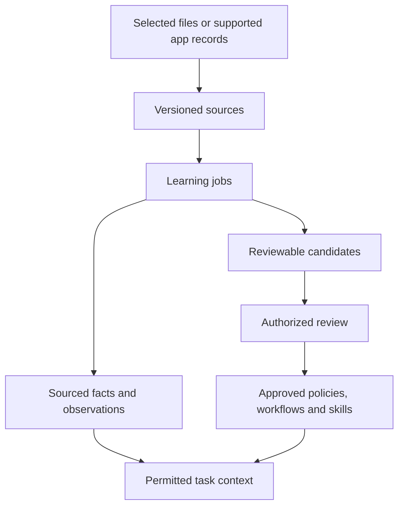

Learning means extracting and updating sourced records, not retraining a model. Eligible ordinary facts from explicitly authoritative sources can activate under the implemented rules. Inferences and operating rules do not become approved simply because they appear repeatedly.

The local extractor recognizes explicit `Fact[key]: statement` lines and sourced observations. Model extraction is opt-in and fixture-tested. General business understanding, video transcription and arbitrary cross-tool workflow discovery are broader targets. [Memory and change handling](docs/memory-and-learning.md).

## Permissions and configuration

Each operation checks an authenticated principal, its credential scope, current space grants and source/artifact audiences. Derived content remains restricted by every contributing source. Organization membership or a folder name does not bypass this chain.

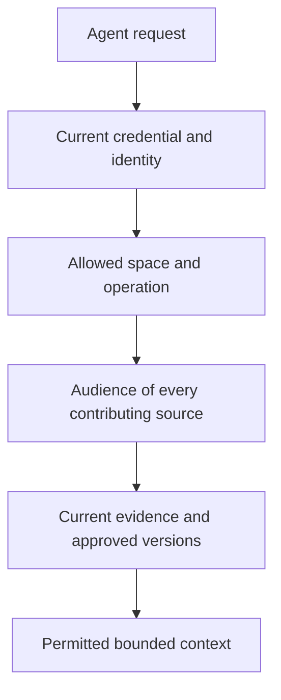

| Identity | Intended use |
| --- | --- |
| Reader | Retrieve permitted information |
| Reporter | Retrieve context, report outcomes, inspect permitted history and propose drafts |
| Publisher | Make explicit artifact publication decisions within granted scope |

Individual credentials provide individual attribution. A shared service key identifies the service, not whichever user name appears in a prompt. Expiry/revocation takes effect on later requests. OS access protects the data home; application grants do not protect a database from a trusted filesystem owner.

Deployment config.toml controls context/result budgets and opt-in remote extraction. Approved shared/department/task configuration can tighten those limits. A narrower request cannot enable remote processing forbidden by deployment settings. Missing required approved context produces an error rather than permission to omit the constraint. [Permissions](docs/permissions.md) · [Configuration](docs/configuration.md).

## What happens when an agent gets a task

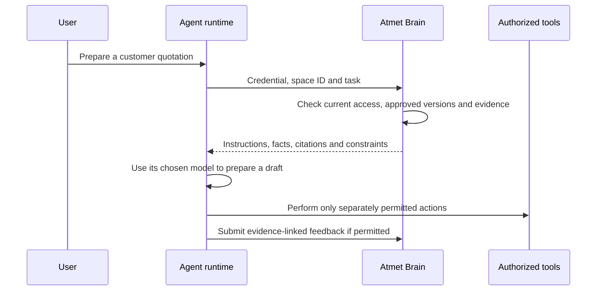

For a quotation, the agent receives applicable approved steps, permitted catalogue/delivery evidence and their exact references. It can ask the user for missing customer or item information. A context manifest records the source/artifact versions used, without recording the full task prompt. The chosen runtime is responsible for following the instructions and enforcing external-action approvals.

The Brain rechecks the real caller's credential and current source permissions. An agent cannot gain authority by sending a person's name or a role in its prompt. Approved instructions and untrusted reference material are returned separately. [Permissions](docs/permissions.md) · [API](docs/api.md).

## Repeated work can become Python

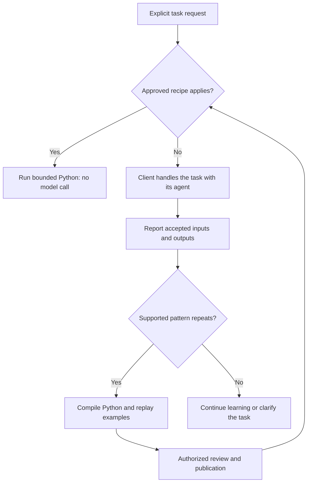

The supported recipe templates cover record cleanup and grouped decimal totals. This is separate from general task-report-to-skill learning: recipe discovery needs exact accepted input/output examples through tasks.record, normally at least three distinct successful inputs, plus an approved workflow/context. Candidates are replayed and reviewed before reuse. A connected runtime reports outcomes and invokes the router. Reuse checks current permissions, evidence and workflow/rule versions. Failed or unsupported tasks return to the client; permission failures remain errors. General Python generation, side effects and automatic scheduling are not implemented. [Script lifecycle and limits](docs/automations.md).

## Changes stay traceable

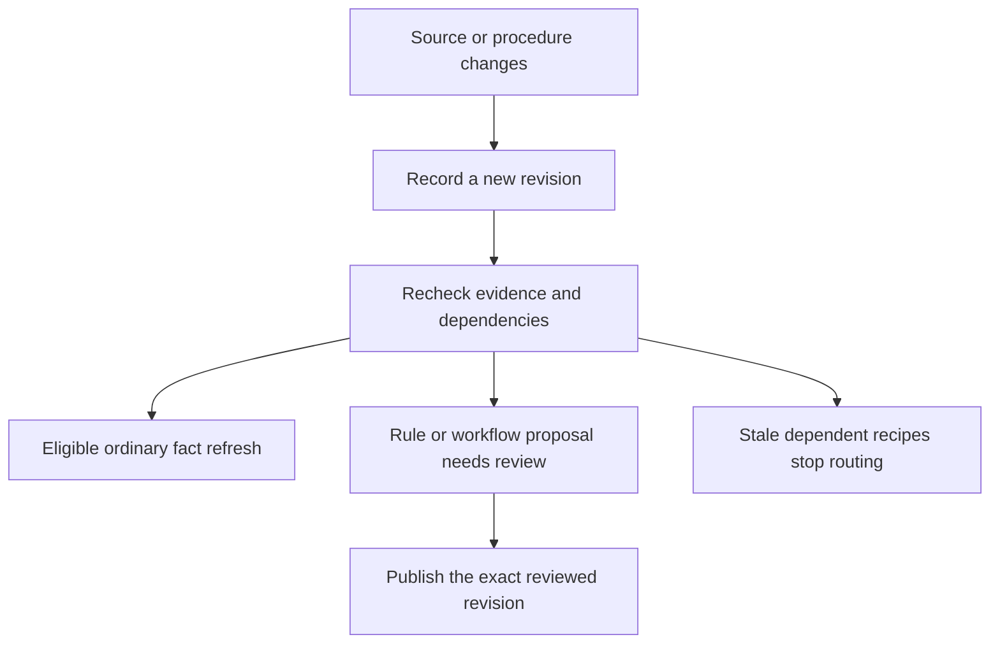

| Change | Current behavior |
| --- | --- |
| A source is updated under the same identity | Capture a new source revision; dependent memories are invalidated and processing uses the new version. |
| Supporting evidence changes | Dependent methods may be unavailable until revalidated through a new reviewed proposal. |
| A business procedure changes | Propose and publish a new workflow/skill revision; repeated observations do not approve it. |
| A source audience narrows or a credential is revoked | Subsequent reads/reuse recheck current access, including retained history. |
| A source/report is erased | Clear its retained logical payload and retract dependent bodies; the recovery journal carries the decision into restoration. |

The Brain can react only after an update reaches it through ingestion or a successful sync. Conflicting current facts are reviewable. Live stock, payment or account status may need a current authorized app read rather than a remembered value.

History explains who changed an artifact and which evidence it used. Rollback creates a new draft business revision for review. Encrypted backup/recovery restores an installation and reconciles current revocations/deletions. These are different operations. [History](docs/versioning.md) · [Recovery](docs/backup-and-recovery.md).

For exact commands and expected results, follow [inspect, compare and restore a workflow](docs/history-walkthrough.md). It shows why a pending revision does not replace approved instructions, and why restoring revision 1 creates revision 3 rather than deleting revision 2. Whole-agent snapshot/version bundles are not implemented by artifact history.

### Inspect history and restore a procedure

For the workflow created earlier, inspect retained revisions:

```bash
atmet-brain rpc artifacts.history --params "{\"artifact_id\":\"$WORKFLOW_ID\"}"
atmet-brain rpc artifacts.get --params "{\"artifact_id\":\"$WORKFLOW_ID\",\"revision\":1}"
```

| Mechanism | What it answers |
| --- | --- |
| Source revisions | Which captured document version supplied the evidence? |
| Workflow/skill history and diff | What instructions changed, and who reviewed the revision? |
| Task history | What did a permitted reporter say happened during selected work? |
| Context manifest | Which source/artifact revisions were actually returned for a context request? |
| Rollback | How do we propose an older retained method as a new revision? |
| Backup restore | How do we recover installation storage after loss? |

For example, after a workflow has revisions 1 and 2, rolling back to revision 1 proposes revision 3. A publisher reviews revision 3 before activation; revision 2 remains in history. Rollback cannot restore erased evidence or bypass current audiences. Follow the [complete history walkthrough](docs/history-walkthrough.md) for diff/rollback commands and manifest inspection. This is content history, not a snapshot of an entire old agent, conversation or model state.

### Back up and recover the Brain

As the local operator, first prepare private key, independent backup and journal storage directories. Adapt these placeholder paths, using a new output/key name:

```bash
atmet-brain backup-key --output /private/keys/brain.key
atmet-brain backup --key-file /private/keys/brain.key --output /backup/storage/brain-001.atmet
atmet-brain journal --output /independent/storage/recovery-journal.json
```

Keep the encryption key separate from backups and the latest recovery journal outside the Brain disk's failure domain. Snapshots include canonical sources, memories, procedures, reports, permission records and safe deployment configuration. Raw client credentials, external-provider secrets and device service/connection files require separate handling.

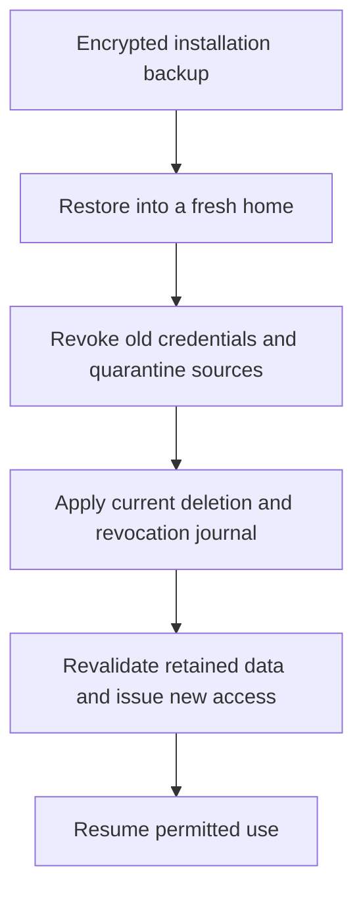

A restore must reconcile later erasures/revocations before serving retained data again. It does not restore old access automatically. Test recovery and schedule backups explicitly; history alone is not disaster recovery. [Backup, restore and journal procedure](docs/backup-and-recovery.md).

## Included in this alpha

| Area | Implemented scope |
| --- | --- |
| Company organization | Independent spaces, human/service identities, scoped credentials, groups and audiences |
| Sources | UTF-8 text, Markdown, JSON and CSV with revisions and evidence |
| Learning | Durable jobs, bounded local extraction, opt-in model adapter and reviewable changes |
| Procedures | Reviewed policies, workflows, nested instructions, skills and typed configuration |
| Retrieval | Permission-first lexical search, bounded context and revision manifests |
| Reuse | Two pure Python recipe templates, reviewed publication, guarded routing and conflict pauses |
| Interfaces | Python, guided CLI, remote HTTPS/SSH-loopback connections, REST and local/bridged MCP stdio |
| Connections | Selected-directory sync; bounded read-only Gmail with fixture coverage |
| Task feedback | Authenticated reports/history, completion hooks, pending skill drafts and separate publisher approval |
| Inspection | Artifact history, diffs and permissioned JSON graph/export |
| Recovery | Encrypted snapshots, integrity checks, journal reconciliation and quarantined restoration |

Gmail/model live accounts, named external MCP-client compatibility, semantic/vector retrieval, recording transcription, general script execution, managed hosting and Playground are outside the implemented or validated scope described in the [support matrix](docs/implementation-status.md). A local API server is not a dashboard or chat interface.

## Connect an agent

For guided setup, run:

```bash
npx atmet-brain@latest agent
```

Choose this device, a saved team connection or Join. Select MCP/terminal/REST/Python, workspace names and read-only or learning access. The wizard prepares a private scoped credential, verifies core permissions, displays a copyable MCP entry and saves method-specific next steps. Add the configuration in your agent app and test it there. It does not grant publication or automatically edit the app. [Guided agent setup](docs/agent-setup.md).

The commands below are the manual alternative.

A connection is set up once; ordinary tasks can then be requested through your agent's conversation. Use a dedicated scoped credential rather than the owner token. If following the Sales example, create a reporter identity:

```bash
export SALES_AGENT_TOKEN="$HOME/.atmet-brain/sales-reporter.token"
atmet-brain team-add "Sales reporter" --kind service --role reporter --space "$SALES_SPACE" --output "$SALES_AGENT_TOKEN"
atmet-brain --token-file "$SALES_AGENT_TOKEN" mcp-config --allow-proposals --task-feedback
```

Use a new credential path. For a custom Brain home, choose a private path under that home instead. Add the generated MCP entry to the client and reconnect it. Request current context for SALES_SPACE and, when appropriate, the explicit workflow ID. The entry enables proposals and completion feedback, not publication. Test a permitted source and a denied scope before real work.

For an application using REST, start the adapter as a separate foreground process:

```bash
atmet-brain serve
```

Or configure an MCP client to launch:

```bash
atmet-brain --token-file /absolute/path/to/scoped-agent.token mcp
```

The API defaults to loopback port 7310. A remote CLI or local MCP bridge can connect through HTTPS or an SSH loopback tunnel. Remote hosting still needs trusted private ingress; no public production gateway/SSO is included. [Company setup](docs/use-for-your-company.md) · [MCP guide](docs/mcp.md) · [Deployment](docs/deployment.md).

## Learn from completed work

Connected agents can report outcomes automatically through a configured task-completion hook. The Brain saves permissioned history and attempts a skill draft from reported steps and corrections. A publisher still approves every new method.

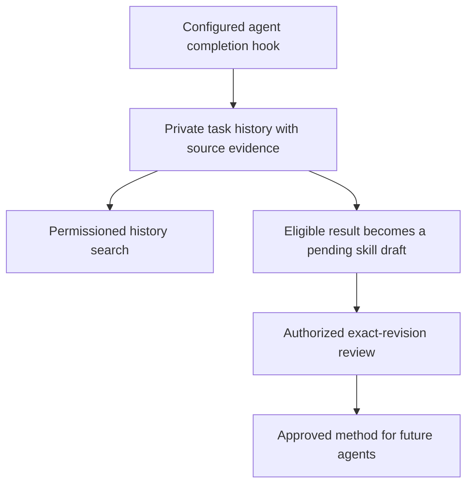

```bash
atmet-brain --token-file /absolute/private/reporter.token mcp-config --task-feedback
atmet-brain task-history "quotation" --space SPACE_ID
```

A configured completion hook sends the result, outcome, actual steps, corrections, checks and original evidence. Eligible successful/corrected reports with steps attempt a deterministic pending candidate; failed-only reports remain history. The compiler makes zero model calls and does not establish independently verified business success. It does not silently rewrite an already approved skill.

The receipt returns report and skill IDs/statuses. A saved report can coexist with blocked drafting; inspect both statuses. Retrying the exact completion reuses the report/candidate without repeating business actions. Report/candidate audiences default private to the reporter. Deliberately share with the intended publisher and ensure they can read all contributing original sources before requesting review.

The publisher inspects the returned candidate and explicitly approves or rejects it. Replace SKILL_ID with its returned ID and use the actual revision:

```bash
atmet-brain rpc artifacts.get --params '{"artifact_id":"SKILL_ID","revision":1}'
atmet-brain review SKILL_ID --revision 1 --approve --reason "Reviewed method, evidence, checks and approvals"
```

Set up [automatic task feedback](docs/automatic-task-feedback.md) once with a reporter credential and MCP `mcp-config --task-feedback` or a Python/host completion hook. MCP instructions require agent cooperation; a host hook provides lifecycle delivery. For manual reporting, create the report JSON using the [complete task-reporting walkthrough](docs/task-history-and-learning.md). Reports default to the reporter's private audience and stay outside ordinary company search/context. History requires explicit read/history grants. Skill learning creates a pending draft, never automatic publication or execution. Current source permissions and versions continue to govern the approved method. Reported success is not independent proof of business success.

## Share one Brain with your team

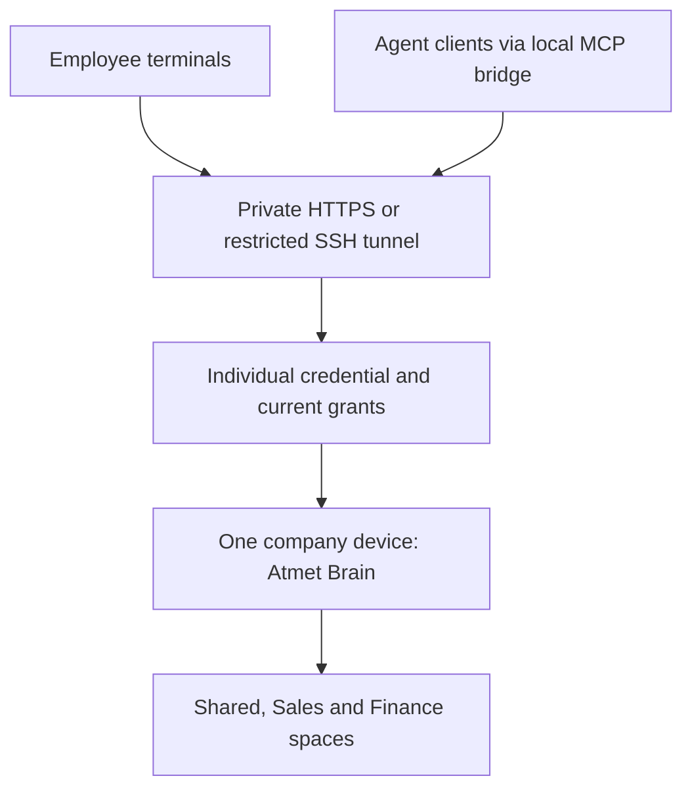

On the company device, open Host using the selected --brain or --home. It creates or reuses that company Brain and defaults to a single-use employee invitation:

```bash
npx atmet-brain@latest host
```

Choose the reachable SSH/HTTPS route, enter the employee's name and login username, select permitted workspaces/role and review. Give the private invitation file to its intended employee. Use team for different roles in different workspaces and later access changes.

On their device:

```bash
npx atmet-brain@latest join
```

Join verifies the company route, enrolls the bound account with a privately chosen password and saves a scoped session. The default password-connection label is the company slug; use the label you selected for later login, status or agent commands. No company database is copied to the employee's device.

Automatic SSH mode opens and closes forwarding for each request after an administrator configures SSH keys/host trust. HTTPS uses existing trusted ingress. Host does not configure firewalls, certificates or a VPN. New .atmet-invite.json files expire and are consumed once. Explicit legacy .atmet-join.json credential files remain supported and are reusable until expiry/revocation. [Employee login and permissions](docs/employee-accounts.md) · [Host/Join reference](docs/team-server.md).

## Documentation

| Goal | Start here |
| --- | --- |
| Connect an agent through a guided terminal flow | [Agent setup](docs/agent-setup.md) |
| Install or try the CLI | [Installation](docs/install.md), [terminal guide](docs/terminal.md) |
| Add knowledge from an existing project | [README project walkthrough](#add-the-brain-to-an-existing-project), [file sources](docs/connectors.md) |
| Automate result reporting with approval | [Automatic task feedback](docs/automatic-task-feedback.md) |
| Report tasks, search past work and propose skills | [Task history and learning](docs/task-history-and-learning.md) |
| Sign in, invite employees or choose company Brains | [Employee accounts](docs/employee-accounts.md) |
| Share a private company server | [Team access and background services](docs/team-server.md) |
| Build your company's first workflow | [Company walkthrough](docs/use-for-your-company.md) |
| Understand modules and data boundaries | [Architecture](docs/architecture.md) |
| Learn from information and changes | [Memory](docs/memory-and-learning.md), [workflows](docs/workflows.md), [skills](docs/skills.md) |
| Reuse deterministic work | [Automations](docs/automations.md) |
| Manage access, configuration and history | [Permissions](docs/permissions.md), [configuration](docs/configuration.md), [versions](docs/versioning.md) |
| View changes or restore older instructions | [Step-by-step history walkthrough](docs/history-walkthrough.md) |
| Back up and operate the core | [Recovery](docs/backup-and-recovery.md), [deployment](docs/deployment.md) |
| Integrate another client | [API](docs/api.md), [MCP](docs/mcp.md), [connectors](docs/connectors.md) |
| Contribute or release | [Contributing](CONTRIBUTING.md), [documentation maintenance](docs/documentation.md), [release versioning](docs/release-versioning.md) |

See the [full documentation index](docs/README.md) and [validation record](docs/validation.md).

## Development

```bash
python -m unittest discover -s tests -v
python scripts/generate_diagrams.py
python scripts/check_project.py
```

Read [CONTRIBUTING.md](CONTRIBUTING.md) and [SECURITY.md](SECURITY.md) before contributing. Keep affected commands, diagrams and guides aligned with code changes. Maintainers can follow [documentation maintenance](docs/documentation.md) and the [publishing guide](docs/package-publishing.md). Release history lives in the [changelog](CHANGELOG.md).

## License

[Apache License 2.0](LICENSE). Copyright 2026 Atmet. Third-party dependencies retain their licenses. Atmet names and branding are separate from the software license.
