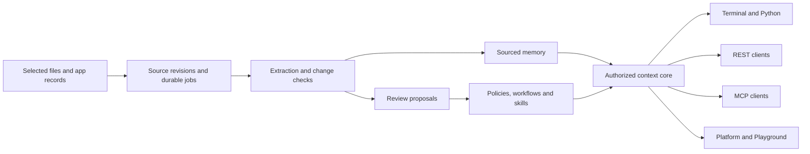

# Atmet Brain

**Company memory, workflows and skills for AI agents.**

Atmet Brain is the open-source core for building a shared understanding of a business. Connect selected sources, keep facts and approved procedures current, and give an agent the context it needs for a task.

Use the same Brain from a terminal, a Python application, a REST client or an MCP client. The Atmet Brain platform and Atmet Playground are separate clients of this core.

**Version 0.1.0 is a local alpha.** It includes working code and tests for the core lifecycle. Start with fictional data and a bounded workflow. See the [implementation status](docs/implementation-status.md) for exact boundaries and [roadmap](docs/roadmap.md) for the wider design.

## Start here

Use Python 3.11 or newer.

```bash
git clone https://github.com/anashamad9/Atmet-brain.git
cd Atmet-brain
python3 -m venv .venv
source .venv/bin/activate
python -m pip install -e .
python examples/demo.py
```

The demo creates a temporary company, ingests a catalogue and customer request, processes memory, publishes an example policy and skill, issues a scoped agent credential, retrieves task context and creates an encrypted backup. It removes its temporary data when it finishes. No model key or external app connection is needed.

For a persistent installation:

```bash
atmet-brain init --organization example-company --owner "Company owner"
atmet-brain space sales
```

Copy the returned space ID, then:

```bash
atmet-brain ingest examples/company/catalogue.md --space SPACE_ID --authority authoritative
atmet-brain worker --space SPACE_ID
atmet-brain search "product price" --space SPACE_ID
atmet-brain context "Prepare a customer quotation" --space SPACE_ID
```

The owner credential is written to a private file under `~/.atmet-brain`. Create separate scoped credentials for apps and agents. The [quickstart](docs/quickstart.md) walks through that setup.

## How it fits together



The Brain stores context and enforces access to it. The agent runtime separately controls actions such as sending an email, editing a business record or running a shell command.

It can also turn supported repeated transformations into reviewed Python recipes. The core then processes matching data without a model call. This bounded pure-computation path does not grant external action permissions. See [repeated tasks into scripts](docs/automations.md).

## What is included

| Area | This release |
| --- | --- |
| Company spaces | Separate spaces, attributable users/services, operation grants and restricted audiences |
| Sources | UTF-8 text, Markdown, JSON and CSV with revisions and evidence |
| Learning | Durable jobs, local extraction, opt-in model extraction, ordinary-fact refresh and reviewable conflicts |
| Operating context | Reviewed policies, nested instructions, workflows, typed configuration and scheduled versions |
| Skills | Portable packages, resources, reviewed updates, pinned dependencies and staged loading |
| Retrieval | Permission-first lexical search, bounded context envelopes and revision manifests |
| Interfaces | Python, CLI, bearer-authenticated REST and MCP stdio |
| Connectors | Selected local directories and a bounded Gmail label reader |
| Discovery | Draft process sequences from explicit case-linked events |
| Repeated tasks | Recorded outcomes, automatic recipe proposals, reviewed Python and permission/version-aware reuse for two supported templates |
| History | Source versions, artifact diffs through retained bodies, audit metadata and controlled rollback |
| Recovery | Encrypted snapshots, integrity checks, a recovery journal and quarantined restore |

Gmail and model adapters have fixture tests; live provider accounts were not used for release validation. Gmail token refresh, remote MCP OAuth, semantic/vector retrieval, recording transcription, managed hosting and the Playground application are later work. See the [support matrix](docs/implementation-status.md).

## A small set of concepts

| Concept | Meaning |
| --- | --- |
| Source | The original information and its revisions |
| Memory | A sourced fact, observation or inference |
| Policy | An approved operating constraint |
| Workflow | A business process with steps, branches and handoffs |
| Skill | A reusable method with instructions and resources |
| Automation | A reviewed executable recipe for a bounded deterministic task |
| Agent | An authenticated client using permitted context through a runtime |

Observations can become suggestions. Operating rules become active through authorized publication. A skill package never grants permissions by itself.

## Connect an agent

Start the REST adapter:

```bash
atmet-brain serve
```

Or configure an MCP client to launch:

```bash
atmet-brain --token-file /absolute/path/to/worker.token mcp
```

Use a dedicated credential and an explicit space ID. The same checks run for every interface. [REST guide](docs/api.md) | [MCP guide](docs/mcp.md) | [Identity and permissions](docs/permissions.md)

## Documentation

- [Documentation index](docs/README.md)
- [Quickstart](docs/quickstart.md)
- [Architecture and data model](docs/architecture.md)
- [Memory and continuous learning](docs/memory-and-learning.md)
- [Workflows and automatic discovery](docs/workflows.md)
- [Skills](docs/skills.md)
- [Repeated tasks into Python scripts](docs/automations.md)
- [Configuration](docs/configuration.md)
- [Versions and history](docs/versioning.md)
- [Backup and recovery](docs/backup-and-recovery.md)
- [Connector development](docs/connectors.md)
- [Deployment](docs/deployment.md)
- [Testing](docs/testing.md)
- [GitHub release guide](docs/releasing.md)
- [Release versions](docs/release-versioning.md)

## Development

```bash
python -m unittest discover -s tests -v
python scripts/check_project.py
```

Tests use temporary fictional data. HTTP integration tests bind loopback sockets. No external model or mailbox is contacted by the test suite.

## Contributing

Read [CONTRIBUTING.md](CONTRIBUTING.md) and [SECURITY.md](SECURITY.md). Small, evidence-backed changes are welcome. Add a regression test when changing authorization, revisions, publication, connector behavior or recovery.

## License

[Apache License 2.0](LICENSE). Copyright 2026 Atmet. Third-party dependencies retain their own licenses. Atmet names and branding are separate from the software license.
