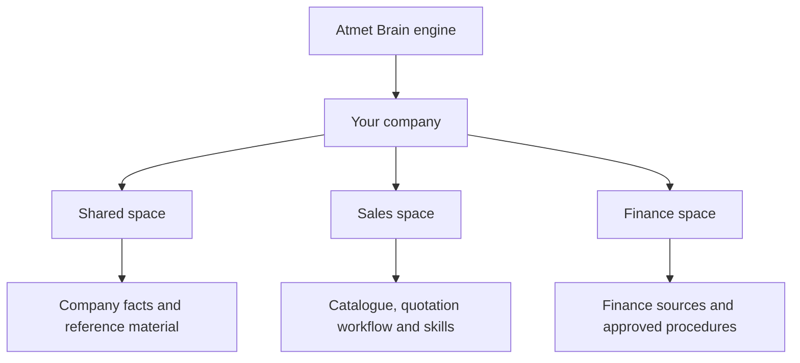
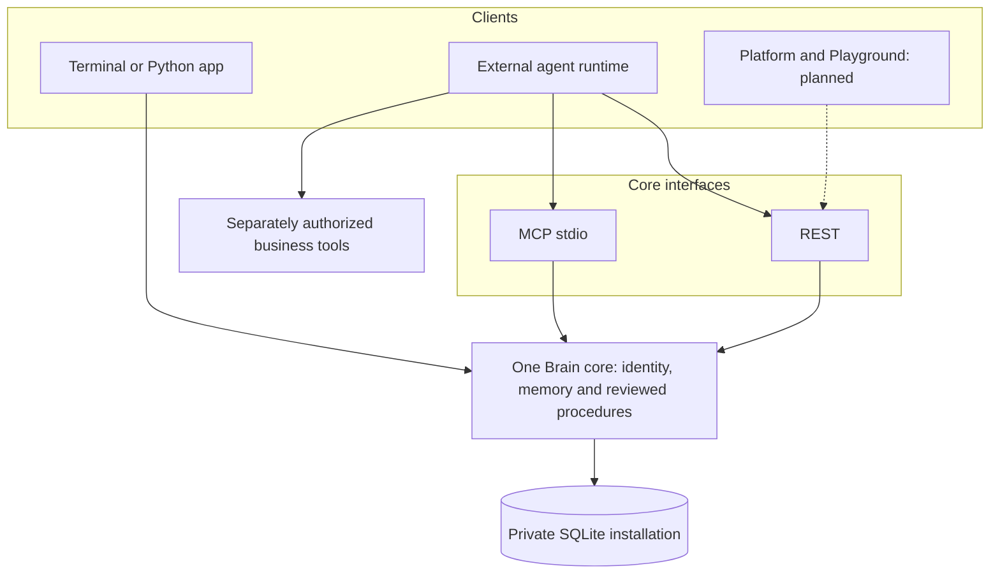
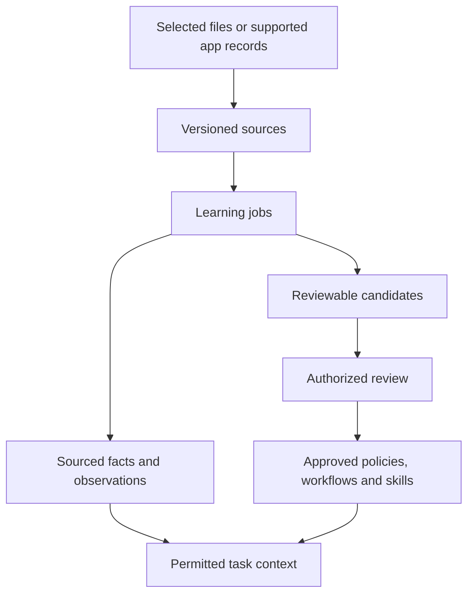
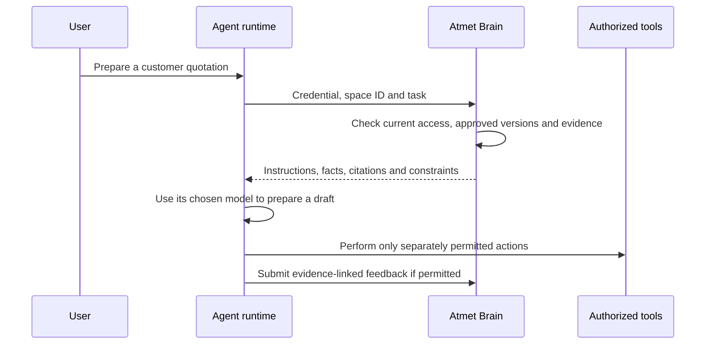
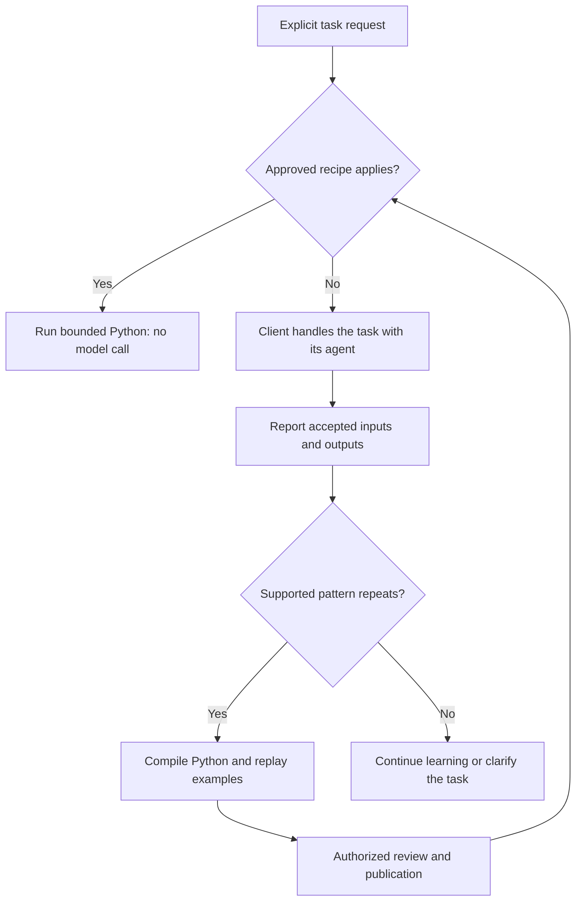
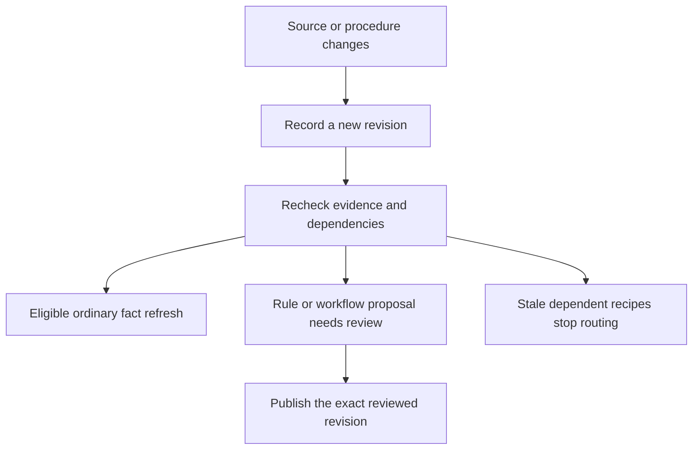
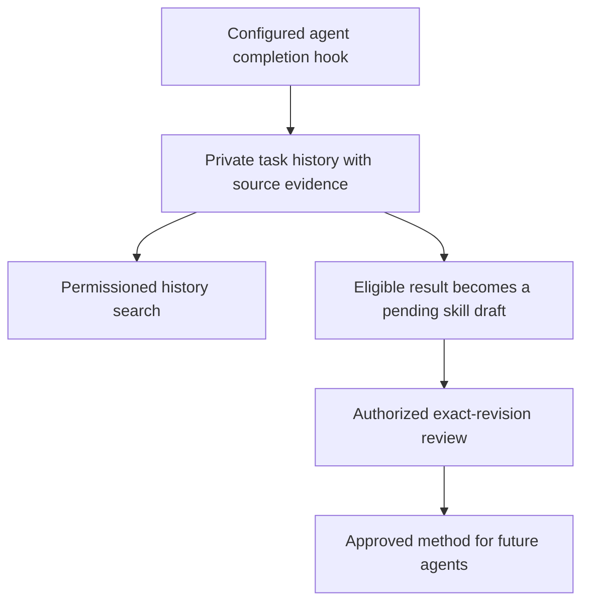
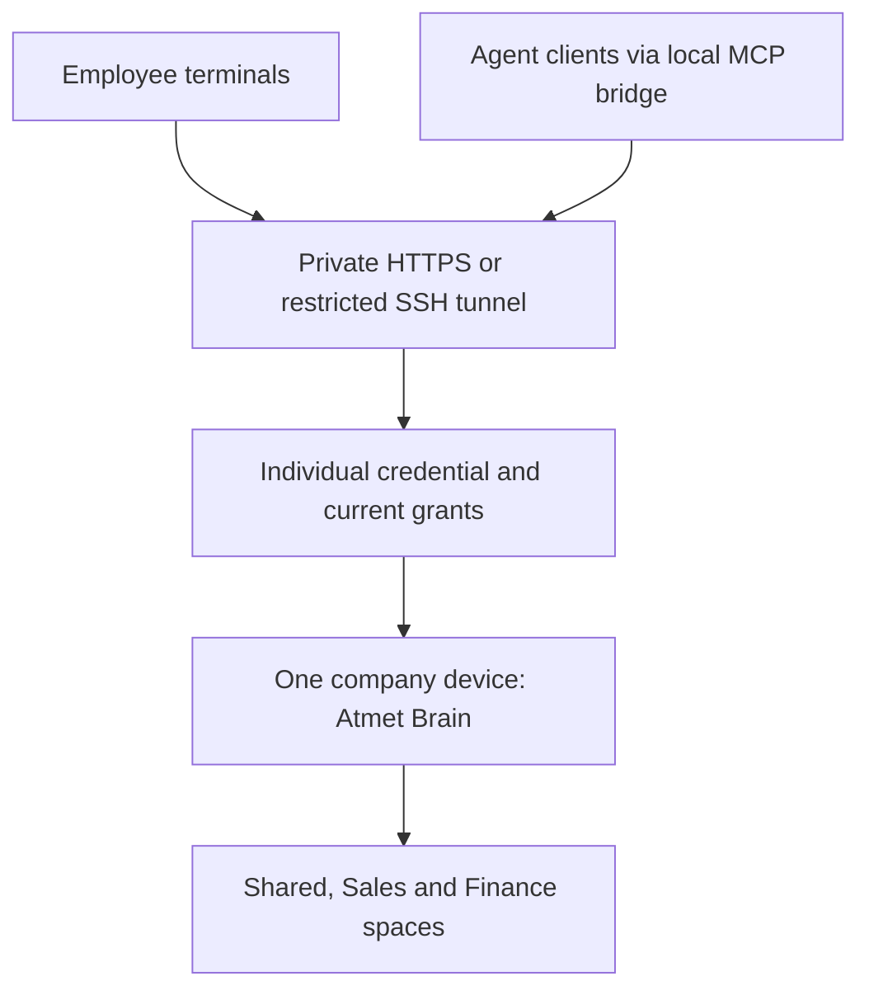

# Atmet Brain

**Company memory, workflows and skills that your agents can use.**

Atmet Brain is the open-source core for keeping business context in one place: company facts, source evidence, approved procedures and reusable task methods. Give an agent the context it is allowed to read, then keep that context current as the business changes.

Run the same core from a terminal, a Python application, REST or MCP. Your company information belongs to your installation. The repository contains the engine and fictional examples, not a preconfigured company Brain.

**Status: local/private-pilot alpha.** See the [support matrix](docs/implementation-status.md) for implemented features, tested integrations and planned capabilities.

[Install](#install) · [Company walkthrough](docs/use-for-your-company.md) · [History walkthrough](docs/history-walkthrough.md) · [Task history](docs/task-history-and-learning.md) · [Architecture](docs/architecture.md) · [API](docs/api.md) · [MCP](docs/mcp.md) · [Changelog](CHANGELOG.md)

## What your company builds

Start with one department and one workflow. For example, a sales agent can retrieve the current catalogue, quotation instructions and approval policy before preparing a draft. A finance agent can work in a separate space with different source access.



Spaces are independent permission scopes. The tree is a logical view, not a set of folders that grants access automatically. An agent reads each permitted space explicitly; shared information is not inherited across spaces. Named department agents are configurations in your chosen client/runtime, not autonomous workers created by a space name.

## One core, several ways to use it



The Brain supplies context and checks access. The agent/runtime chooses its model and controls external actions. The pure recipe runner inside the core can transform bounded data; email sending, browser control and general code execution need separate runtime permissions.

## Install

With Node.js 22.14+ and npm installed, run:

```bash
npx atmet-brain@latest setup
```

Setup guides you through creating a company Brain or connecting to a company server. For a new Brain, you choose the company name and department spaces. Your information is stored in the selected Brain home.

The launcher prepares the matching Python engine in an isolated runtime, so you do not need to clone the repository or install Python manually. First use needs network access for runtime dependencies. Automatic setup supports macOS and glibc Linux on x64/arm64; Windows is not validated. See [installation](docs/install.md) for requirements, version pinning and Python use.

To use the short `atmet-brain` command in the examples below, install it once:

```bash
npm install --global atmet-brain
atmet-brain setup
```

You can also run commands through `npx atmet-brain@latest` without a global installation.

### Use the terminal


Run `atmet-brain` to see the welcome screen and entry points for setup, status and available commands. Use `atmet-brain --help` to explore the CLI, `--plain` for unstyled output and `--json` for scripts. See the [terminal guide](docs/terminal.md) for local and remote commands.

### Create a first company Brain

If `setup` already created your company and Sales space, run `atmet-brain space` to find its ID and skip the next two commands. Otherwise, use the manual path below. Initialize each data home only once.

```bash
atmet-brain init --organization example-company --owner "Company owner"
atmet-brain space sales
```

Save the returned space ID, then try a fictional company fact:

```bash
export SALES_SPACE="paste-the-returned-space-id"
printf '%s\n' 'Fact[delivery.window]: Standard delivery is five business days.' > company.md
atmet-brain ingest company.md --space "$SALES_SPACE" --authority authoritative
atmet-brain worker --space "$SALES_SPACE"
atmet-brain context "What delivery window should a sales quotation use?" --space "$SALES_SPACE"
```

The default private data home is `~/.atmet-brain`. It starts empty. `init` creates the company, owner credential and configuration; it does not start a chat interview. `setup` adds guided company/department questions; business workflow discovery still needs sources and reviewed instructions. `context` returns structured context for an agent, not a generated customer reply. [Continue with a company workflow](docs/use-for-your-company.md).

### Run the repository examples

For a disposable demonstration or code changes, use a source checkout:

```bash
git clone https://github.com/anashamad9/Atmet-brain.git
cd Atmet-brain
python3 -m venv .venv
source .venv/bin/activate
python -m pip install -e .
python examples/demo.py
python examples/automation_demo.py
```

Use Python 3.11 or newer. Both demos use temporary fictional data, remove their state on exit and need no model key. A wheel installation provides the library and CLI; repository examples live in the source checkout.

## How the Brain learns



Learning means extracting and updating sourced records, not retraining a model. Eligible ordinary facts from explicitly authoritative sources can activate under the implemented rules. Inferences and operating rules do not become approved simply because they appear repeatedly.

The local extractor recognizes explicit `Fact[key]: statement` lines and sourced observations. Model extraction is opt-in and fixture-tested. General business understanding, video transcription and arbitrary cross-tool workflow discovery are broader targets. [Memory and change handling](docs/memory-and-learning.md).

## What happens when an agent gets a task



The Brain rechecks the real caller's credential and current source permissions. An agent cannot gain authority by sending a person's name or a role in its prompt. Approved instructions and untrusted reference material are returned separately. [Permissions](docs/permissions.md) · [API](docs/api.md).

## Repeated work can become Python



The supported recipe templates cover record cleanup and grouped decimal totals. A connected runtime reports outcomes and invokes the router. Reuse checks current permissions, evidence and workflow/rule versions. Failed or unsupported tasks return to the client; permission failures remain errors. General Python generation, side effects and automatic scheduling are not implemented. [Script lifecycle and limits](docs/automations.md).

## Changes stay traceable



History explains who changed an artifact and which evidence it used. Rollback creates a new reviewed business revision. Encrypted backup/recovery restores an installation and reconciles current revocations/deletions. These are different operations. [History](docs/versioning.md) · [Recovery](docs/backup-and-recovery.md).

For exact commands and expected results, follow [inspect, compare and restore a workflow](docs/history-walkthrough.md). It shows why a pending revision does not replace approved instructions, and why restoring revision 1 creates revision 3 rather than deleting revision 2. Whole-agent snapshot/version bundles are not implemented by artifact history.

## Included in this alpha

| Area | Implemented scope |
| --- | --- |
| Company organization | Independent spaces, human/service identities, scoped credentials, groups and audiences |
| Sources | UTF-8 text, Markdown, JSON and CSV with revisions and evidence |
| Learning | Durable jobs, bounded local extraction, opt-in model adapter and reviewable changes |
| Procedures | Reviewed policies, workflows, nested instructions, skills and typed configuration |
| Retrieval | Permission-first lexical search, bounded context and revision manifests |
| Reuse | Two pure Python recipe templates, reviewed publication, guarded routing and conflict pauses |
| Interfaces | Python, guided CLI, remote HTTPS/SSH-loopback connections, REST and local/bridged MCP stdio |
| Connections | Selected-directory sync; bounded read-only Gmail with fixture coverage |
| Inspection | Artifact history, diffs and permissioned JSON graph/export |
| Recovery | Encrypted snapshots, integrity checks, journal reconciliation and quarantined restoration |

Gmail/model live accounts, named external MCP-client compatibility, semantic/vector retrieval, recording transcription, general script execution, managed hosting and Playground are outside the implemented or validated scope described in the [support matrix](docs/implementation-status.md). A local API server is not a dashboard or chat interface.

## Connect an agent

Use a dedicated scoped credential. Start the REST adapter:

```bash
atmet-brain serve
```

Or configure an MCP client to launch:

```bash
atmet-brain --token-file /absolute/path/to/worker.token mcp
```

The API defaults to loopback port 7310. A remote CLI or local MCP bridge can connect through HTTPS or an SSH loopback tunnel. Remote hosting still needs trusted private ingress; no public production gateway/SSO is included. [Company setup](docs/use-for-your-company.md) · [MCP guide](docs/mcp.md) · [Deployment](docs/deployment.md).

## Learn from completed work

Connected agents can report outcomes automatically through a configured task-completion hook. The Brain saves permissioned history and attempts a skill draft from reported steps and corrections. A publisher still approves every new method.



```bash
atmet-brain --token-file /absolute/private/reporter.token mcp-config --task-feedback
atmet-brain task-history "quotation" --space SPACE_ID
```

Set up [automatic task feedback](docs/automatic-task-feedback.md) once with a reporter credential and MCP `mcp-config --task-feedback` or a Python/host completion hook. MCP instructions require agent cooperation; a host hook provides lifecycle delivery. For manual reporting, create the report JSON using the [complete task-reporting walkthrough](docs/task-history-and-learning.md). Reports default to the reporter's private audience and stay outside ordinary company search/context. History requires explicit read/history grants. Skill learning creates a pending draft, never automatic publication or execution. Current source permissions and versions continue to govern the approved method. Reported success is not independent proof of business success.

## Share one Brain with your team



On the company device, open Host. It creates a new Brain or reuses the existing one:

```bash
npx atmet-brain@latest host
```

Choose the secure route, enter a teammate's name, select allowed workspaces by name and choose a role. Host creates a private `.atmet-join.json` connection file and offers to install/start the local background API service. Run Host again to add another teammate.

Give that file privately to its intended recipient. On their device:

```bash
npx atmet-brain@latest join
```

Join asks for the file, displays the server/access details, verifies the actual identity and lists permitted workspaces. The default saved connection name is `company`. For regular use, install the CLI globally, then:

```bash
atmet-brain --connection company space
atmet-brain --json --connection company mcp-config
```

Automatic SSH mode opens and closes forwarding for each request; no separate tunnel terminal is needed. An administrator must first configure the forwarding-only SSH account, each teammate's SSH key and trusted host key. Alternatively use existing HTTPS ingress. Host does not configure OS accounts, firewalls, certificates or a VPN. The connection file contains a scoped credential, not a public or single-use invitation; keep it private. [Step-by-step Host and Join guide](docs/team-server.md) · [Terminal commands](docs/terminal.md).

## Documentation

| Goal | Start here |
| --- | --- |
| Install or try the CLI | [Installation](docs/install.md), [terminal guide](docs/terminal.md) |
| Report tasks, search past work and propose skills | [Task history and learning](docs/task-history-and-learning.md) |
| Share a private company server | [Team access and background services](docs/team-server.md) |
| Build your company's first workflow | [Company walkthrough](docs/use-for-your-company.md) |
| Understand modules and data boundaries | [Architecture](docs/architecture.md) |
| Learn from information and changes | [Memory](docs/memory-and-learning.md), [workflows](docs/workflows.md), [skills](docs/skills.md) |
| Reuse deterministic work | [Automations](docs/automations.md) |
| Manage access, configuration and history | [Permissions](docs/permissions.md), [configuration](docs/configuration.md), [versions](docs/versioning.md) |
| View changes or restore older instructions | [Step-by-step history walkthrough](docs/history-walkthrough.md) |
| Back up and operate the core | [Recovery](docs/backup-and-recovery.md), [deployment](docs/deployment.md) |
| Integrate another client | [API](docs/api.md), [MCP](docs/mcp.md), [connectors](docs/connectors.md) |
| Contribute or release | [Contributing](CONTRIBUTING.md), [documentation maintenance](docs/documentation.md), [release versioning](docs/release-versioning.md) |

See the [full documentation index](docs/README.md) and [validation record](docs/validation.md).

## Development

```bash
python -m unittest discover -s tests -v
python scripts/generate_diagrams.py
python scripts/check_project.py
```

Read [CONTRIBUTING.md](CONTRIBUTING.md) and [SECURITY.md](SECURITY.md) before contributing. Keep affected commands, diagrams and guides aligned with code changes. Maintainers can follow [documentation maintenance](docs/documentation.md) and the [publishing guide](docs/package-publishing.md). Release history lives in the [changelog](CHANGELOG.md).

## License

[Apache License 2.0](LICENSE). Copyright 2026 Atmet. Third-party dependencies retain their licenses. Atmet names and branding are separate from the software license.
