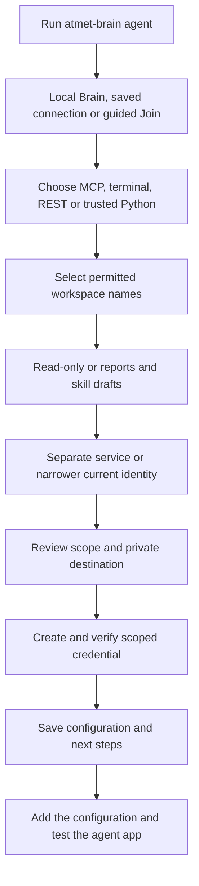

# Connect an agent with the terminal wizard

Run this after creating a Brain, or choose Join inside the wizard to connect to your team's Brain:

```bash
npx atmet-brain@latest agent
```

The wizard requires engine 0.6.0+ at both ends; employee password enrollment needs 0.7.0. Current engine 0.8.0 uses schema 4. Before opening older data, follow the [upgrade procedure](versioning.md#schema-4-upgrade), back up with the existing engine and stop old processes. Signed-in employees can use their saved password session; generated child credentials cannot outlive it.

The wizard creates a private connection bundle and verifies its identity/space permissions. It does not edit application settings, install task hooks, start API services or import project files. After adding the configuration, verify the connection in the chosen agent app.



## 1. Choose the Brain

Choose local for a Brain already on this device. If none exists, run setup first. An empty installation is not initialized silently.

Saved team connections appear by name. Choose Join to open and verify the private connection file supplied by your administrator. SSH/HTTPS infrastructure must already be configured. A private CA can be supplied with the global --ca-file option.

You can select a saved connection directly:

```bash
atmet-brain --connection company agent
```

Remote mode never falls back to a local database. No company database is copied to the client. The wizard saves a separate named connection for its new scoped credential.

## 2. Choose how the agent connects

| Choice | What you receive | What you do next |
| --- | --- | --- |
| MCP | A ready mcp.json entry, shown in the terminal too | Add it to an app supporting local MCP stdio and reconnect that client |
| Terminal | A scoped context command and agent instructions | Let the coding agent use those commands through its terminal tools |
| REST | Endpoint, request.json and credential-file path | Start a local API if needed, then implement the authenticated HTTP call in your app |
| Python | An agent.py context example and the installed interpreter command | Run it, then integrate it into your trusted Python application |

MCP and terminal can use saved SSH connections. Direct REST/Python options require HTTPS or an explicitly managed loopback endpoint, so they are not offered for an automatic SSH profile. The CLI/MCP bridge handles that profile's forwarding instead.

A local Python example embeds the core and needs trusted filesystem access. A remote Python example uses the HTTP client and preserves the selected CA. A local REST choice supplies the serve command but does not start or probe a listener automatically.

## 3. Select workspaces and access

Select listed workspace names or #numbers, separated by commas. IDs also work in flags, but are not needed in the guided UI. Each selected workspace must permit the requested operations.

- Read-only uses the reader role. It exposes no proposal or task-completion tools in the generated MCP entry.
- Reports and skill drafts uses the reporter role: read, observe, contribute and history. MCP enables proposals and task feedback. Publication, erasure, management and recipe execution are not granted.

The core preflight checks actual current grants and credential scope. A tool switch cannot elevate a reader into a reporter. Source audiences still constrain every later context/history read.

Reports/candidates remain private by default. If a publisher should review a service agent's result, deliberately authorize an appropriate report audience and ensure that publisher can read all original sources. The wizard does not automatically share company information.

## 4. Choose the agent identity

Authorized administrators can create a separate service identity, normally expiring after 30 days and never later than the issuer. This provides separate attribution for that agent.

Other callers can use their current identity with a new child credential restricted to the selected operations/spaces. It retains that identity's attribution and parent expiry. Revoking the parent invalidates its children. The wizard never copies the broad issuer token into the configuration bundle.

Review the agent name, method, workspaces, access and destination before creating the bundle. Cancellation or missing required answers stops before credential issuance. Existing setup directories and connection profiles are not overwritten; use a new agent name for another setup.

## 5. Use the generated bundle

The default directory is home/agents/AGENT_NAME inside the private Brain/client data home. Directories are private and generated files use owner-only permissions.

| File | Purpose |
| --- | --- |
| agent.token | The new narrowed credential; never print or commit its contents |
| mcp.json | Ready local/remote MCP entry without a raw embedded token |
| agent-instructions.md | Space selection, context handling and optional reporting guidance |
| CONNECT.md | Method-specific commands and next steps |
| request.json | Example context.get HTTP request body |
| agent.py | Local or HTTPS Python context example; omitted for an SSH-only profile |
| receipt.json | Identity, scope, expiry, paths and core verification result |

The terminal shows the relevant next steps instead of dumping every metadata field. Generated commands use the installed Python runtime, so an npm-only installation does not need a global atmet-brain executable. Machine users can select --json for the complete structured result. Use --plain or NO_COLOR to disable terminal colors.

For MCP, copy the printed entry or open mcp.json. Add it to the app's local MCP settings and reconnect. The entry points to the installed Python runtime and token file; retain both while the app uses them. No named external client is certified by this generic configuration.

Ask the connected agent:

> List permitted Brain spaces. Retrieve context from the selected project using terms from a known imported source. Show its source ID/revision and any applicable approved method. Keep new skill proposals pending for publisher approval.

Core permission verification does not establish source relevance, model obedience or that the external app has connected. Import selected sources separately if the space is empty. For file import/update, use [existing-project setup](../README.md#add-the-brain-to-an-existing-project).

## Automatic task results

Learning mode supplies MCP completion instructions and the scoped CLI completion command in CONNECT.md. The agent must follow MCP instructions; reliable automatic delivery needs its host lifecycle hook. Python hosts can use client.task_feedback. No hook is installed in an unrelated application automatically.

Reports require safe result fields and complete original source evidence. Eligible results attempt pending skills; failures/no steps remain history. Inspect report and skill statuses separately and retry the same completion after delivery failure without repeating business actions. The reporter cannot publish. [Completion hooks and exact-revision approval](automatic-task-feedback.md).

## Flags for scripts

Flags are explicit answers for a non-interactive run; stdin prompts stay off stdout:

```bash
atmet-brain --json agent --name project-assistant --method mcp --spaces sales --access learn --identity new
```

That example requires an administrator able to provision a service in Sales. A teammate with suitable existing scoped access can instead derive a child credential:

```bash
atmet-brain --json --connection company agent --name project-reader --method terminal --spaces sales --access read --identity current
```

Optional --output selects a new private directory. Keep it outside the project repository. Explicit --token-file takes precedence over an ambient ATMET_TOKEN, so a scoped agent configuration cannot accidentally use a shell's broader credential. Saved connections continue using their own bound credential.

## Failed setup and revocation

If bundle writing or remote verification fails after issuance, setup attempts to revoke the new credential and removes its local token file when revocation succeeds. Partial folders/profiles may remain for inspection. If remote revocation cannot be confirmed, the error identifies the new credential ID so an administrator can revoke it. Use a new name/directory for retry; do not rerun business tasks.

A successful bundle records the new credential ID in receipt.json. An authorized administrator can revoke it through credentials.revoke. Existing app sessions cannot bypass server-side revocation. Deleting a local folder alone does not revoke a credential. [Access lifecycle](permissions.md).
