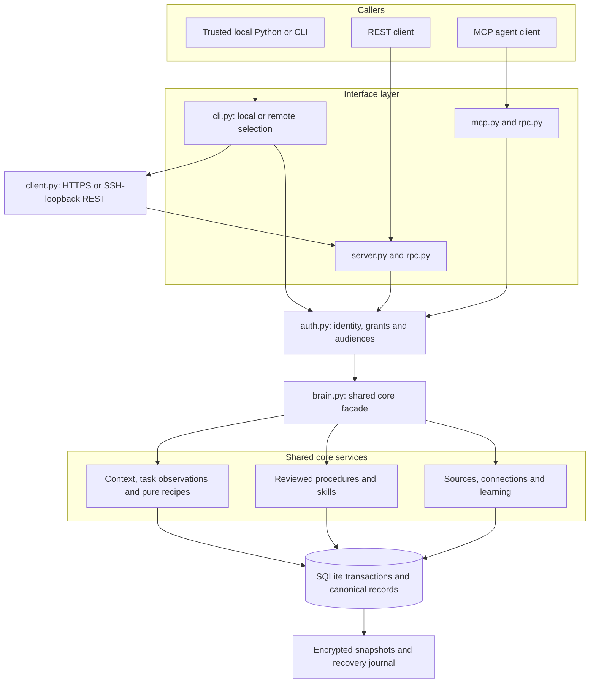
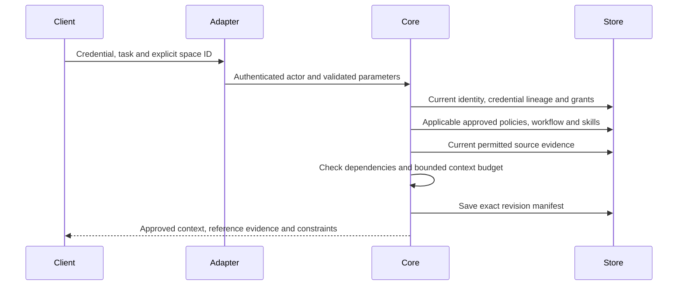
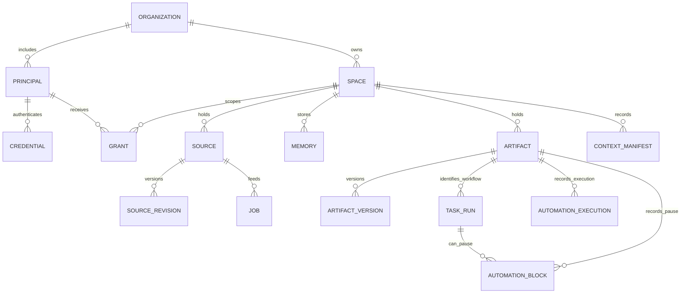
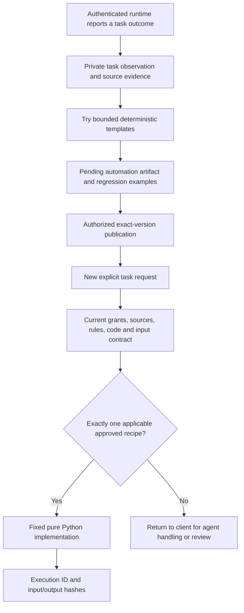

# Architecture

Atmet Brain is one reusable Python core with thin interfaces and a private SQLite installation. The same core checks identity, source access and approved versions for terminal, REST and MCP callers. These are modules in one application, not independently deployed microservices.

The current engine is the open-source product. The future Brain platform and Playground consume its interfaces. [Implementation status](implementation-status.md) is the authority for available versus fixture-only/planned capabilities.

## 1. Application boundaries

`brain.py` composes the shared service mixins. Its facade is an integration point, not a second policy engine. Public network/tool requests resolve an actual credential before reaching the explicit RPC registry. Python embedding and filesystem-owner operations assume trusted control of the installation.

## 2. Code map

| Layer | Files | Responsibility |
| --- | --- | --- |
| Facade/version | `brain.py`, `_version.py` | Compose one core and expose a consistent engine version |
| Identity | `auth.py` | Principal identity, credential lineage/expiry, grants, groups and audiences |
| Canonical sources | `sources.py` | Source revisions, evidence validation, permission-aware reads, invalidation and erasure |
| Learning | `extraction.py`, `learning.py`, `discovery.py` | Bounded extraction, durable jobs and explicit case-event sequence drafts |
| Approved procedures | `artifacts.py`, `skills.py` | Proposals, exact-version publication, dependencies, history, rollback and skill resources |
| Retrieval | `retrieval.py` | Permission-first lexical retrieval, context envelopes/manifests and permitted graph/export |
| Repeated work | `automations.py`, `recipe_runtime.py` | Recorded examples, template inference, reviewed recipes, routing, pure computation and pause records |
| Connections | `connector_service.py`, `connectors/` | Selected-resource bindings, source reconciliation and bounded provider adapters |
| Persistence | `db.py`, `schema.sql` | Transactions, durable canonical state, source/permission references and audit metadata |
| Recovery | `backups.py` | Coherent encrypted snapshots, quarantined restoration and deletion/revocation reconciliation |
| Interfaces | `cli.py`, `rpc.py`, `server.py`, `mcp.py`, `client.py` | Thin request/transport adapters, including the local stdio-to-REST bridge, over the same service methods |
| Operator/client setup | `terminal.py`, `setup.py`, `connections.py`, `services.py` | Human rendering, explicit onboarding, private identity-bound remote profiles and per-user service definitions |

`rpc.py` exposes an explicit operation allowlist, not every facade method. Provisioning, filesystem binding selection and installation backup/recovery are local operator actions outside RPC. No adapter supplies a privileged path around the core's checks.

## 3. Company and source scope

An organization owns independent spaces. A readable path such as `Atmet/example-company/sales` describes a logical scope, not a copied engine or a permission-bearing directory. Stable IDs establish identity. An external runtime explicitly selects the spaces it is allowed to use.

Source and artifact audiences constrain space grants. Derived information is readable only when the caller can read every contributing source. Required approved context that the caller cannot read fails as incomplete; it is not silently removed from a task. Current access also applies to retained history, training examples, graph/export and audit metadata. [Permission model](permissions.md).

## 4. Task retrieval path

Context assembly is retrieval, not task execution. The client may use a model or its own business tools after receiving context. The core returns `external_actions_authorized=false`; source text cannot confer tool or data permissions. A service key identifies that service unless a separately implemented trusted delegation layer establishes an end-user identity.

## 5. Canonical records and derived views

Evidence, dependency and context references use validated JSON inside canonical records. The diagram is a conceptual map, not a complete SQL schema. The permissioned JSON graph and lexical ranking are views over canonical data, not an independent knowledge-graph database or vector store.

Company facts/observations, approved procedures, pending proposals and operational task state remain distinct. Source revisions, workflow versions, recipe-runtime versions, engine version and database schema are independent dimensions. A software release does not approve a company workflow.

## 6. Repeated-task path

`recipe_runtime.py` contains fixed bounded data transformations. The core compares stored Python source with the exact template compiler output; it never evaluates arbitrary stored code. No shell, network, filesystem or business-app effects are available through the recipe runner. General generated code requires a separate isolated runtime and is future work. [Automation contracts](automations.md).

Private task payloads stay outside ordinary search. Source erasure clears dependent retained inputs/outputs and retracts affected recipe bodies. Conflicting accepted outcomes pause affected versions; changed context stops routing. Whole-installation backups include task observations, pauses and execution records, with journal reconciliation on restore.

## 7. Persistence and deployment

SQLite transactions keep canonical updates coherent. Source capture and its durable processing job commit together. Workers run separately from the request, then recheck current source revision and rights before publishing eligible output. Job leases and stable candidate IDs support safe retry. There is no general business-task scheduler in this alpha.

The local database supports reproducible first installation and coherent bounded backup. It is not a claim of unlimited throughput or production tenant isolation. PostgreSQL, semantic/vector indexes and multi-node workers need separate adapters, migration and load testing. [ADR 0001](adr/0001-local-core.md) records the original choice.

Task observations, automation blocks and execution hashes use additive schema-1 tables created on open. Old snapshots gain empty operational tables, not invented training history. Future incompatible schema changes require a migration/recovery plan.

## 8. External boundaries

| Boundary | Core responsibility | External responsibility |
| --- | --- | --- |
| Source ingestion | Validate supported content, revisions, current evidence and audiences | Select resources and supply authorized provider access |
| Model use | Opt-in extraction adapter and bounded returned context | Choose task model, construct prompts and control data sent by the runtime |
| Agent actions | Return applicable procedures and constraints | Enforce email/browser/shell/business-record action permissions and required approvals |
| Pure scripts | Run exact approved fixed templates under current rights | General custom-code isolation, side effects and scheduling |
| Deployment | Local reference interfaces and recovery tools | Trusted ingress/TLS, host access, provider identity and operating targets |

The Brain platform and Playground are future clients of this core. Their UI and action runtimes are not required for self-hosted use and are not implemented by drawing an arrow in the architecture.

## 9. Terminal and company-server operation

Local operator commands keep their existing trust boundary. Remote CLI/MCP operations use the explicit RPC registry and never fall back to opening a local database. Device-specific connection/token files stay outside the canonical database and encrypted installation payload; restore issues fresh credentials. `team.add` provisions a non-admin principal, bounded grants and a credential in one transaction. Network access does not establish company data authority. Services keep API and worker processes separate, bind the managed API to loopback and require explicit installation. [Terminal](terminal.md) and [company server](team-server.md) document limits and operation.

## npm entry point

`npm/atmet-brain` is a thin launcher. It verifies the pinned uv bootstrap archive, installs an exact PyPI engine into version-specific private runtime storage and forwards core arguments without a shell. There is no second database, permission model or agent runtime in the npm package. Installation/configuration happens on first execution, not in npm lifecycle hooks. [Distribution/account setup](package-publishing.md) distinguishes tested local packaging from pending public registry uploads.
