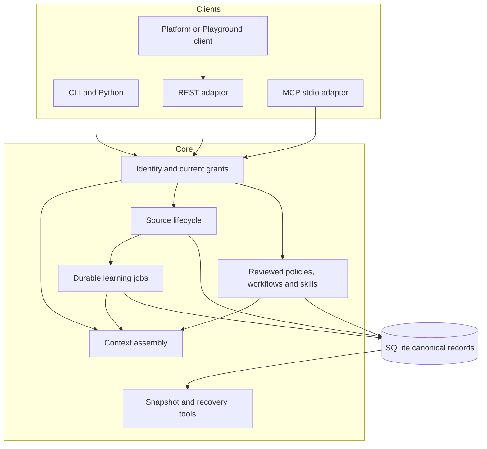
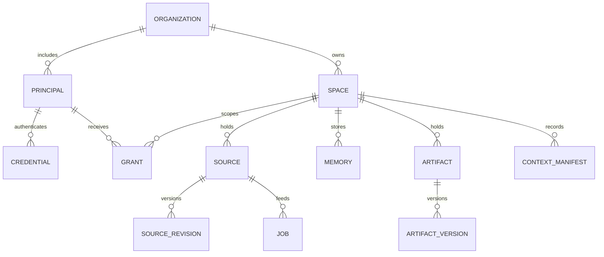
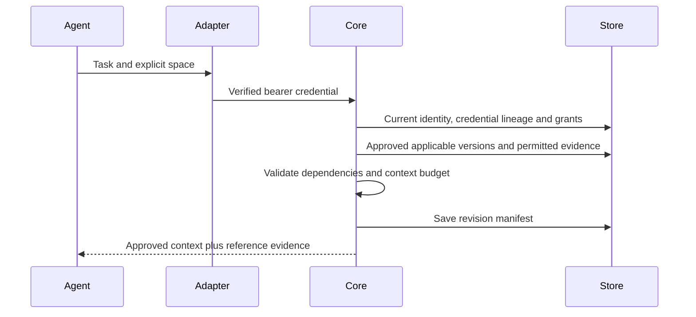

# Architecture

The [repeated-task subsystem](automations.md) adds operational task observations, reviewed automation artifacts, pause records and execution hashes to the same SQLite installation. Its fixed pure Python runtime is a bounded data-processing path. General script/tool execution remains an external runtime responsibility. These additive tables are created for existing schema-1 installations on open; older snapshots gain empty operational tables, not invented training history. Erasure reconciliation includes retained training payloads.

Atmet Brain is one reusable engine. Company organizations own independently scoped spaces. A readable path such as `Atmet/example-company/sales` is a presentation convention; stable IDs and server-side grants establish actual scope.

## System

## Code map

| Module | Responsibility |
| --- | --- |
| `brain.py` | Shared facade |
| `db.py`, `schema.sql` | Transactions, schema and minimal audit events |
| `auth.py` | Current principal, credential lineage, grants and audiences |
| `sources.py` | Capture, revisions, evidence access and invalidation |
| `extraction.py`, `learning.py` | Bounded extraction and durable job processing |
| `artifacts.py`, `skills.py` | Proposals, publication, dependencies and skill packages |
| `retrieval.py` | Authorized search, context manifests, graph and export |
| `discovery.py` | Observed case sequences |
| `connectors/`, `connector_service.py` | Selected-directory and Gmail adapters |
| `backups.py` | Encrypted snapshot and conservative recovery |
| `rpc.py`, `server.py`, `mcp.py`, `cli.py` | Interface adapters |

## Data model

Evidence and artifact dependency edges are explicit JSON references validated by the core. Derived records must satisfy every contributing source's current access restrictions. The JSON graph is a permitted view over those records; it is not a separate authoritative database.

## Request path

## Storage decisions

This release uses SQLite, transactions and retained text inside the database. A source update and its durable job are committed together. Workers run outside the ingestion request, then recheck current source revision and permissions before publication. Job leases and stable candidate IDs make repeated processing safe.

The local database makes the first installation and coherent backup reproducible. It is not a claim of unlimited throughput. PostgreSQL, vector indexes and multi-node workers require separate adapters, migration work and load testing. See [ADR 0001](adr/0001-local-core.md).

## Runtime boundary

The Brain returns context and accepts authorized updates. It does not execute skill scripts, send mail, operate a browser or run coding commands. Those capabilities belong to an agent runtime with separate permissions. A remote model cannot acquire new rights by writing instructions into source material.
