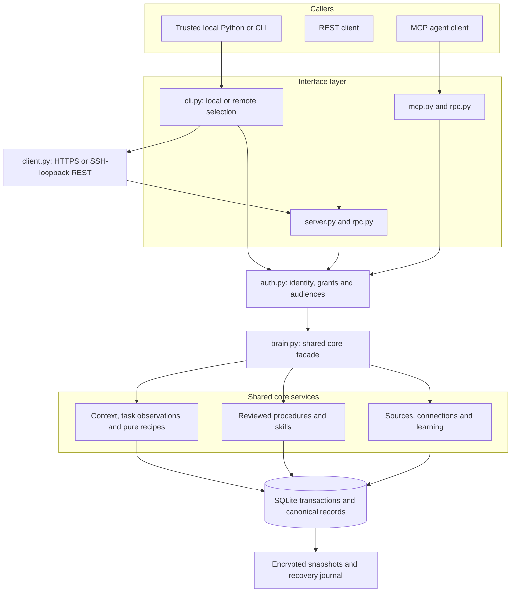
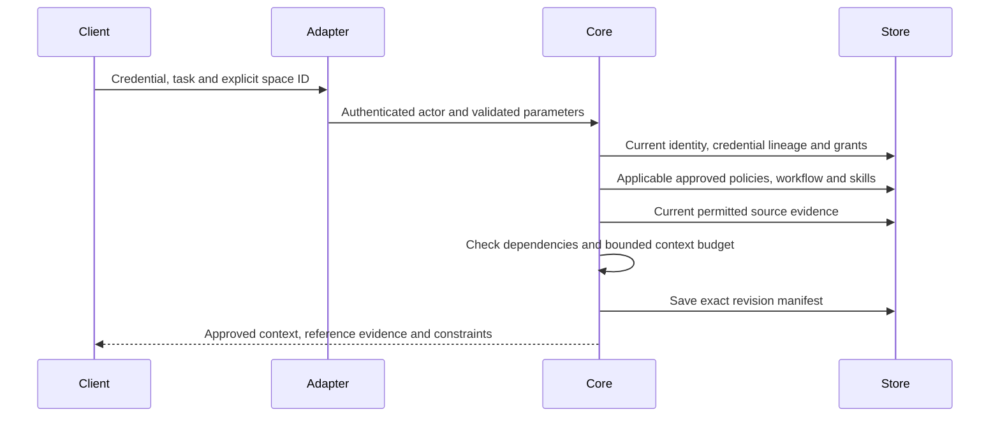
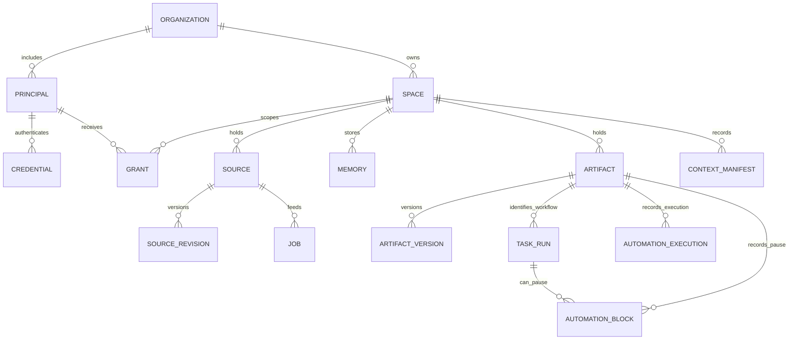
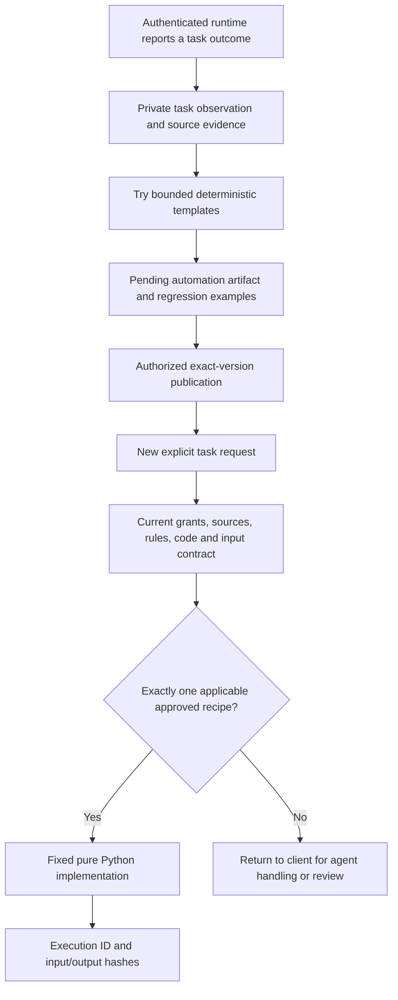
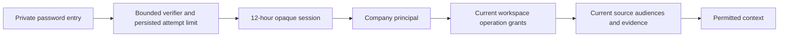
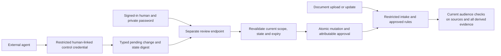

# Architecture

Atmet Brain is one reusable Python core with thin interfaces and a private SQLite installation. The same core checks identity, source access and approved versions for terminal, REST and MCP callers. These are modules in one application, not independently deployed microservices.

The current engine is the open-source product. The future Brain platform and Playground consume its interfaces. [Implementation status](implementation-status.md) is the authority for available versus fixture-only/planned capabilities.

## 1. Application boundaries

`brain.py` composes the shared service mixins. Its facade is an integration point, not a second policy engine. Public network/tool requests resolve an actual credential before reaching the explicit RPC registry. Python embedding and filesystem-owner operations assume trusted control of the installation.

## 2. Code map

| Layer | Files | Responsibility |
| --- | --- | --- |
| Facade/version | `brain.py`, `_version.py` | Compose one core and expose a consistent engine version |
| Identity | `auth.py` | Principal identity, credential lineage/expiry, grants, groups and audiences |
| Canonical sources | `sources.py` | Source revisions, evidence validation, permission-aware reads, invalidation and erasure |
| Learning | `extraction.py`, `learning.py`, `discovery.py` | Bounded extraction, durable jobs and explicit case-event sequence drafts |
| Approved procedures | `artifacts.py`, `skills.py` | Proposals, exact-version publication, dependencies, history, rollback and skill resources |
| Retrieval | `retrieval.py` | Permission-first lexical retrieval, context envelopes/manifests and permitted graph/export |
| Task outcomes | task_reports.py | Explicit scoped reports, lexical operational history and skill drafts through the normal artifact lifecycle |
| Repeated work | `automations.py`, `recipe_runtime.py` | Recorded examples, template inference, reviewed recipes, routing, pure computation and pause records |
| Connections | `connector_service.py`, `connectors/` | Selected-resource bindings, source reconciliation and bounded provider adapters |
| Persistence | `db.py`, `schema.sql` | Transactions, durable canonical state, source/permission references and audit metadata |
| Recovery | `backups.py` | Coherent encrypted snapshots, quarantined restoration and deletion/revocation reconciliation |
| Administration and intake | administration.py, security.py, admin_cli.py | Human-bound proposals, private approval, rule history and fail-closed source classification |
| Employee identity | accounts.py, invitations.py, account_cli.py | Password accounts, single-use enrollment, expiring sessions, reviewed memberships and private client state |
| Company chooser | companies.py | Explicit device-local labels for independent data homes; no silent company switch or global resolver |
| Team setup | `setup.py`, `sharing.py`, `connections.py`, `ssh.py` | Guided Host/Join, private scoped connection files, verified profiles and bounded per-request SSH forwarding |
| Interfaces | `cli.py`, `rpc.py`, `server.py`, `mcp.py`, `client.py` | Thin request/transport adapters, including the local stdio-to-REST bridge, over the same service methods |
| Operator/client setup | `terminal.py`, `setup.py`, `connections.py`, `services.py` | Human rendering, explicit onboarding, private identity-bound remote profiles and per-user service definitions |

`rpc.py` exposes an explicit operation allowlist, not every facade method. Provisioning, filesystem binding selection and installation backup/recovery are local operator actions outside RPC. No adapter supplies a privileged path around the core's checks.

## 3. Company and source scope

An organization owns independent spaces. A readable path such as `Atmet/example-company/sales` describes a logical scope, not a copied engine or a permission-bearing directory. Stable IDs establish identity. An external runtime explicitly selects the spaces it is allowed to use.

Source and artifact audiences constrain space grants. Derived information is readable only when the caller can read every contributing source. Required approved context that the caller cannot read fails as incomplete; it is not silently removed from a task. Current access also applies to retained history, training examples, graph/export and audit metadata. [Permission model](permissions.md).

## 4. Task retrieval path

Context assembly is retrieval, not task execution. The client may use a model or its own business tools after receiving context. The core returns `external_actions_authorized=false`; source text cannot confer tool or data permissions. A service key identifies that service unless a separately implemented trusted delegation layer establishes an end-user identity.

## 5. Canonical records and derived views

Evidence, dependency and context references use validated JSON inside canonical records. The diagram is a conceptual map, not a complete SQL schema. The permissioned JSON graph and lexical ranking are views over canonical data, not an independent knowledge-graph database or vector store.

Company facts/observations, approved procedures, pending proposals and operational task state remain distinct. Source revisions, workflow versions, recipe-runtime versions, engine version and database schema are independent dimensions. A software release does not approve a company workflow.

## 6. Repeated-task path

`recipe_runtime.py` contains fixed bounded data transformations. The core compares stored Python source with the exact template compiler output; it never evaluates arbitrary stored code. No shell, network, filesystem or business-app effects are available through the recipe runner. General generated code requires a separate isolated runtime and is future work. [Automation contracts](automations.md).

Private task payloads stay outside ordinary search. Source erasure clears dependent retained inputs/outputs and retracts affected recipe bodies. Conflicting accepted outcomes pause affected versions; changed context stops routing. Whole-installation backups include task observations, pauses and execution records, with journal reconciliation on restore.

## 7. Persistence and deployment

SQLite transactions keep canonical updates coherent. Source capture and its durable processing job commit together. Workers run separately from the request, then recheck current source revision and rights before publishing eligible output. Job leases and stable candidate IDs support safe retry. There is no general business-task scheduler in this alpha.

The local database supports reproducible first installation and coherent bounded backup. It is not a claim of unlimited throughput or production tenant isolation. PostgreSQL, semantic/vector indexes and multi-node workers need separate adapters, migration and load testing. [ADR 0001](adr/0001-local-core.md) records the original choice.

Schema 2 adds task-report metadata and a source category for operational report bodies. Report bodies use immutable observation sources and original-source evidence; they have no extraction jobs and are excluded from ordinary search/context/source listings. Task history requires history permission; approved learned methods retain report and original evidence checks. Schema-1 installations upgrade transactionally, and supported old backups upgrade before quarantine/recovery. Older engines cannot open schema 2. See [task reporting](task-history-and-learning.md) and [schema upgrades](versioning.md#schema-2-upgrade).

## 8. External boundaries

| Boundary | Core responsibility | External responsibility |
| --- | --- | --- |
| Source ingestion | Validate supported content, revisions, current evidence and audiences | Select resources and supply authorized provider access |
| Model use | Opt-in extraction adapter and bounded returned context | Choose task model, construct prompts and control data sent by the runtime |
| Agent actions | Return applicable procedures and constraints | Enforce email/browser/shell/business-record action permissions and required approvals |
| Pure scripts | Run exact approved fixed templates under current rights | General custom-code isolation, side effects and scheduling |
| Deployment | Local reference interfaces and recovery tools | Trusted ingress/TLS, host access, provider identity and operating targets |

The Brain platform and Playground are future clients of this core. Their UI and action runtimes are not required for self-hosted use and are not implemented by drawing an arrow in the architecture.

## 9. Terminal and company-server operation

Local operator commands keep their existing trust boundary. Remote CLI/MCP operations use the explicit RPC registry and never fall back to opening a local database. Device-specific connection/token files stay outside the canonical database and encrypted installation payload; restore issues fresh credentials. `team.add` provisions a non-admin principal, bounded grants and a credential in one transaction. Network access does not establish company data authority. Services keep API and worker processes separate, bind the managed API to loopback and require explicit installation. [Terminal](terminal.md) and [company server](team-server.md) document limits and operation.

## npm entry point

`npm/atmet-brain` is a thin launcher. It verifies the pinned uv bootstrap archive, verifies and installs the exact core wheel bundled in the npm archive into version-specific private runtime storage and forwards core arguments without a shell. There is no second database, permission model or agent runtime in the npm package. Installation/configuration happens on first execution, not in npm lifecycle hooks. [Installation](install.md) explains runtime/data locations and supported entry points. [Publishing](package-publishing.md) covers the separate maintainer release procedure.

## Agent completion boundary

The feedback module wraps an explicitly instrumented host task; remote Client and token-bound LocalClient share its task_feedback interface. A host callback or the MCP completion tool invokes reports.complete. That operation records through the existing report transaction and then attempts deterministic skills.learn through the existing artifact transaction. The receipt exposes partial failure. Per-report candidate identity/idempotency prevents duplicate drafts on retries and avoids changing an already approved method. Candidate audiences inherit their report; original source/evidence checks still gate all reads and publication. The reporter preset omits publish authority. No background transcript watcher, model call, persisted delivery queue or external-action permission is introduced. [Automatic task feedback](automatic-task-feedback.md).

## Guided agent provisioning

agent_setup.py composes identity.me, access.check, team.add or narrowed credentials.create, verified connection profiles and private bundle files. It does not add a second permission model or modify client application settings. Only core-reported permitted operations are offered, and generated credentials omit publication authority. Local setup uses the token-bound core client; remote setup derives a new profile with the existing verified route and never opens a client-side database. Partial failures attempt revocation and preserve diagnostics without logging raw tokens. [Agent setup contract](agent-setup.md).

## 11. Employee authentication and company selection

Company-local accounts bind an approved username to a human principal. Owner enrollment requires an unrestricted human administrator credential. A private single-use invitation binds employee username, issuer, expiry and approved workspace roles; acceptance creates/enrolls the principal and grants atomically. Reset invitations bind the expected membership revision. Login is password authentication, followed by opaque hashed-token serving authorization. A supplied name/role is never a verified identity.

Public password endpoints are limited to /v1/auth/login and /v1/auth/accept; they cannot run arbitrary RPC. Admin enrollment, invitation creation/revocation and member editing use authenticated core methods. Request framing/origin/rate/transport guards apply before credential or password processing. Passwords use salted scrypt; parameters and operational bounds are in the [account guide](employee-accounts.md). They are not stored in client profiles, audit payloads or command arguments. SSO/MFA and email verification remain separate adapters, not implied by password login.

Schema 3 adds user_accounts, company_invites, member_versions and auth_attempts. Membership reviews check current revision and delegation rights, replace grants and revoke credentials atomically. Login sessions remain bounded by current grants/audiences; a changed password revokes old keys and children. Restore clears password verifiers, disables accounts/principals, revokes invitations and retains the existing journal/quarantine procedure. [Upgrade](versioning.md#schema-3-upgrade).

A device-local company catalog maps labels to independent data homes and never grants remote access. Company selection is explicit and is embedded as a resolved data home in generated agent commands. It is not an implicit shared active company. Each Brain has separate backup/journal handling and server-port configuration. The filesystem owner remains trusted; local owner-account recovery is intentionally absent from RPC/MCP. [Account and company operations](employee-accounts.md).

## Approved administration and fail-closed intake

administration.py owns immutable proposals, protected human-linked control credentials, exact previews/digests, current-state checks and transactional application. security.py evaluates approved explicit term/connector rules and enforces current classification/retained audience clauses. Source capture stages before extraction; common source/evidence guards protect retrieval, history and derived data. The external agent interprets natural language; it does not supply identity or approval.

Schema 4 adds security_heads, security_rules/history, source_security, control_credentials and admin_changes. Earlier active source rows remain governed by existing permissions until changed or a policy epoch requires reclassification. Rule changes invalidate earlier classification epochs; source revisions preserve prior restrictive clauses. The read-only admin catalog includes known hosting route metadata, not OS command execution or secrets. [Usage](conversational-administration.md) and [upgrade](versioning.md#schema-4-upgrade).

## Local update boundary

The update command is a filesystem-owner operation, absent from REST/MCP. It checks the selected existing home without constructing Store, then stops canonical unchanged managed services and acquires a cooperative exclusive maintenance lease. Ordinary core connections hold shared leases until close. Only the operator's current execution context can open the target core during that lease; it cannot be bypassed through public request arguments. Older releases/custom direct SQLite programs do not participate, so explicit external-process shutdown remains required.

The updater snapshots the old schema through SQLite's backup API without running migrations, creates and authenticates the encrypted envelope plus matching journal, then opens the same home and compares original table columns/records, IDs and private files. New migration metadata/tables are allowed; unexpected changes fail closed. Managed definitions retain port/workspace/credential paths, are rewritten only after verification and restart only after releasing maintenance. Failures retain a private phase report and backups without automatic database rollback. See [operator steps and limits](upgrading.md).
