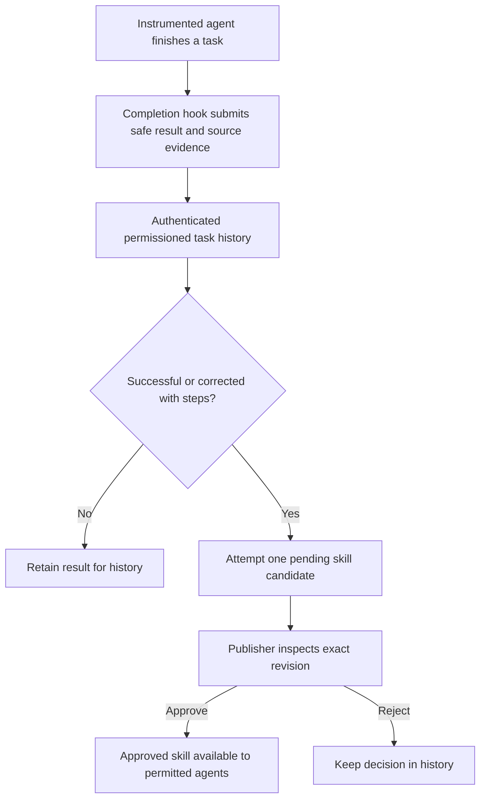

# Automatic task feedback

Connect reporting once in your agent application. After each instrumented task ends, its completion hook sends a bounded result to the Brain and attempts a skill draft. Users do not need to create report files or run task-learn for each task. A publisher still reviews the exact draft revision before other agents can use it as an approved skill.

Completion feedback needs engine 0.5.0+; current engine 0.7.0 uses schema 3 for employee accounts. Follow the [schema-3 upgrade procedure](versioning.md#schema-3-upgrade) before opening older data. Password sessions/agent children expire and require explicit sign-in; continuing background services should use deliberately scoped service credentials. Separate publication approval remains required.



## Choose the integration

| Your agent connection | Setup once | Completion behavior |
| --- | --- | --- |
| Python application | Wrap its task with task_feedback().run() or a context manager | Hook submits on normal completion and ordinary exceptions |
| Application with an end-of-task callback | Send reports.complete from that callback, or feed JSON to task-complete - | Host callback controls delivery and retries |
| MCP agent | Generate configuration with --task-feedback | Server supplies completion instructions and brain_complete_task; the agent must follow them |

MCP provides a tool and instructions, not a guaranteed callback from every external agent. Use a host lifecycle hook for reliable delivery. Nothing monitors unrelated terminals, reads all conversations or installs client-specific hooks automatically. A killed process, KeyboardInterrupt or SystemExit does not produce a completion report through the Python wrapper.

For guided provisioning and a ready configuration, run `atmet-brain agent` and choose reports/skill drafts. The [wizard](agent-setup.md) keeps publication separate; actual host hooks still require integration as described below.

## 1. Give the agent scoped access

An administrator provisions a separate service identity for the selected space:

```bash
atmet-brain team-add "Sales task reporter" --kind service --role reporter --space SPACE_ID --output /absolute/private/sales-reporter.token
```

The reporter preset grants read, observe, contribute and history. It can submit reports, inspect permitted history and propose skills. It has no publish, erase, manage or process permission. Its token cannot exceed its issuer's scope/expiry. Keep the publisher credential separate. Individual agents or users need their own identities when separate attribution is required.

Reports and automatic candidates default private to the submitting principal. If a human publisher should review a service agent's work, deliberately choose an audience that includes that publisher, such as a permitted department group. `["space"]` is suitable only when all eligible members of that workspace may inspect it. Every contributing original source must also permit the reviewer. Organization ownership does not bypass these audiences.

## 2. Python completion hook

Use this in the environment where your application has installed the Python core. The npm launcher's isolated runtime does not install a module into every unrelated Python environment. See [installation](install.md) for a wheel/development environment.

```python
from pathlib import Path
from atmet_brain import Brain, LocalClient

client = LocalClient(
    Brain("/absolute/path/to/brain-data"),
    Path("/absolute/private/sales-reporter.token").read_text().strip(),
)
feedback = client.task_feedback(
    space_id="SPACE_ID",
    report_key="HOST_JOB_ID",  # Stable, opaque, unique for this task run.
    task_key="prepare-quotation",
    summary="Prepared a quotation draft",
    evidence=[{"source_id": "SOURCE_ID", "revision": 1}],
    audience=["space"],  # Deliberate sharing for this example, not the default.
)

def prepare_quotation(task):
    task.step("Read the current catalogue")
    # Your existing authorized agent/workflow runs here.
    # Record only steps and checks that actually happened.
    task.step("Prepare a quotation draft")
    task.check("Check current item prices")
    return "Quotation draft ready for human review"  # Safe bounded result text.

feedback.run(prepare_quotation)
print(feedback.receipt)  # Contains report ID and skill ID/revision or a blocked reason.
```

The wrapper executes your supplied callable in your application, not in a Brain sandbox. It adds no external-action permission. Supply all original business sources actually used, including permitted dependencies of retrieved methods. `feedback.cite([...])` can add references during a task. The Brain checks supplied evidence; it cannot detect omitted dependencies. Avoid credentials, raw transcripts and unnecessary personal data in result text or steps. There is no automatic secret scrubber for deliberately supplied fields.

For a remote Brain, use the same task_feedback method on the authenticated HTTP client:

```python
from pathlib import Path
from atmet_brain import Client

client = Client(
    "https://brain.example.com",
    Path("/absolute/private/sales-reporter.token").read_text().strip(),
)
```

That endpoint needs the company's existing trusted HTTPS ingress. The CLI also supports [saved SSH connections](team-server.md); the Python HTTP client does not manage SSH tunnels itself.

For a host that needs its own return value, use a context manager and provide deliberate result text:

```python
with client.task_feedback(
    space_id="SPACE_ID", report_key="ANOTHER_HOST_JOB_ID",
    task_key="prepare-quotation", summary="Corrected a quotation draft",
    evidence=[{"source_id": "SOURCE_ID", "revision": 1}],
    audience=["space"],
) as feedback:
    feedback.step("Check the customer template")
    feedback.correction("Use the customer-specific template")
    feedback.result("Corrected draft ready", outcome="corrected")

print(feedback.receipt)
```

A normal context-manager exit requires result(). The run() wrapper uses the callable's returned safe text if result() was not called. It never infers success from an empty context. An ordinary exception records a generic failed outcome without copying the exception message/traceback, then re-raises the original exception. If that failure report cannot be delivered, feedback.error exposes the delivery code while the original task exception is preserved.

## 3. MCP setup

For a local Brain:

```bash
atmet-brain --home /absolute/path/to/brain-data --token-file /absolute/private/sales-reporter.token mcp-config --task-feedback
```

For an existing named company connection:

```bash
atmet-brain --connection company mcp-config --task-feedback
```

Add the returned entry to the agent's MCP settings and restart that client. The flag adds brain_complete_task and initialize instructions asking the agent to report completed tasks and useful failures with complete original evidence. It does not add publication/erasure tools or widen the credential. Existing --allow-task-reports and --allow-proposals remain available for separate manual operations.

The agent receives report and skill statuses. It should present a pending candidate's ID/revision and ask the publisher to inspect it. If the client ignores completion instructions, nothing is submitted; use its host lifecycle callback when guaranteed reporting is required. No particular external client is certified by this generic interface.

## 4. Completion callbacks through CLI or REST

A trusted host can pipe its selected safe result JSON to:

```bash
atmet-brain --connection company task-complete - --space SPACE_ID
```

Input uses the same bounded fields as task-report, plus optional `"learn": false` to retain history without attempting a draft. Use a stable report_key for one run. The host supplies stdin; the command does not discover a task's result. A file path works too. The [reporting guide](task-history-and-learning.md#2-report-the-task-result) shows the JSON format. CLI input is limited to 200000 bytes.

REST uses `reports.complete` on `/v1/rpc` with those parameters plus space_id. The response contains `report`, `skill`, `outcomes_verified=false` and `publication_authorized=false`. Identity always comes from authentication. Unknown identity or approval parameters are rejected.

## 5. Inspect and approve

Eligible succeeded/corrected reports with explicit steps attempt one candidate per report. Failures and reports without steps remain searchable history. The compiler uses the reported steps/corrections/checks with zero model calls; it does not prove business success or generalize arbitrary transcripts. Candidates inherit their report audience and original evidence restrictions. They never overwrite an existing approved method. Combine selected reports or propose a revision explicitly using task-learn when a reviewed synthesis is useful.

The host receives these skill statuses:

| Status | Meaning |
| --- | --- |
| pending_review | New or previously pending candidate; inspect its id and revision |
| existing | That same candidate was already reviewed; state reports its current decision |
| not_eligible | Failed result or no explicit steps; report is still saved |
| not_requested | learn=false; report is saved without drafting |
| blocked | Report saved, but drafting failed; inspect error.code and correct access/evidence/size issues |

A publisher with access inspects and approves the exact candidate:

```bash
atmet-brain rpc artifacts.get --params '{"artifact_id":"SKILL_ID","revision":1}'
atmet-brain review SKILL_ID --revision 1 --approve --reason "Reviewed source evidence, method, checks and required approvals"
```

Use --reject instead of --approve if the method is unsuitable. This is the human decision point. No auto-approval, inbox notification service or two-person approval requirement is introduced. The core enforces publish permission; the integration keeps that authority away from the reporting agent.

## Failures and retries

Report saving and draft creation are separate transactions. A blocked skill status is partial completion, not a lost report. An exact retry resumes the attempt and reuses the same report/candidate. After an ambiguous connection failure, retry the same frozen payload; never rerun business actions merely to send feedback. Python feedback.retry() resends its in-memory request and rechecks current credentials. It does not schedule retries or write a plaintext queue. A host needing crash recovery must retain a safe payload in its own controlled storage and replay the same identity/key/content.

Missing/unauthorized/stale source evidence can block report creation. Missing history access may allow the report but block drafting. Source changes after recording can leave readable history while blocking a new draft or approval. Erased reports cannot be recreated by retry; source/report erasure retracts dependent candidates through the existing recovery journal. No evidence is fabricated to fill missing provenance. [Access and recovery details](task-history-and-learning.md#changes-erasure-and-recovery).
