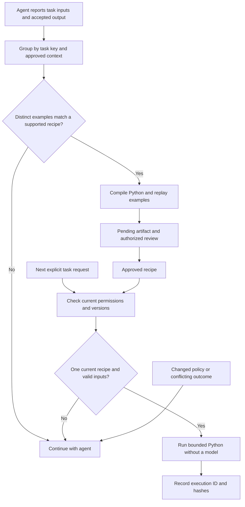

# Repeated tasks into Python scripts

The Brain can learn a supported deterministic transformation from recorded task outcomes, propose a reusable Python script, and route later tasks to its approved version. The script path makes no model call. A connected agent or application must report its task runs and invoke the router; the Brain cannot observe every external conversation automatically.

## What works now

The local alpha compiles two bounded templates:

| Template | Inputs and behavior |
| --- | --- |
| `records.normalize` | String-valued records; select fields, trim whitespace, optionally lowercase selected fields, sort by one field and remove exact duplicates |
| `records.aggregate` | String-valued records; group by one field and sum another as exact decimal amounts with up to two decimal places |

Inputs contain only `records`, with at most 500 rows, 20 fields per row and 30,000 serialized characters. Values are strings. Empty lists work after publication, but learning needs distinct useful examples. Output equality is checked exactly, including list order. Judgment, arbitrary document understanding and unsupported formats stay with the agent.

The generated Python is readable and standalone. Inside the core, the fixed Python recipe implementation processes data directly. Stored source text is compared with the exact compiler output and is never evaluated or executed as arbitrary code. This is a narrow pure-computation runtime, not a sandbox for general Python. It supplies no shell, file, network, email or business-record access.

## Lifecycle



`tasks.record` automatically checks for a candidate after each observation. The default is three distinct successful inputs; `automations.discover` can require 3 to 10. These are local defaults, not statistical proof of correctness. Replaying the same input does not count as another distinct test. Discovery validates the latest 100 matching recorded outcomes that the caller may read. A visible failed run in that window prevents automatic compilation. Unsupported transformations return `ai_required`.

A candidate includes the exact generated code, template parameters, runtime version, training run IDs and pinned workflow/context references. An existing candidate is not silently rewritten or republished. An authorized publisher reviews its code, examples, assumptions and expected input range, then publishes the exact revision through the normal artifact lifecycle. Three examples alone do not establish that a rule applies to the whole business.

## Observation and API contract

Only integrations that know a task's outcome should report it. Token counts and accepted outcomes are attributable client reports, not independently attested measurements. Supply all source evidence that the input, output or reasoning depends on; the core cannot detect undisclosed provenance in client-provided data.

```json
{
  "method": "tasks.record",
  "params": {
    "space_id": "SPACE_ID",
    "run_key": "accepted-report-123",
    "task_key": "department-totals",
    "workflow_id": "WORKFLOW_ID",
    "inputs": {"records": [{"department": "Sales", "amount": "10.20"}]},
    "output": {"totals": [{"group": "Sales", "total": "10.20"}], "count": 1},
    "succeeded": true,
    "ai_tokens": 120,
    "evidence": [{"source_id": "SOURCE_ID", "revision": 1}]
  }
}
```

The operation requires `observe`, `contribute`, current workflow/dependency access and current source evidence. The run key is unique per space. A conflicting replay is rejected. Recording succeeds durably before the separate discovery/proposal step; if a subsequent step fails, inspect or retry the same run key. Inputs and outputs are retained as private operational training data, outside ordinary search. `tasks.runs` returns permitted metadata; `include_payload=true` additionally requires `history`.

Use `tasks.route` before expensive model work. It returns `mode=script` only when exactly one applicable approved recipe is currently usable. It never calls a model. `tasks.run` combines the same selection with execution:

```json
{
  "method": "tasks.run",
  "params": {
    "space_id": "SPACE_ID",
    "task_key": "department-totals",
    "workflow_id": "WORKFLOW_ID",
    "inputs": {"records": [{"department": "Sales", "amount": "0.10"}, {"department": "Sales", "amount": "0.20"}]},
    "idempotency_key": "report-124"
  }
}
```

The script result contains `output`, `execution_id`, artifact ID/revision, `model_calls=0` and `external_actions_authorized=false`. Execution needs both `process` and `read`; the worker role already contains them. A reader cannot execute. Reusing an execution key for different content fails. Permission and version checks run again on replay.

If no unique valid recipe applies, the result is `mode=agent`, `status=fallback_required`. The client decides whether to ask a question, request review or use its model. Authorization failures and unavailable required context remain errors; they must not trigger a fallback using broader credentials. The core does not launch a model or send data to a provider automatically.

CLI access uses the same operations:

```bash
atmet-brain rpc tasks.record --params @observed-run.json
atmet-brain rpc tasks.runs --params @inspect-runs.json
atmet-brain review ARTIFACT_ID --revision 1 --approve --reason "Reviewed code, examples and input range"
atmet-brain rpc tasks.run --params @next-task.json
```

Create the named JSON files before running these commands. Files passed to `--params` contain the inner `params` object from the examples, without the REST `method` wrapper. Report at least three distinct accepted supported inputs before expecting a candidate. Inspect the candidate ID/revision returned by discovery, then use that exact revision in review; task recording does not publish it automatically.

## Changes, permissions and recovery

The recipe pins the workflow and transitive dependencies plus currently applicable approved policy, instruction and configuration artifacts. A new applicable rule also changes the context snapshot. Routing recomputes that snapshot and checks current source evidence, audiences and credentials. Changed rules, source revisions, runtime code, retired recipes, failed regression checks or ambiguity prevent script reuse. Future-effective rules apply when their effective time arrives. Unrelated task paths do not join the snapshot.

A reported failure or conflicting output for an input the recipe accepts pauses the affected pending/approved revision. A new artifact name cannot bypass a visible conflicting outcome. Resolve the workflow/context and collect reviewed fresh evidence before recompiling. Unexpected inputs that the recipe rejects cause fallback for that request; they do not automatically rewrite the recipe. There is no automatic publication or restoration of a paused script.

Training data and compiled artifacts remain within their Brain space and current evidence restrictions. Permissioned lists, raw test inspection, artifact history and audit metadata honor those restrictions. Source erasure clears dependent retained task inputs/outputs and retracts affected recipe bodies. Encrypted whole-installation backups include task observations, blocks and execution hashes; recovery journal replay clears erased training data before reauthorization. Portable space exports include permitted approved automation artifacts, not the entire operational training set.

## Trying it

For the complete disposable scenario below, first use the [source checkout installation](install.md#source-examples-and-contributions). The examples directory is not installed with the wheel or npm launcher. From that checkout and its Python environment:

```bash
python examples/automation_demo.py
```

This disposable fictional example records three accepted reports, reviews the generated script, then computes a new report without a model. Review is simulated explicitly in demo code, not bypassed by the product. No API key is needed.

For MCP, routing is a read tool. `--allow-proposals` exposes explicit discovery. Add `--allow-automations` to expose task observation and bounded execution; underlying operation grants remain required. See [MCP](mcp.md).

## Wider target

An external coding agent could later generate custom Python or other languages for stable workflow steps, with schemas, representative regression and edge cases, dependency hashes, shadow comparisons, measured cost/latency and reviewed release gates. General scripts need a separate isolated execution service, explicit tool/network/secret permissions, resource limits, idempotent side-effect handling, deployment controls and kill switches. Those mechanisms, automatic scheduling, universal task detection and arbitrary code generation/execution are not implemented here.

Compare equivalent work before claiming savings. The pure script operation makes zero model calls, but a surrounding chat, classification or explanation may still use model tokens. No total-workflow savings percentage or autonomous correctness guarantee is established.

## Task reports versus recipe training

[Task reports](task-history-and-learning.md) retain general selected outcomes, steps and corrections and can draft reusable text skills. The tasks.record interface above records exact input/output examples for the two bounded deterministic transformations. They are separate contracts; a general report does not automatically become a script or prove its correctness.
