# Backup and recovery

A backup is a coherent, encrypted installation snapshot. History explains changes; an export is a permitted data view; rollback is a new business revision. Each serves a different purpose.

## Create

```bash
atmet-brain backup-key --output /private/keys/brain.key
atmet-brain backup --key-file /private/keys/brain.key --output /backup/storage/brain-001.atmet
atmet-brain journal --output /independent/storage/recovery-journal.json
```

The snapshot uses SQLite's backup API, then verifies database integrity. Its encrypted payload contains a manifest, canonical database and safe deployment settings. The database contains sources, memories, workflows, skills, permissions, audit metadata, jobs and recovery decisions. A SHA-256 manifest checks content integrity inside authenticated Fernet encryption. Version 0.1 supports database snapshots up to 256 MiB and loads the encrypted payload into memory.

Keep the key separate from backup storage. Losing it prevents decryption. No plaintext backup mode is provided. Runtime provider credentials live outside this payload. Raw bearer tokens are not stored in the database.

## Keep the journal current

Deletion and revocation decisions are recorded in the database and flushed to `recovery-journal.json`. Set `ATMET_RECOVERY_JOURNAL` to an independently recoverable private destination to update that destination on these operations. Without it, the default journal shares the data directory's failure domain.

A backup cannot know which decisions happened after it was made. A stale but internally valid journal cannot establish completeness. The recovery operator must supply the latest trustworthy journal and explicitly confirm it covers known decisions. This is a documented operating requirement, not a promise of automatic distributed recovery.

## Restore

```mermaid
flowchart LR
    Backup[Encrypted snapshot] --> Verify[Decrypt and verify inventory]
    Verify --> Fresh[Restore into fresh data home]
    Fresh --> Quarantine[Revoke keys and quarantine sources]
    Quarantine --> Journal[Reconcile current recovery journal]
    Journal --> Owner[Provision new recovery owners]
    Owner --> Validate[Revalidate sources and memberships]
    Validate --> Serve[Resume permitted serving]
```



```bash
atmet-brain restore --input /backup/storage/brain-001.atmet --destination /private/recovered-brain --key-file /private/keys/brain.key
atmet-brain --home /private/recovered-brain doctor
atmet-brain --home /private/recovered-brain recover --journal /independent/storage/recovery-journal.json --owner "Recovery owner" --confirm-journal-complete
```

Restore refuses an existing destination. Old credentials and principals are disabled, grants revoked, group memberships removed, connectors disabled and sources quarantined. After journal reconciliation, each company gets a new private recovery-owner token. Sources remain unavailable until individually revalidated; new users receive grants only after current identity checks. Erased sources remain tombstoned. Connector reauthorization/re-registration is an explicit operator step.

Use the returned recovery token file for subsequent calls. For a retained source:

```bash
atmet-brain --home /private/recovered-brain --token-file /private/recovered-brain/example-company-recovery.token rpc sources.access --params '{"source_id":"SOURCE_ID","audience":["principal:RECOVERY_PRINCIPAL_ID"],"active":true}'
```

Never place the restored database into service by bypassing recovery mode or copying old credentials back in.

## Schedule and test

[scripts/backup_snapshot.py](../scripts/backup_snapshot.py) creates uniquely named snapshots and exports the journal. Run it from an operator-managed scheduler. Managed retention, key rotation, remote object-store destinations and recovery time objectives need deployment-specific work. Choose and measure backup frequency, acceptable data loss, retention and recovery time before real use.

Test a restore into a fresh directory regularly, verify sources/skills/versions and current permission denial, then dispose of the recovery environment appropriately. The test suite covers tampering, clean restore, later erasure replay and old-key rejection.

Source erasure is logical removal from serving and retained bodies. Physical storage remnants, external model/provider retention and old backup destruction need separate operational controls. No immediate media-erasure guarantee is made.
