# Backup and recovery

A backup is a coherent, encrypted installation snapshot. History explains changes; an export is a permitted data view; rollback is a new business revision. Each serves a different purpose.

## Before starting

Install the CLI persistently and select the initialized data home you intend to protect. These are local operator commands; ordinary remote users cannot back up the server database. The paths below are placeholders: create private key, backup and independent journal directories first, and use `--home` before each command for a non-default installation.

Use a new key-file/output name for a new example. Keep the encryption key away from the backup, and keep the recovery journal outside the Brain disk's failure domain. A copy on the same disk can test the procedure but is not independent recovery storage.

For an ordinary software update, keep the existing home and follow the [safe update procedure](upgrading.md). Restore is a separate recovery operation; a successful normal update does not need it.

## Create

```bash
atmet-brain backup-key --output /private/keys/brain.key
atmet-brain backup --key-file /private/keys/brain.key --output /backup/storage/brain-001.atmet
atmet-brain journal --output /independent/storage/recovery-journal.json
```

The snapshot uses SQLite's backup API, then verifies database integrity. Its encrypted payload contains a manifest, canonical database and safe deployment settings. The database contains sources, memories, workflows, skills, permissions, audit metadata, jobs and recovery decisions. A SHA-256 manifest checks content integrity inside authenticated Fernet encryption. The encrypted snapshot implementation supports database snapshots up to 256 MiB and loads the encrypted payload into memory.

Keep the key separate from backup storage. Losing it prevents decryption. No plaintext backup mode is provided. Runtime provider credentials live outside this payload. Raw bearer tokens are not stored in the database. Device-specific remote connection profiles/token files and OS service definitions are also outside the canonical payload. Reinstall services and reconnect clients with newly issued credentials after recovery; do not copy old raw keys back into service.

## Keep the journal current

Deletion and revocation decisions are recorded in the database and flushed to `recovery-journal.json`. Set `ATMET_RECOVERY_JOURNAL` to an independently recoverable private destination to update that destination on these operations. Without it, the default journal shares the data directory's failure domain.

A backup cannot know which decisions happened after it was made. A stale but internally valid journal cannot establish completeness. The recovery operator must supply the latest trustworthy journal and explicitly confirm it covers known decisions. This is a documented operating requirement, not a promise of automatic distributed recovery.

## Restore

```mermaid
flowchart LR
    Backup[Encrypted snapshot] --> Verify[Decrypt and verify inventory]
    Verify --> Fresh[Restore into fresh data home]
    Fresh --> Quarantine[Revoke keys and quarantine sources]
    Quarantine --> Journal[Reconcile current recovery journal]
    Journal --> Owner[Provision new recovery owners]
    Owner --> Validate[Revalidate sources and memberships]
    Validate --> Serve[Resume permitted serving]
```



```bash
atmet-brain restore --input /backup/storage/brain-001.atmet --destination /private/recovered-brain --key-file /private/keys/brain.key
atmet-brain --home /private/recovered-brain doctor
atmet-brain --home /private/recovered-brain recover --journal /independent/storage/recovery-journal.json --owner "Recovery owner" --confirm-journal-complete
```

Restore refuses an existing destination. Old credentials and principals are disabled, grants revoked, group memberships removed, connectors disabled and sources quarantined. After journal reconciliation, each company gets a new private recovery-owner token. Sources remain unavailable until individually revalidated; new users receive grants only after current identity checks. Erased sources remain tombstoned. Connector reauthorization/re-registration is an explicit operator step.

Use the returned recovery token file for subsequent calls. For a retained source:

```bash
atmet-brain --home /private/recovered-brain --token-file /private/recovered-brain/example-company-recovery.token rpc sources.access --params '{"source_id":"SOURCE_ID","audience":["principal:RECOVERY_PRINCIPAL_ID"],"active":true}'
```

Never place the restored database into service by bypassing recovery mode or copying old credentials back in.

## Confirm recovery before resuming use

After recover, use the newly returned recovery-owner token path and principal ID. List sources with that token, compare known source/artifact revisions, and revalidate each retained source only after checking its current audience/evidence. Recreate employee/service identities and scoped credentials as needed. Requests using an old token must fail; sources not revalidated must remain unavailable. Do not point normal clients at the recovery home until those checks are complete.

A backup restore recovers installation state. For an ordinary workflow mistake, use [artifact history and rollback](history-walkthrough.md) instead.

## Schedule and test

[scripts/backup_snapshot.py](../scripts/backup_snapshot.py) creates uniquely named snapshots and exports the journal. It is a source-checkout helper, not a file installed by the npm launcher or wheel. From an installed Python environment and source checkout, its arguments are:

```bash
python scripts/backup_snapshot.py --home /private/brain-data --destination /backup/storage --key-file /private/keys/brain.key --journal-destination /independent/storage/recovery-journal.json
```

Replace those paths with the installation, existing private key and chosen storage. Run it from an operator-managed scheduler, or schedule the installed CLI backup/journal commands directly with a unique output name. Managed retention, key rotation, remote object-store destinations and recovery time objectives need deployment-specific work. Choose and measure backup frequency, acceptable data loss, retention and recovery time before real use.

Test a restore into a fresh directory regularly, verify sources/skills/versions and current permission denial, then dispose of the recovery environment appropriately. The test suite covers tampering, clean restore, later erasure replay and old-key rejection.

Source erasure is logical removal from serving and retained bodies. Physical storage remnants, external model/provider retention and old backup destruction need separate operational controls. No immediate media-erasure guarantee is made.

## Task history and schema upgrades

Schema-2 snapshots include explicit task reports, their attribution and learned skill evidence. Restore accepts supported schema-1 snapshots, checks the original manifest/database schema, upgrades before quarantine and then follows the same recovery journal procedure. Later erasures of report sources or their original evidence clear report payloads and retract dependent methods during replay. Raw reports stay outside portable space exports. Back up before an upgrade; there is no in-place schema downgrade. See [task history](task-history-and-learning.md).

## Password accounts and several company Brains

Schema-3 snapshots contain password verifiers and account/invitation metadata inside the encrypted database, never raw passwords or bearer session tokens. Restore accepts supported schema-1/2/3 snapshots, upgrades before quarantine, clears password verifiers, disables accounts/principals and revokes pending invitations and credentials. Completing journal recovery does not restore old employee logins. Enroll the new recovery owner with a fresh login name and deliberately re-enroll employees/revalidate their sources. Local owner password recovery cannot bypass installation recovery.

Back up each company Brain and its independent recovery journal separately. A snapshot does not include other company data homes nested beneath its catalog directory, the catalog mapping, device-local profiles or operator/session token files. Register restored company homes deliberately with brains add. [Current upgrade procedure](versioning.md#schema-4-upgrade).

## Administration and source classification snapshots

Schema-4 snapshots also contain protected control-credential references, pending proposals, access-rule history and source classification state. Restore accepts supported schemas 1/2/3/4, upgrades before quarantine, rejects pending changes, disables active rules and resets classification decisions/clauses for deliberate recovery revalidation. Old controls remain revoked. The new recovery owner and fresh groups must rebuild explicit access before serving restored documents; a prior proposal/approval never executes merely because it was restored. Preserve your independent latest journal.

## Backup-first software updates

Use [the guided update](upgrading.md) for ordinary software upgrades. It creates a uniquely named encrypted snapshot and matching journal without opening the old schema through the new core, verifies the saved envelope, then checks retained data after migration. The backup manifest records the snapshot writer's engine version and the actual pre-migration schema. Its separately protected key is never included in the snapshot/report contents. Device credentials and external files remain in place and need their own protected backup. Update does not use quarantined restore as a normal migration step.
