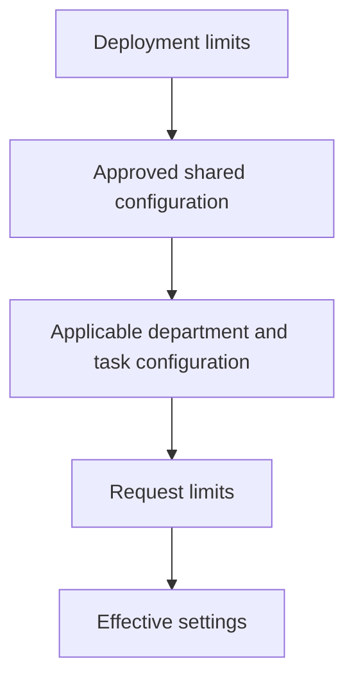

# Configuration

The deployment configuration lives in the private data home as `config.toml`:

```toml
[brain]
max_context_chars = 16000
max_results = 12
allow_remote_processing = false
```

Unknown keys and invalid types are rejected. Context characters range from 500 to 100000. Result counts range from 1 to 100. Configuration does not accept permission or role definitions; those are separate grant operations.

## Apply a space/task limit

The default file is `~/.atmet-brain/config.toml`, or `config.toml` under your selected `--home`/ATMET_HOME. Edit it as the local operator, preserving other valid settings. Restart running API/worker processes after deployment-file changes; each new CLI invocation loads the file again.

For a reviewed limit on Sales quotations, set SALES_SPACE and create:

```bash
cat > quotation-budget.json <<JSON
{
  "space_id": "$SALES_SPACE",
  "kind": "config",
  "name": "quotation-budget",
  "instruction_path": "departments/sales/quotations",
  "body": {"max_context_chars":8000,"max_results":5,"allow_remote_processing":false},
  "expected_revision": 0,
  "reason": "Limit the quotation task's retrieved context",
  "idempotency_key": "quotation-budget-initial"
}
JSON
atmet-brain propose quotation-budget.json
```

Copy the returned ID as CONFIG_ID, inspect its pending body, then publish and request the matching task path:

```bash
export CONFIG_ID="PASTE_ARTIFACT_ID"
atmet-brain rpc artifacts.get --params "{\"artifact_id\":\"$CONFIG_ID\",\"revision\":1}"
atmet-brain review "$CONFIG_ID" --revision 1 --approve --reason "Owner reviewed context and remote-processing limits"
atmet-brain context "Prepare a quotation" --space "$SALES_SPACE" --task-path departments/sales/quotations --max-chars 6000
```

With the default deployment settings, `budget_chars` is 6000: the request may narrow the 8000-character reviewed limit. Inspect the returned manifest ID with `context.manifest` to see effective settings under `revisions.settings` and exact artifact/source versions. A lower budget can produce `incomplete_context` if required instructions do not fit; it does not authorize their omission. Update a configuration through the same expected-revision/review process as a [workflow](workflows.md).

## Precedence



Numeric limits use the lowest applicable value. Remote-processing permission uses the intersection of allowed settings. A deeper artifact can reduce access to remote processing or a context budget; it cannot enable something the deployment prohibits. Learning jobs conservatively apply all active configuration restrictions within their space.

Policies, instruction files and configuration artifacts use an `instruction_path`, such as `shared` or `departments/sales/quotations`. Context assembly includes shared constraints and the applicable path prefixes. Selected artifacts also bring their own path into the applicable chain. Folder depth does not grant authority.

The current implementation supports deployment settings and versioned shared/department/task configuration within a space. A separate organization-wide configuration editor is planned. Deployment changes require constructing a new Brain instance or restarting the service.

## Environment

| Variable | Purpose |
| --- | --- |
| `ATMET_HOME` | Private data home |
| `ATMET_TOKEN_FILE` | Credential file for CLI or MCP |
| `ATMET_TOKEN` | Explicit credential supplied by the operator |
| `ATMET_RECOVERY_JOURNAL` | Destination updated when deletion/revocation decisions are flushed |
| `ATMET_EXTRACTOR` | `local` or `compatible` |
| `ATMET_MODEL_BASE_URL` | Compatible endpoint including its API version prefix |
| `ATMET_MODEL` | Explicitly selected extraction model |
| `ATMET_MODEL_API_KEY` | Private provider credential |
| `NO_COLOR` | Disable ANSI terminal accents when present |

Gmail bindings name an operator-managed `ATMET_...` environment variable. Tokens are not stored in connector configuration. Raw credentials are excluded from portable exports and public examples. Backups contain credential hashes, not the original bearer tokens; restore revokes them all.

Remote client profiles are separate private JSON records under `connections/`, with copied credentials in `client-tokens/`. They do not modify server settings or confer grants. A named connection is always explicit; it uses its saved credential instead of an ambient `ATMET_TOKEN`. User-session services do not automatically inherit interactive shell provider configuration. See [terminal](terminal.md) and [team services](team-server.md).

An explicit CLI --token-file takes precedence over ATMET_TOKEN. Without that explicit flag, ATMET_TOKEN retains its configured override behavior before ATMET_TOKEN_FILE/default files. Generated agent bundles always select a dedicated token file or saved connection.
