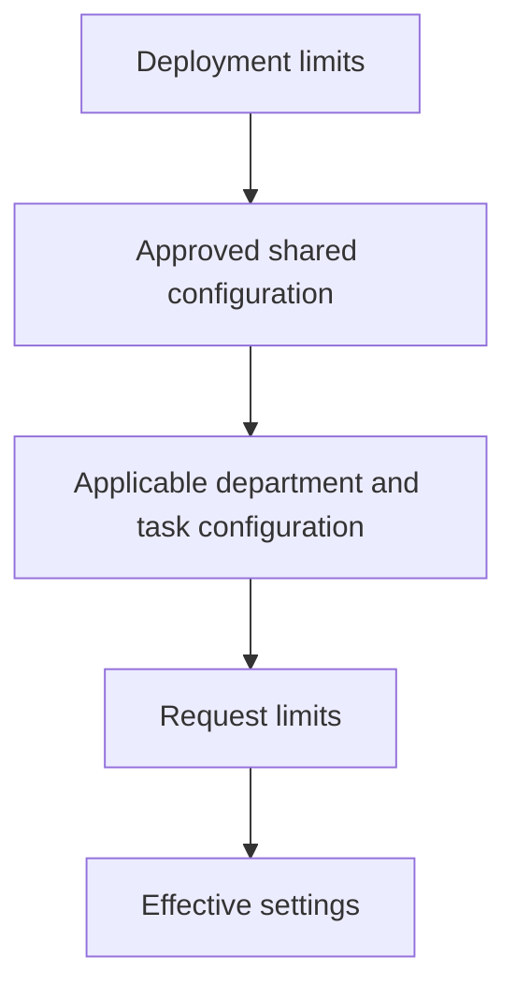

# Configuration

The deployment configuration lives in the private data home as `config.toml`:

```toml
[brain]
max_context_chars = 16000
max_results = 12
allow_remote_processing = false
```

Unknown keys and invalid types are rejected. Context characters range from 500 to 100000. Result counts range from 1 to 100. Configuration does not accept permission or role definitions; those are separate grant operations.

## Precedence



Numeric limits use the lowest applicable value. Remote-processing permission uses the intersection of allowed settings. A deeper artifact can reduce access to remote processing or a context budget; it cannot enable something the deployment prohibits. Learning jobs conservatively apply all active configuration restrictions within their space.

Policies, instruction files and configuration artifacts use an `instruction_path`, such as `shared` or `departments/sales/quotations`. Context assembly includes shared constraints and the applicable path prefixes. Selected artifacts also bring their own path into the applicable chain. Folder depth does not grant authority.

The current implementation supports deployment settings and versioned shared/department/task configuration within a space. A separate organization-wide configuration editor is planned. Deployment changes require constructing a new Brain instance or restarting the service.

## Environment

| Variable | Purpose |
| --- | --- |
| `ATMET_HOME` | Private data home |
| `ATMET_TOKEN_FILE` | Credential file for CLI or MCP |
| `ATMET_TOKEN` | Explicit credential supplied by the operator |
| `ATMET_RECOVERY_JOURNAL` | Destination updated when deletion/revocation decisions are flushed |
| `ATMET_EXTRACTOR` | `local` or `compatible` |
| `ATMET_MODEL_BASE_URL` | Compatible endpoint including its API version prefix |
| `ATMET_MODEL` | Explicitly selected extraction model |
| `ATMET_MODEL_API_KEY` | Private provider credential |

Gmail bindings name an operator-managed `ATMET_...` environment variable. Tokens are not stored in connector configuration. Raw credentials are excluded from portable exports and public examples. Backups contain credential hashes, not the original bearer tokens; restore revokes them all.
