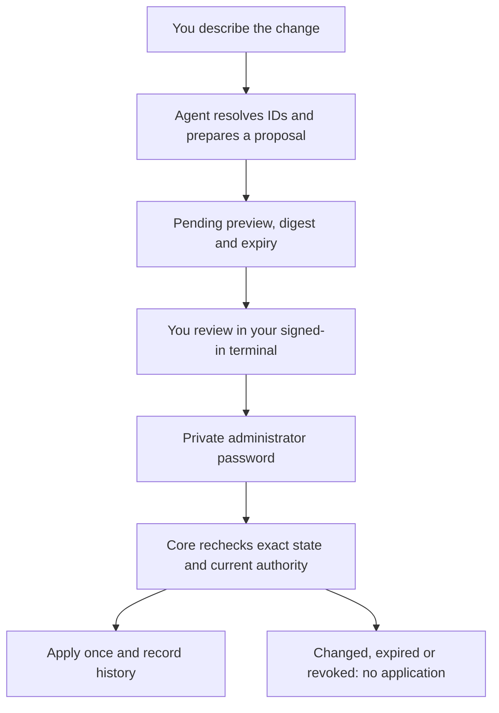
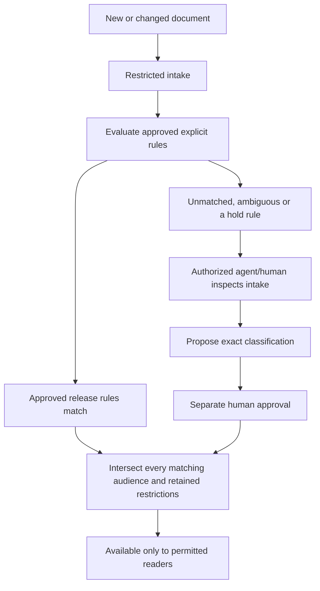

# Manage the Brain by talking to your agent

Connect your existing AI/coding agent to the Brain's administration MCP tools. Describe the company change in normal language. The agent resolves actual workspace/person/group IDs and prepares a precise proposal. You review it in your own terminal and enter your administrator password privately. The Brain applies only that exact approved proposal.

The CLI does not contain its own chat model. Your configured agent interprets the conversation. A sentence in a document, a model's claim that you approved, or an approve=true tool argument cannot authorize a change.



## 1. Connect an administration agent

For an existing installation, follow the [schema-4 upgrade](versioning.md#schema-4-upgrade) before the first new command that opens it. On a new company or upgraded company, enroll the owner login if needed and sign in:

```bash
npx atmet-brain@latest --brain acme account setup --username owner
npx atmet-brain@latest --brain acme login --username owner
npx atmet-brain@latest --brain acme admin agent --name company-assistant
```

Skip account setup when the owner already enrolled. Use your actual catalog label instead of acme. A remote human administrator can use --connection acme in place of --brain acme.

The command writes a private MCP configuration and agent-instructions.md. Add its atmet-admin server entry to your agent application's MCP settings and reconnect. The generated configuration exposes administration proposals, permitted context/drafts, completion reporting and bounded existing automation tools. It does not install settings in the external app or run a model for you.

Its credential follows this human's current company-admin authority and expires within 12 hours or the parent session's remaining lifetime. It cannot call ordinary management/publishing/erase operations directly. The administration adapter resolves a protected reference to the originating human's authority to validate proposals and permitted intake inspection. Parent logout, password/access changes or credential revocation also block the agent. Never share the human session/operator token or password instead of using this bundle.

## 2. Describe a change

For example, tell the connected agent:

> Create a Finance workspace. Let Operations read general finance, but restrict salary and payroll documents to the Finance group and me. Keep anything unclassified private. Show me the changes before applying them.

The agent should inspect brain_admin_overview, resolve actual people/spaces/groups and ask you to clarify ambiguous recipients. Several dependent changes need separate proposals and approvals: create the workspace, create a Finance-and-owners group, choose employee workspace roles, then propose a salary rule using those actual IDs. A group is an audience restriction; it does not grant its members workspace read access.

Ask the agent to show the affected people, workspace roles, rule conditions, retained history implications, pending change ID and approval command. A proposal is pending work. The agent must check its status afterward before saying it was applied.

## 3. Approve in your own terminal

Use your signed-in human company session, not the control credential:

```bash
npx atmet-brain@latest --brain acme admin review CHANGE_ID
```

Replace CHANGE_ID with the returned ID. The terminal shows the stored exact preview, digest, effect and expiry. Confirm yes to apply, no to reject, or cancel to leave pending. Enter your administrator password in the hidden prompt. Do not type the password into the agent conversation.

Changes expire within one hour and cannot outlive their proposing credential. Changed source revisions, membership revisions, group members or rule versions require a new proposal. The core rechecks both the original authority and the reviewing human session. Applying the mutation and recording review are one database transaction. A proposal cannot be applied twice; there is no automatic replay after an uncertain network response. Inspect admin list/get status before deciding what to do next.

Human review uses a separate authenticated /v1/admin/review endpoint and password check. It is absent from ordinary RPC/MCP tool registration. The built-in approval terminal requires interactive private input. A trusted custom human UI can integrate that endpoint; it must keep the password and session away from the agent and its logs.

## 4. Understand the supported controls

Run admin overview for actual IDs and the current operation catalog. The proposal flow currently supports:

| Control | Result after human approval |
| --- | --- |
| spaces.create | Create a department/workspace |
| members.access | Replace a non-admin employee/service's workspace roles and revoke existing credentials |
| members.disable | Disable the member, revoke credentials/reset invites and remove document groups |
| groups.create / groups.membership | Create or review membership of a source-audience group |
| rules.upsert / rules.retire | Version the company ingestion access policy |
| intake.release / intake.hold | Classify/release an exact document revision, or withdraw it for review |
| sources.authority | Review observation/reference/authoritative status without releasing pending intake |
| sources.access | Change an already classified source's base audience, retaining rule restrictions |
| sources.erase | Permanently erase the source and invalidate derived evidence |
| connectors.disable | Stop an existing connector and invalidate its dependent context |

Normal Brain tools still retrieve context, propose memory/workflow/skill changes, report tasks and run supported approved pure recipes when their operations are granted. Editors/publishers review business artifacts through the existing publication path. Skills are never automatically published by this administration bundle.

Company creation/catalog selection, owner recovery, local server files, connector registration with server filesystem paths and OS service/network provisioning remain local operator actions. Invites/login/passwords use their existing private terminal flow. These are explicit boundaries, not universal agent or operating-system control.

## 5. Restricted document intake

By default, every new or changed document enters restricted intake before normal search, context, graph, export, history or extraction can use it. Sources already active before the schema-4 upgrade retain their existing permissions until changed or a policy change makes reclassification necessary. Task reports have their separate private/default audience and original-evidence checks; this is document ingestion control, not universal message/transcript DLP.



An authorized administration agent can inspect only intake covered by its originating human's current workspace and audience permissions. Intake is not exposed as ordinary business context. Permitting inspection lets your chosen external agent/model receive those sensitive documents; choose the runtime accordingly. The engine remote-processing setting does not control a separate application's model or network calls. Documents remain reference data even when they contain instructions to share themselves.

For manual onboarding, use:

```bash
npx atmet-brain@latest --brain acme admin intake
npx atmet-brain@latest --brain acme admin classify SOURCE_ID
```

The classification wizard displays the exact source and current rule evaluation, asks for a reason and audience selectors, then requires the same private human approval. Use the source ID returned by ingest/sync or intake. Source processing can run after release. If the approving/processing identity no longer has the necessary source access, processing remains blocked; classification does not invent worker privileges.

## 6. Define a salary rule once

An agent translates the requested policy into an explicit rule such as this. IDs are placeholders to resolve from admin overview:

```json
{
  "key": "salary-privacy",
  "name": "Salary information: Finance and selected owners",
  "space_ids": ["FINANCE_SPACE_ID"],
  "terms_any": ["salary", "salaries", "payroll"],
  "connector_id": null,
  "audience": ["group:FINANCE_AND_OWNERS_GROUP_ID"],
  "decision": "release"
}
```

The agent proposes rules.upsert with rule plus the current expected_policy_revision. After your approval, matching future documents are automatically classified under the restricted audience. No agent needs to ask for approval again to execute that exact already approved condition. Changes to its conditions/audience still need another exact review.

Terms match case-insensitive substrings in the supported document title/body. A connector condition additionally requires that exact enabled binding in the selected workspace; workspace, connector and content conditions combine with AND. Every matched rule's audience is an additional AND restriction. Selectors inside one audience are alternatives. Any matched hold rule keeps the document restricted.

Unmatched does not mean safe. There is no automatic public fallback. Workspace-wide automatic release requires an explicitly approved trusted connector binding; words such as invoice alone cannot authorize broad sharing. Prefer a separate payroll folder/connector with a restricted binding even when document wording changes. Supported document extraction remains UTF-8 text/Markdown/CSV/JSON; this is not a claim of reliable salary recognition in images, PDFs, video, spreadsheets or every language/format.

The configured model may suggest categories by inspecting permitted intake. Its suggestion alone does not release the document or change the policy. Keywords and model judgments can miss sensitive facts. Treat this as explicit policy automation and review, not perfect semantic classification or a compliance guarantee.

## 7. Changes, history and recovery

New revisions are classified again. Earlier restrictive classification audiences remain attached, so deleting salary wording cannot expose a retained salary-containing revision. To create a differently shared sanitized document, use a genuinely separate source after reviewing its content. Automatic row/column redaction is not supplied.

Rule changes increment a company policy revision and make earlier classifications stale until reviewed again. Because this affects company-wide retrieval, rule changes require management authority across all company workspaces. The preview warns about reclassification. Current rule/group/source access always applies to source history and derived memories/skills/reports. Ordinary source.access activation cannot bypass pending classification.

Each administrative proposal retains its operation, preview/digest, attributable proposer/reviewer, expiry and result. Rule revisions retain review IDs/history. Erasing a source removes its stored classification reason and redacts associated source-change previews; the operation/digest audit remains without the original content. Backup restoration revokes controls, rejects pending changes, disables old rules and requires explicit source reclassification under fresh recovery identities. It never treats an old approval as permission to apply a change later.

List views are bounded to the most recent 100 changes and 200 scanned intake candidates. Large-queue pagination, independent security/load assessment and named-agent application acceptance remain further work.

A trusted local operator can deliberately set require_document_classification=false in [brain] for compatibility fixtures/development. This is not remotely configurable and is not the default. It cannot bypass an existing source classification or any approved company policy. An operator controlling the server filesystem can already alter its database; never give employees that filesystem access as part of joining.

## Reader, User, Editor and administrator

| Everyday preset | Core alias | Can do |
| --- | --- | --- |
| Reader | reader | Read permitted information |
| User | user / reporter | Read, report work, inspect permitted task history and contribute drafts/observations |
| Editor | editor / publisher | Read, edit/review/publish supported business artifacts in granted workspaces |
| Company administrator | Separate identity privilege plus management operations | Manage company structure/security; agent-originated changes use the separate human review |

Advanced contributor/reviewer/worker roles remain available. User does not imply arbitrary script execution; process permission is separate. Editor does not imply company-admin privilege or access to salaries. Giving an agent an editor preset does not give it employee/security administration.

## Is authentication working?

Yes. Company-local username/password login, single-use enrollment, 12-hour sessions, logout and credential/parent revocation are implemented. The core derives identity from the verified session, not a username supplied in a tool argument. Private review rechecks the human's password and current scope, with a persisted attempt limit. [Employee setup](employee-accounts.md) covers the working flow. SSO, MFA, email verification/delivery and browser login UI remain separate work.

SSH is transport, not Brain identity. Admin overview exposes only a validated saved HTTPS address or SSH destination/port when configured. It never exposes SSH private keys, account passwords or arbitrary server files, and it does not create SSH users, domains, VPNs or firewall rules. Your external coding agent can assist with those only through separately authorized operating-system tools.
