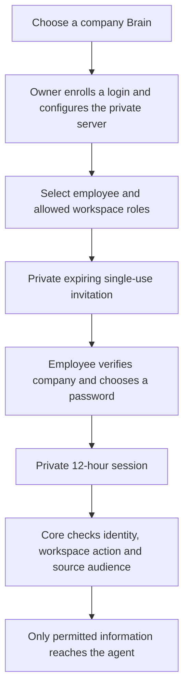

# Employee login, company invitations and private payroll

Use one independent Brain data home for each company. Each company has its own employee accounts, workspaces and permissions. Administrators invite employees; employees choose their own passwords. Their agent uses a scoped session/child credential, rather than the administrator's key.

Existing installations must follow the [schema-4 upgrade](versioning.md#schema-4-upgrade) before their first 0.8.0 command that opens the database. A company name/ID locates a selected organization; it never authenticates a person or grants access.



## 1. Choose the company

For a new company, run:

```bash
npx atmet-brain@latest brains create acme --spaces shared,operations,finance-general,payroll
npx atmet-brain@latest --brain acme status
```

The first command creates a private company home under the catalog's companies directory and asks for the owner name in an interactive terminal. The catalog normally lives under ~/.atmet-brain. With --home before brains, that directory becomes the catalog location. Use a new label; existing data is never replaced.

You can register an existing company instead:

```bash
npx atmet-brain@latest brains add acme --path /private/acme-brain
```

Use your actual existing data home. Run brains for a guided create/add/open chooser, or brains list for the catalog. Run another brains create command for another company. Every --brain selection is explicit; it does not silently change another agent or shell's company. Setup also registers the local company in its starting catalog, using a distinct label if necessary. A label is device-local and is not a global server directory or an access credential.

Each Brain needs its own backup and recovery journal. A backup of the original home does not include other companies nested beneath its companies directory, the catalog or client profiles. After restoring elsewhere, register that restored home deliberately.

## 2. Enroll the owner login

On the controlled company device:

```bash
npx atmet-brain@latest --brain acme account setup --username owner
npx atmet-brain@latest --brain acme login --username owner
```

Choose and confirm a password privately. Use a passphrase of 15 to 128 characters; common/trivial values are rejected. Setup is one-time and requires an unrestricted human administrator credential. Local setup's operator key remains private; it is not given to employees. Login creates an expiring session and does not save the password.

After local password login, ordinary commands use that session unless an explicit token file or configured credential override is supplied. Logout leaves a signed-out marker, so commands do not silently resume owner-key access. The trusted local operator can still select an operator file explicitly; filesystem ownership remains the installation's trust boundary.

## 3. Configure hosting and invite an employee

```bash
npx atmet-brain@latest --brain acme host
```

Select a reachable, administrator-configured HTTPS address or restricted SSH route. Interactive Host defaults to a single-use password invitation. Enter the employee display name, work username/email, permitted workspace names and a role, then review. The username is an account identifier; entering an email does not verify that mailbox or send a message.

Host offers explicit API service installation. Keep the host running and reachable. SSH accounts/keys/known hosts, TLS, firewalls and VPNs remain administrator tasks. Different employee IPs are fine when that route is reachable. Each company server running on the same device needs its own local port; the multi-company Host flow asks for one. Retain the configured port and use a distinct endpoint/subdomain or SSH forwarding destination/port for each company.

For finer per-workspace roles, or later invitations, use:

```bash
npx atmet-brain@latest --brain acme team
```

Choose invite, enter the employee, select workspace names and choose a role separately for each. A saved Host route is reused. A verified remote administrator can also run --connection COMPANY team using that connection's HTTPS/SSH route. The administrator must currently be allowed to delegate every selected operation in each workspace.

The result is a private .atmet-invite.json file. It contains a high-entropy enrollment secret, not an employee's password or a reusable session. It expires after at most 24 hours by default, clipped to the issuer credential's expiry; an explicit expiry may be at most 7 days and cannot outlive the issuer. Give it privately to the intended employee after verifying the recipient. No email or notification is sent automatically. Reissuing an invitation for the same company/username revokes the earlier pending one.

The team menu can list or revoke invitations. A pending invitation does not create an account or grant employee access before acceptance. Its issuer must still be authorized when it is accepted.

## 4. Employee enrollment and agent connection

On the employee's device:

```bash
npx atmet-brain@latest join
```

Select the invitation file, choose a local connection label, review the company/server/username and choose a password privately. The server consumes the invitation once and grants only the administrator-selected memberships. The client verifies the returned identity before saving a private session. Another device joins the existing account with login; it does not reuse the consumed invitation.

For a company using a private CA, obtain its certificate separately and supply --ca-file before join. An invitation cannot disable certificate verification or select local certificate/key paths. Password authentication uses the same verified HTTPS or strict SSH forwarding route as other requests, with no redirects.

After enrollment, use the connection label selected by Join:

```bash
npx atmet-brain@latest --connection acme status
npx atmet-brain@latest --connection acme agent
```

Choose MCP/terminal/REST/Python in the agent wizard. Ordinary employees derive a narrower credential for their current identity. It cannot outlive the login session. Reports and skill drafts still need the relevant grants, and skill publication still requires separate authorized review. A service agent using its own key acts as that service, not as every employee who talks to it. Do not share a more privileged service key with employees needing less access.

## 5. Keep salaries private

A workspace can represent an access area rather than exactly one department:

| Workspace | Operations | Finance | Administrator with explicit grants |
| --- | --- | --- | --- |
| operations | Reader or reporter | Only if needed | Appropriate granted access |
| finance-general | Reader | Reporter or publisher as needed | Appropriate granted access |
| payroll | No access | Appropriate granted access | Appropriate granted access |

In team, choose access and select the employee by name/number. Select only their allowed workspaces, set each role, review, and confirm. Omitted spaces are not granted. Enter none to remove all workspace access. Owner/organization-admin identities are deliberately excluded from this employee editor to avoid accidental administrative lockout.

Import budget/invoice sources into finance-general and salary originals into payroll, using their actual returned IDs. After approved classification, sources retain their selected base audience and any matching rule restrictions, so ordinary setup does not need employee-by-employee rules for each file. Directory connectors can apply a chosen destination/audience to a collection. Folder names do not automatically classify or protect content. Split documents mixing public budgets and private salaries; row/column salary redaction is not implemented.

For a restricted source within an otherwise shared space, existing principal/group audiences still apply. Being an administrator, publisher or group member does not bypass the other content checks. Search, graph, context, derived methods and retained history continue enforcing current source access.

Applying a permission change atomically replaces that employee/service's workspace grants and revokes their existing credentials, including agent children. The employee signs in again to obtain the new scope. A service credential must be reissued deliberately. The review uses a membership revision; a concurrent change requires reload/review rather than silently overwriting it. The review displays existing document groups; a workspace edit does not change those groups. Use the source-audience/group APIs for advanced document exceptions; the terminal employee editor manages workspace roles.

## 6. Daily sign-in, sign-out and password changes

```bash
npx atmet-brain@latest --connection acme login
npx atmet-brain@latest --connection acme logout
npx atmet-brain@latest --connection acme login
npx atmet-brain@latest --connection acme account password
```

Sessions last 12 hours and remain subject to current grants and source audiences. The saved password profile retains the company address and username for explicit sign-in after expiry/revocation. Service/API-key profiles and generated scoped agent profiles cannot be upgraded by login; use a separate new employee connection name. Password change requires a saved employee connection or a local company session. Logout revokes the selected session and descendants and removes its local credential; other device sessions are separate. If the server cannot confirm revocation, local logout reports that fact and the credential ID for administrator action. A password change revokes all existing credentials for that principal, including agent/API/operator credentials, then saves a fresh session. Reissue continuing automation credentials deliberately.

For a new HTTPS device without an invitation/profile, use login with the actual address, company ID/slug, username and new connection label:

```bash
npx atmet-brain@latest --endpoint https://brain.example.com login --organization acme --username alex --name acme
```

For an administrator-configured SSH route use login --ssh-destination forward@brain-host --port PORT with the same organization/username/name options. No company database is copied to a remote device.

For automation, --password-stdin reads a bounded password line; account password reads old and new password lines. Prefer interactive private entry. Password values are never command arguments and are not read from a stored environment setting. Keep ordinary JSON/receipt output free of passwords, invitation secrets and session tokens. Low-level credential-issuing RPC/HTTP operations necessarily return a secret to their integrating client; trusted integrations must store it privately and not log it.

## 7. Disable or recover an employee login

Choose disable in team to block that employee and revoke their credentials. It also revokes pending reset invitations and removes document-group memberships. Re-enrollment does not silently restore those groups. This does not remove information they already received in another application.

Choose reset to prepare a new single-use invitation with deliberately reviewed workspace roles. It retains the employee principal and its attributed history, replaces the password on acceptance, revokes old credentials and applies those reviewed memberships. It can enroll an existing legacy human principal without duplicating their identity. If permissions changed after a reset was prepared, the employee needs a new invitation. For a suspected compromise, disable the employee immediately before preparing recovery. A reset invitation alone does not terminate existing sessions until acceptance.

Owner/organization-admin password recovery is a separate local operator action:

```bash
npx atmet-brain@latest --brain acme account recover --username owner
```

This requires control of the private data home and explicit confirmation. It resets an active owner's password, revokes their previous credentials and saves a new private operator key. It is not a remote RPC/MCP recovery endpoint. Retain the printed operator-file path for continuing local administration, select it explicitly when needed and never share it. It does not reactivate a quarantined installation or bypass journal recovery. Recovered installations require a fresh owner login name and explicit re-enrollment/revalidation of disabled employees.

## 8. Errors and current boundaries

Invalid SSH addresses, HTTPS addresses, slugs, workspace choices and agent names re-prompt that field. Type /cancel to cancel the current operation; the interactive team menu can return to its action menu. Incorrect login passwords can be retried without re-entering the company. EOF/Ctrl+C or deliberate completion ends the command and returns to the shell; it does not close the Terminal app.

Never automatically repeat an operation after an uncertain network response or partially completed write. If invitation acceptance may already have succeeded, use login with the chosen password and company route instead of repeatedly trying enrollment. Failed local saving attempts revoke a newly issued invitation/session when possible and identify unresolved cleanup. Existing companies, connection profiles and unrelated agent settings are not silently overwritten.

Passwords use independent random salts and scrypt N=32768, r=8, p=3, an [OWASP-listed password-storage configuration](https://cheatsheetseries.owasp.org/cheatsheets/Password_Storage_Cheat_Sheet.html). Password work is bounded to two concurrent KDF calls. Login permits at most eight attempts per canonical company/username in a 15-minute window, persisted across server restart, in addition to the HTTP adapter's network rate limit. A small common/trivial-password blocklist is included; no external compromised-password service or NIST certification is claimed. The [NIST password guidance](https://pages.nist.gov/800-63-4/sp800-63b.html) informs minimum length and attempt limiting. Deployments still need independent load/security evaluation and an appropriate ingress.

This release supplies local password authentication and private invitation handoff. It does not supply SSO, MFA, email verification/delivery, a browser login UI, identity-document verification or a global numeric company resolver. A company ID alone grants nothing. Anyone controlling the server filesystem can alter the installation; employees must not receive that filesystem access as part of joining.

For rule-based future imports and exact human approvals, see [conversational administration](conversational-administration.md). Reader/User/Editor are everyday presets; company administration is separate. Keyword/model suggestions do not provide perfect salary detection.
