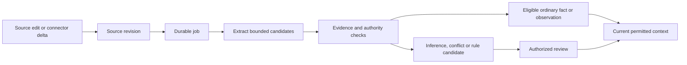

# Memory and learning

Learning is a maintained evidence pipeline. It does not require training new model weights.

## Stored records

- Sources retain original accepted text, content hashes and revisions.
- Memories retain extracted statements, types, evidence, review state and effective/recorded dates.
- Policies, workflows and skills are reviewed artifacts with independent versions.
- Context manifests retain the references used for a task, without retaining the full task prompt.

## Continuing learning



In the default local extractor, plain text lines become observations. Explicit `Fact[key]: statement` lines from an authoritative source can activate ordinary facts. Rule-like language remains pending. Authoritative sources can only be designated by a principal with management rights. A fact that conflicts with another permitted current statement sharing its key becomes reviewable.

This release intentionally uses explicit markers for automatic ordinary-fact activation. General semantic extraction can suggest candidates through the optional model adapter. A model's confidence does not establish company authority.

## Optional model extraction

Set `allow_remote_processing = true` in the private deployment configuration only after deciding which provider may process the selected information. An approved configuration artifact can further restrict this setting.

```bash
export ATMET_EXTRACTOR=compatible
export ATMET_MODEL_BASE_URL=https://your-provider.example/v1
export ATMET_MODEL=your-selected-model
export ATMET_MODEL_API_KEY=your-private-key
atmet-brain worker --space SPACE_ID
```

The adapter sends accepted text to a compatible chat-completions endpoint. It checks response size, JSON shape and exact quoted evidence. Redirects are disabled. Inputs larger than 30000 characters need to be split. Live model quality and provider-specific compatibility must be evaluated separately; fixture validation is not a provider certification.

## Jobs and failures

Source acceptance and memory readiness have different states. `jobs.list` shows pending, running, done, retry, failed, blocked or cancelled status. Each job has a source revision, requester credential, attempts and a lease. The worker rechecks the original requester and the processing principal before extraction and publication.

Retries are bounded to three attempts. Retrying extraction can repeat provider cost; stable IDs prevent duplicate published memory. There are no external business side effects in these jobs. The simple worker uses immediate bounded retries, not a production provider-specific backoff scheduler.

```bash
atmet-brain rpc jobs.list --params '{"space_id":"SPACE_ID"}'
atmet-brain rpc jobs.retry --params '{"job_id":"JOB_ID"}'
```

## Changes, removal and freshness

A changed source invalidates dependent memories. A revoked source or disabled binding is excluded from raw and derived retrieval immediately when the core knows the change. Connector detection depends on the next successful sync. Failed/incomplete snapshots do not mean every old source disappeared.

Source erasure removes retained logical source content and retracts dependent bodies. Physical media, WAL pages, backups and external providers have separate retention concerns. See [backup and recovery](backup-and-recovery.md).

Current stock, payment status or similar transactional questions may need a live authorized app read. A memory of a prior state must remain labeled as evidence from that time.
