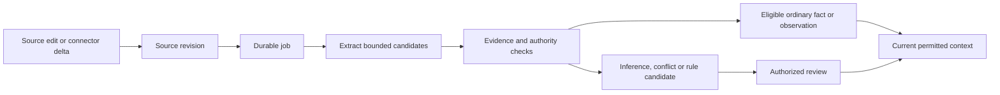

# Memory and learning

New and changed document imports start restricted. Enroll/sign in to your human administrator account, inspect admin intake, and run admin classify SOURCE_ID for each source returned by ingest/sync before processing or using it as evidence. The wizard requires explicit private approval. Approved term/connector rules can classify subsequent imports; unmatched stays restricted. See [classification and conversational administration](conversational-administration.md).

Learning is a maintained evidence pipeline. It does not require training new model weights.

## Add information and check the result

First [initialize a Brain](quickstart.md), list its spaces with `atmet-brain space` and save the selected ID as SALES_SPACE. These commands use an authorized owner in a private working directory:

```bash
printf '%s\n' 'Fact[support.hours]: Support is available from 09:00 to 17:00.' > support.md
atmet-brain ingest support.md --space "$SALES_SPACE" --external-id support-hours --authority authoritative
atmet-brain worker --space "$SALES_SPACE"
atmet-brain context "What are the support hours?" --space "$SALES_SPACE"
atmet-brain rpc memories.list --params "{\"space_id\":\"$SALES_SPACE\",\"include_pending\":true}"
```

Save the source `id` returned by ingest as SOURCE_ID. Ingestion captures the document; the worker extracts its memory. The context result contains reference evidence and a manifest, rather than a generated reply. Only mark a source authoritative when the company has approved that source.

## Update an existing source

Use the same external ID and its current revision. For the new source above, the first update is:

```bash
printf '%s\n' 'Fact[support.hours]: Support is available from 09:00 to 18:00.' > support.md
atmet-brain ingest support.md --space "$SALES_SPACE" --external-id support-hours --authority authoritative --expected-revision 1
atmet-brain worker --space "$SALES_SPACE"
atmet-brain rpc sources.get --params "{\"source_id\":\"$SOURCE_ID\",\"revision\":1}"
atmet-brain context "What are the support hours?" --space "$SALES_SPACE"
```

The source now has revision 2. Its old extracted memory is invalidated and the new eligible fact becomes usable after processing. A changed file imported under a different external ID is a different source; it is not an update to the old one. A competing current fact with the same key creates a reviewable conflict rather than silently winning. Use [history](history-walkthrough.md) to inspect retained revisions.

For a pending memory, inspect its statement/evidence and use its returned ID and revision in an authorized review:

```bash
atmet-brain rpc memories.review --params '{"memory_id":"MEMORY_ID","expected_revision":1,"approve":true,"reason":"Checked the statement against current evidence"}'
```

This example requires replacing MEMORY_ID and the revision with the selected pending record. Memory review approves a sourced statement; policies, workflow steps and skills use their separate [artifact publication](workflows.md) process.

## Stored records

- Sources retain original accepted text, content hashes and revisions.
- Memories retain extracted statements, types, evidence, review state and effective/recorded dates.
- Policies, workflows and skills are reviewed artifacts with independent versions.
- Context manifests retain the references used for a task, without retaining the full task prompt.

## Continuing learning



In the default local extractor, plain text lines become observations. Explicit `Fact[key]: statement` lines from an authoritative source can activate ordinary facts. Rule-like language remains pending. Authoritative sources can only be designated by a principal with management rights. A fact that conflicts with another permitted current statement sharing its key becomes reviewable.

This release intentionally uses explicit markers for automatic ordinary-fact activation. General semantic extraction can suggest candidates through the optional model adapter. A model's confidence does not establish company authority.

## Optional model extraction

Set `allow_remote_processing = true` under [brain] in the private deployment config.toml (see [configuration](configuration.md)) only after deciding which provider may process the selected information. An approved configuration artifact can further restrict this setting.

```bash
export ATMET_EXTRACTOR=compatible
export ATMET_MODEL_BASE_URL=https://your-provider.example/v1
export ATMET_MODEL=your-selected-model
read -r -s ATMET_MODEL_API_KEY
export ATMET_MODEL_API_KEY
atmet-brain worker --space SPACE_ID
```

In this Bash example, paste the private provider key at the waiting read input and press Enter; it is not echoed or included in the command text.

The adapter sends accepted text to a compatible chat-completions endpoint. It checks response size, JSON shape and exact quoted evidence. Redirects are disabled. Inputs larger than 30000 characters need to be split. Live model quality and provider-specific compatibility must be evaluated separately; fixture validation is not a provider certification.

## Jobs and failures

Source acceptance and memory readiness have different states. `jobs.list` shows pending, running, done, retry, failed, blocked or cancelled status. Each job has a source revision, requester credential, attempts and a lease. The worker rechecks the original requester and the processing principal before extraction and publication.

Retries are bounded to three attempts. Retrying extraction can repeat provider cost; stable IDs prevent duplicate published memory. There are no external business side effects in these jobs. The simple worker uses immediate bounded retries, not a production provider-specific backoff scheduler.

```bash
atmet-brain rpc jobs.list --params '{"space_id":"SPACE_ID"}'
atmet-brain rpc jobs.retry --params '{"job_id":"JOB_ID"}'
```

## Changes, removal and freshness

A changed source invalidates dependent memories. A revoked source or disabled binding is excluded from raw and derived retrieval immediately when the core knows the change. Connector detection depends on the next successful sync. Failed/incomplete snapshots do not mean every old source disappeared.

Source erasure removes retained logical source content and retracts dependent bodies. Physical media, WAL pages, backups and external providers have separate retention concerns. See [backup and recovery](backup-and-recovery.md).

Current stock, payment status or similar transactional questions may need a live authorized app read. A memory of a prior state must remain labeled as evidence from that time.
