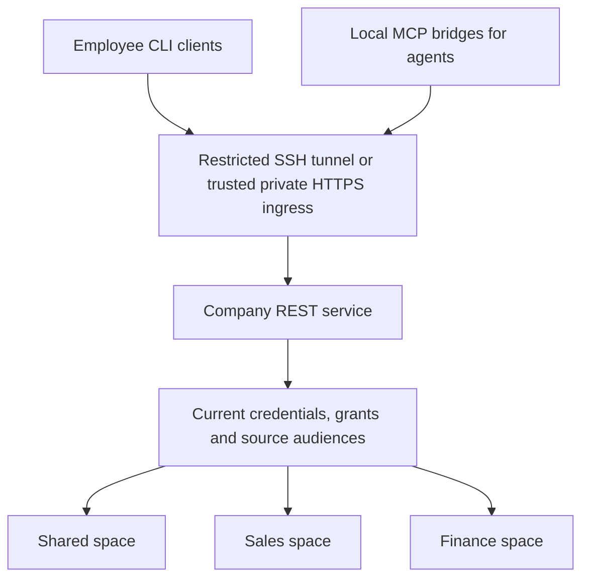

# Share a company Brain

One installation owns the canonical database. Each employee or agent connects using an individual credential with explicit grants. Do not share the database directory, owner token or an operating-system account that can read the Brain files. Host administrators remain trusted with the whole installation.

The core is an alpha for local use and controlled private pilots. These instructions are not a public-production security assessment. Network reachability and application authorization are separate checks.



For a plain-language explanation of department access, private payroll, different networks and the current credential authentication, read [team access explained](team-access-explained.md). A numeric company ID cannot locate a private server without a separately configured resolver, and never grants access by itself.

## Guided Host and Join

There are two jobs: the company administrator hosts the Brain, and each teammate joins it. A workspace named `shared` is a memory space, not a network-sharing switch. Access always needs explicit grants.

### On the company device: Host

```bash
npx atmet-brain@latest host
```

For regular administration, install with `npm install --global atmet-brain` and use `atmet-brain host`.

1. For a new data home, enter the company slug, owner name and department workspace names. An existing Brain is reused without replacing its owner or data. With a custom data home, run `atmet-brain --home /srv/company/brain host`.
2. Choose **ssh**, **https** or **later**. SSH uses an administrator-configured forwarding-only `user@host`; HTTPS uses an already configured company Brain address. Choose later if secure network access is not ready, then run Host again when it is.
3. Enter a teammate's name, allowed workspace names and role. The default role is reader. Only the selected spaces are granted, including `shared` only if explicitly selected. Review the summary before creating access.
4. Host saves one private connection file and offers to install/start the per-user background API service. If you choose no, start the displayed `serve` command and keep that terminal running. The API stays on loopback. The host must stay awake and connected.
5. Give the returned `.atmet-join.json` file privately to its intended recipient. Run Host again for each teammate. The wizard does not send it to anyone.

Host validates the route syntax, not real remote reachability. A completed Host wizard is not proof that teammates can reach the service. Join performs that check from their device. If a service installation fails after access was created, retain the printed file path and fix/start the service; do not repeatedly create credentials.

### On each teammate's device: Join

```bash
npx atmet-brain@latest join
```

Choose the received file and a local connection name, default `company`. Check the displayed server/access summary against your administrator's instructions. Join verifies the server-reported organization, principal and credential identity, then lists the workspaces that the server currently permits. It saves a private copy of the credential and creates no local company database. The file's displayed role/workspace labels are descriptive; server grants remain authoritative.

If your company uses a private certificate authority, obtain its CA certificate separately through your administrator and run `atmet-brain --ca-file /private/company-ca.pem join`. A connection file cannot select a local CA file or disable verification.

After a successful Join, use a persistent globally installed CLI:

```bash
atmet-brain --connection company status
atmet-brain --connection company space
atmet-brain --json --connection company mcp-config
```

Without a global installation, prefix commands with `npx atmet-brain@latest`, for example `npx atmet-brain@latest --connection company status`. Select the connection explicitly each time; joining does not silently change the active company. The MCP configuration launches a local bridge using this verified connection.

### Automatic SSH route: prerequisites and behavior

An administrator must configure a forwarding-only SSH account that cannot read Brain files or run a general shell, restrict forwarding to the Brain's loopback port, authorize each teammate's own SSH key, and verify/install the host key on their devices. The company SSH host must be reachable. Default Brain port is 7310; Host accepts `--port` for a different upstream. SSH service ports and identity-file choices can use administrator-controlled local OpenSSH configuration; the connection file cannot supply shell commands, SSH options or local key paths. Supported destination syntax is `user@hostname` or `user@IPv4`, including a configured host alias.

Atmet opens an ephemeral loopback forwarding port for each API request, requires OpenSSH's own bind/listen confirmation before sending any Brain request, and closes its SSH process afterward. A reachable local port alone is not trusted. CLI and MCP share this behavior. It uses key-based, non-interactive authentication, strict host-key verification, no remote command and no agent forwarding. Unknown host keys or unavailable SSH access fail with instructions; they are never silently accepted. There is no fallback to an unprotected network endpoint. Each request establishes a connection, so SSH adds latency. [OpenSSH forwarding](https://man.openbsd.org/ssh#L) and [client configuration](https://man.openbsd.org/ssh_config).

### Protect and revoke connection files

The file contains a bearer credential with a default 30-day expiry, selected workspaces and a non-owner role. It is reusable until expiry or revocation, not an invitation code consumed once. Do not put it in source control, public chat, a shared drive or logs. Anyone with a copy can use its Brain permissions if they can reach the server. The file contains no SSH private key; SSH access is checked separately.

Host prints a credential ID so an administrator can revoke access:

```bash
atmet-brain rpc credentials.revoke --params '{"credential_id":"CREDENTIAL_ID"}'
```

Revocation blocks saved clients and copies of the file. Deleting a file or local connection does not revoke access. Brain backups protect canonical server records; exported connection files and device-local client profiles need their own private handling. Never distribute owner credentials or the database directory.

### Non-interactive administration

For an already initialized Brain:

```bash
atmet-brain --json host --transport https --endpoint https://brain.example.com --member "Sales employee" --member-spaces shared,sales --role reader --output /private/sales.atmet-join.json
atmet-brain --json join --file /private/sales.atmet-join.json --name company
```

The first command runs on the host; the second runs on the teammate's device after private delivery. Replace the example domain with your configured ingress. For SSH, replace `--transport https --endpoint ...` with `--transport ssh --ssh-destination forward-user@brain-host`. On a fresh host, also pass `--organization example-company --spaces shared,sales`. Existing hosts reject creation flags to avoid silently changing company identity. Add `--start-service` only when explicitly installing a new per-user API service. For an existing service use `service start`, not repeated installation.

`setup --mode host` and `setup --mode join` provide the same flows. The older `setup --mode team` aliases Host; `setup --mode connect` keeps the manual endpoint/credential wizard. JSON mode requires explicit answers and never prompts.

## Manual setup and deployment reference

The following commands remain available for administrators who need individual steps or existing credential files.

## 1. Create the server installation

Install the released CLI persistently on a company device, then:

```bash
atmet-brain setup --mode team --organization example-company --spaces shared,sales,finance
atmet-brain space
atmet-brain serve
```

Save the returned space IDs. The default endpoint is `http://127.0.0.1:7310`. It is only reachable on the server itself until you configure a secure forwarding/ingress route. A laptop sleeping, logging out or disconnecting can make the service unavailable. Use an appropriate always-on company device for a continuing team pilot.

## 2. Give each member a credential

On the server, using an authorized company administrator:

```bash
atmet-brain team-add "Sales employee" --space SALES_SPACE_ID --space SHARED_SPACE_ID --role reader --output /private/sales-employee.token
```

The operation creates a separate human principal, selected-space grants and a narrowed credential atomically. The default role is reader and expiry is 30 days; `--expires-at` accepts a future timestamp bounded by the issuer's expiry. Use `--kind service` for an agent and choose a role deliberately. `team-add` cannot create an organization administrator or use the owner role.

The CLI reserves a private destination before provisioning, refuses overwrite and prints the file path, credential ID and scope rather than the raw credential. Securely deliver the credential to its intended recipient outside public chat/source control. Membership does not bypass source audiences or reveal other spaces. For narrower custom operation sets, use the existing principal/grant/token commands.

Revocation uses the returned credential ID:

```bash
atmet-brain rpc credentials.revoke --params '{"credential_id":"CREDENTIAL_ID"}'
```

The raw low-level `rpc` interface can return credentials when explicitly calling a credential-issuing method. Prefer `team-add` and `token` for private file output. Never paste issued tokens into URLs, command arguments, logs or repository files.

## 3. Choose a secure connection

### Restricted SSH forwarding for a pilot

An administrator must configure SSH, separate keys and a forwarding-only account that cannot read the Brain directory or run a general shell. Restrict permitted forwarding destinations to loopback port 7310. Do not give ordinary employees the server owner's shell account.

On an employee device, replace `forward-user@brain-host` with the SSH account and reachable company host:

```bash
ssh -N -o ExitOnForwardFailure=yes -L 127.0.0.1:17310:127.0.0.1:7310 forward-user@brain-host
```

Keep that tunnel running. The different local port avoids conflicts with a personal Brain. On the employee device:

```bash
atmet-brain connect company --endpoint http://127.0.0.1:17310 --token-file /private/sales-employee.token
atmet-brain --connection company space
atmet-brain --connection company context "Prepare a quotation" --space SALES_SPACE_ID
```

The tunnel encrypts traffic; Atmet still authenticates every operation with the employee's credential. SSH does not assign Brain roles. [OpenSSH forwarding reference](https://man.openbsd.org/ssh#L).

### Private network or HTTPS domain

An administrator can use a private VPN such as [Tailscale](https://tailscale.com/docs/how-to/quickstart) and trusted HTTPS ingress. Configure device/user network restrictions, certificates and proxy forwarding explicitly. Use the existing loopback adapter as the upstream where possible. A domain is an address, not authorization.

```bash
atmet-brain connect company --endpoint https://brain.example.com --token-file /private/sales-employee.token
```

For an organization-issued CA, append `--ca-file /private/company-ca.pem`. Publicly trusted certificates need no custom CA file. Non-loopback plaintext HTTP is refused, including private LAN/VPN IP addresses. Keep the raw HTTP port private and do not forward it directly from a router. This release does not install VPNs, TLS certificates, an SSO provider or a production reverse proxy.

For a separately isolated private ingress that must reach a non-loopback binding, `serve --host PRIVATE_BIND_IP --allow-network` is an explicit operator choice. This flag adds no encryption or identity service by itself. Browser-origin requests remain rejected, and the adapter has a shared per-peer request limit. Size and harden an ingress separately for larger teams.

## 4. Connect agents

On each agent's device, save a dedicated service credential/connection, then:

```bash
atmet-brain --json --connection company mcp-config
```

The generated configuration launches a local stdio-to-REST bridge. It uses the same current permission checks as other requests. This supports a remote Brain with a local MCP client, without granting that client server filesystem access or publishing a remote MCP/OAuth transport.

## 5. Keep it running

```bash
atmet-brain service render
atmet-brain service install --start
atmet-brain service status
atmet-brain service stop
atmet-brain service start
atmet-brain service remove
```

Services are explicit per-user definitions: launchd LaunchAgents on macOS and systemd user units on Linux. API services bind loopback only. Installation refuses an existing managed file and records its hash; modified service definitions require manual review. Removal stops/removes the service definition while preserving company data. No sudo, OS account creation or machine-wide daemon installation is performed.

A persistent installed interpreter is recorded, including its virtual environment. After moving/uninstalling that environment, remove and reinstall the service. The install command probes that the interpreter can import the package without PYTHONPATH. Temporary uvx caches and source-only imports are unsuitable for a continuing service.

These are user-session services, not a guarantee of operation before login or after logout. Linux boot-without-login needs administrator-configured user lingering; macOS before-login operation needs a separately administered LaunchDaemon. API installation does not start learning workers or schedule connector sync automatically.

Create a separate worker service for a selected space:

```bash
atmet-brain --token-file /private/worker.token service install --kind worker --space SPACE_ID --start
atmet-brain --token-file /private/worker.token service status --kind worker --space SPACE_ID
```

The worker credential must currently have process access. Keep that file available and private. Use the same kind/space selection for start/stop/remove. Service processes do not inherit your interactive shell's provider secrets or deployment-specific recovery-journal location; configure such environment requirements through an administrator-reviewed service definition. Atmet then refuses to manage a manually modified definition until reviewed externally.

macOS logs live in the private data home's `service-logs` directory. Linux uses the user's journal; the generated unit name is returned on install. `service status` reports manager state, not an authenticated API/worker health assessment. Run `status`, `doctor` and a scoped request as appropriate.

Templates and service-manager command dispatch have regression tests; actual launchd/systemd lifecycle, before-login operation and production ingress need deployment-specific validation. See [Apple launchd](https://developer.apple.com/library/archive/documentation/MacOSX/Conceptual/BPSystemStartup/Chapters/CreatingLaunchdJobs.html) and [systemd service](https://www.freedesktop.org/software/systemd/man/latest/systemd.service.html) documentation.

## 6. Operate and recover

Protect the host account, data directory, disks, individual credential files and encryption keys. Keep [encrypted backups and a current independent recovery journal](backup-and-recovery.md). Revoke departed employees and compromised credentials promptly. A restored installation disables old authority and requires new connections using newly issued credentials.

Local hosting describes where Brain storage runs. An opted-in cloud extractor or an external agent's cloud model may still receive selected company information. Configure model/tool data flows deliberately. Capacity, uptime, monitoring, retention and recovery objectives require real deployment measurements.
