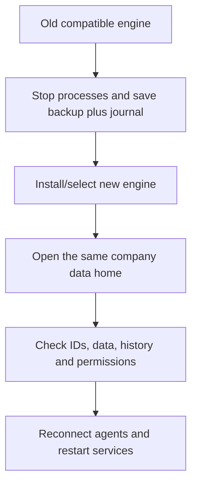

# Update Atmet Brain without losing company data

Update the installed software and open the same company data home. Your workspaces, documents, memory, workflows, skills, task history and permissions belong to that home. They are not stored in the npm package.

This guide uses 0.8.1 as the target. Updating from 0.8.0 keeps schema 4 unchanged and needs no data migration. Older supported schemas migrate on first open with the new engine. Make the backup with the old compatible version before that happens. Read the target release's [changelog](../CHANGELOG.md) and [schema notes](versioning.md#schema-4-upgrade) first.

## What stays where

| Item | Location and update behavior |
| --- | --- |
| Installed launcher and Python runtime | npm installation/cache and version-specific managed runtime directories; a newer launcher installs its matching engine |
| Company records and workspace IDs | brain.sqlite3 inside the selected private data home; the update opens this existing database |
| Default local Brain | ~/.atmet-brain, unless ATMET_HOME or --home changes it |
| Several company Brains | Each catalog entry points to its own data home, commonly ~/.atmet-brain/companies/COMPANY |
| Catalog, connection profiles and credential files | Device-local files kept separately from the package; leave them in place |
| MCP and background-service configuration | Can contain an absolute path to the old engine; update these separately |

Using another data folder can make the installation look empty. It does not move your existing workspaces to that folder. Re-select the correct home before creating anything.

Do not run init, brains create, restore or a new-company setup to perform an ordinary software update. Do not delete the Brain folder, database, catalog or credentials.

## 1. Identify the version and company you already use

Use your existing executable's --version, the version in its terminal banner, or the versioned executable path in your current MCP/service configuration. Running npx atmet-brain@latest --version shows the selected new engine, not which version last opened your database.

Set these values in one terminal. The old version below is an example: replace it with your actual currently compatible version. Keep the same paths throughout the procedure.

```bash
BRAIN_CURRENT_VERSION="0.8.0"
BRAIN_NEW_VERSION="0.8.1"
BRAIN_HOME_PATH="$HOME/.atmet-brain"
```

For a catalog-managed company on 0.7.0+, list the catalog with the old version:

```bash
npx "atmet-brain@$BRAIN_CURRENT_VERSION" --json brains list
```

Set BRAIN_HOME_PATH to the exact home returned for your company. If your catalog uses a custom root, pass that existing --home before brains list. The rest of this guide uses the actual company home directly, so it also works for a legacy installation without a catalog. Repeat the procedure for every company home.

If you do not know the old compatible version, establish it from your existing installation/release records before opening the data with a guessed version. Keep older-version backups and runtime paths available.

## 2. Stop processes using this company

Close its MCP connection in the agent app. Stop foreground serve and worker processes with Ctrl+C in their terminals, and pause scripts/scheduled jobs that access this home. For a shared server, arrange a maintenance window with its administrator and stop its workers/API before opening it with a new engine.

If you installed an Atmet-managed API service, inspect it using the old version:

```bash
npx "atmet-brain@$BRAIN_CURRENT_VERSION" --home "$BRAIN_HOME_PATH" service status --kind api
```

If it is installed, stop it:

```bash
npx "atmet-brain@$BRAIN_CURRENT_VERSION" --home "$BRAIN_HOME_PATH" service stop --kind api
```

Do not run stop for a not_installed result. For each managed worker, use the same --kind worker, --space and --token-file values as its saved definition. Record the API port and worker settings for reinstallation. An externally managed service/container must be stopped through its actual manager instead.

An npm update alone does not stop a running Python server or MCP process. Do not mix old and new engines against a migrated database.

## 3. Back up using the old version

Choose fresh output names for this update. The example creates private local backup/key folders; for protection against disk loss, put the encrypted snapshot and current recovery journal on independent storage, keeping the key separately protected.

```bash
BRAIN_BACKUP_DIR="$HOME/Atmet-backups/before-0.8.1"
BRAIN_KEY_FILE="$HOME/.atmet-backup-keys/before-0.8.1.key"
umask 077
mkdir -p "$BRAIN_BACKUP_DIR" "$HOME/.atmet-backup-keys"

npx "atmet-brain@$BRAIN_CURRENT_VERSION" backup-key --output "$BRAIN_KEY_FILE"
npx "atmet-brain@$BRAIN_CURRENT_VERSION" --home "$BRAIN_HOME_PATH" backup --key-file "$BRAIN_KEY_FILE" --output "$BRAIN_BACKUP_DIR/brain.atmet"
npx "atmet-brain@$BRAIN_CURRENT_VERSION" --home "$BRAIN_HOME_PATH" journal --output "$BRAIN_BACKUP_DIR/recovery-journal.json"
```

Keep the terminal open so its variables stay available. If you already have a protected backup key, select that key and skip backup-key. Do not overwrite a previous key or snapshot. Each backup command must succeed before continuing; the encrypted snapshot verifies database integrity as it is created. Losing the key prevents decryption.

Record the original organization and workspace IDs, and keep the status output privately for comparison:

```bash
npx "atmet-brain@$BRAIN_CURRENT_VERSION" --json --home "$BRAIN_HOME_PATH" status > "$BRAIN_BACKUP_DIR/before-status.json"
```

If status needs sign-in, use the old version and your existing account before recording it. A backup does not extend an expired credential.

The encrypted snapshot contains canonical company records and supported deployment settings. It excludes the device catalog, remote profiles, raw credential files, provider secrets and OS-service definitions. Keep those existing files in place during the update and protect them through your normal encrypted device/configuration backup. Never put tokens or backup keys in Git, chat or a shared company folder. See [exact backup and recovery scope](backup-and-recovery.md).

## 4. Select the new software

For npx users, no uninstall or fresh company setup is required:

```bash
npx "atmet-brain@$BRAIN_NEW_VERSION" --version
```

Expected output for this example: Atmet Brain 0.8.1. This command prepares the matching runtime without opening the company database.

If you use a globally installed command, update that package too:

```bash
npm install --global "atmet-brain@$BRAIN_NEW_VERSION"
atmet-brain --version
```

For a later update, review that release and change BRAIN_NEW_VERSION deliberately. Using npx atmet-brain@latest selects npm's current latest version, while a command pinned to an older version keeps selecting that older version.

The GitHub organization move does not change the package name or the company data location.

## 5. Open the existing home and verify it

Only after the backup and shutdown steps, open the same home with the new version:

```bash
if [ -n "$BRAIN_HOME_PATH" ] && [ -f "$BRAIN_HOME_PATH/brain.sqlite3" ]; then
  npx "atmet-brain@$BRAIN_NEW_VERSION" --home "$BRAIN_HOME_PATH" doctor &&
  npx "atmet-brain@$BRAIN_NEW_VERSION" --json --home "$BRAIN_HOME_PATH" status &&
  npx "atmet-brain@$BRAIN_NEW_VERSION" --home "$BRAIN_HOME_PATH" space
else
  printf '%s\n' 'Stop: select the existing company home containing brain.sqlite3.' >&2
  false
fi
```

The guard stops this block if the selected database is absent. Doctor itself opens/initializes database storage, so do not point it at a guessed empty folder. Doctor should report integrity ok, schema 4 and recovery_mode false. If a supported old schema was present, the first database open migrates it transactionally. Compare the returned home, organization ID and workspace IDs with before-status.json. Inspect a known document, workflow/history revision and permitted context before resuming team work.

Normal updating is not recovery: it does not deliberately reset users or recreate workspaces. Credentials can still expire or be revoked normally. Sign in again if required; never widen permissions or replace the database to get past an authentication error.

For a catalog-managed company, its label should continue pointing to the same home:

```bash
npx "atmet-brain@$BRAIN_NEW_VERSION" --json brains list
npx "atmet-brain@$BRAIN_NEW_VERSION" --brain YOUR_COMPANY status
```

Replace YOUR_COMPANY with the existing label. Keep any custom catalog-root --home before --brain. If you instead see not_initialized, a setup interview or a different organization, stop and check the selected home/catalog/environment. Do not initialize the apparently empty location.



## 6. Reconnect agents and restart services

Changing the npm version does not rewrite saved MCP JSON. Regenerate the MCP entry using the new runtime, the same home/connection and the same scoped credential and opt-in flags as before. For a local agent with an existing dedicated token file:

```bash
npx "atmet-brain@$BRAIN_NEW_VERSION" --home "$BRAIN_HOME_PATH" --token-file /absolute/path/to/existing-agent.token mcp-config
```

For a saved remote connection, use --connection NAME instead of --token-file and retain its client-profile home. Keep existing --task-feedback / --allow-proposals / --allow-task-reports / --allow-automations / --allow-admin flags only where already intended. Keep the existing MCP server entry name so another company connection is not overwritten. Replace that entry's command/arguments in your agent app, restart its MCP connection and test the permitted workspace. Do not substitute the company owner's credential for an employee/agent credential. [Agent configuration](agent-setup.md), [MCP flags](mcp.md).

For an API service that you stopped earlier, remove only its old managed service definition and install the new one with the same port:

```bash
npx "atmet-brain@$BRAIN_NEW_VERSION" --home "$BRAIN_HOME_PATH" service remove --kind api
npx "atmet-brain@$BRAIN_NEW_VERSION" --home "$BRAIN_HOME_PATH" service install --kind api --port 7310 --start
npx "atmet-brain@$BRAIN_NEW_VERSION" --home "$BRAIN_HOME_PATH" service status --kind api
```

7310 is the default example; retain your actual previous port so SSH/HTTPS routes continue to reach it. Skip this block if no Atmet-managed service was installed. Worker definitions need the original workspace and credential-file arguments. These commands manage service definitions, not company data; actual service-manager behavior depends on your host and login session. Re-render/redeploy external service/container definitions through their manager using the same data mount. Do not remove old runtimes until all clients/services stop referencing them.

## Shared teams, other install methods and recovery

- **Joined employee:** update your local launcher and MCP runtime; keep the same named connection, endpoint and credentials. The host administrator upgrades/backups the server data. Updating only your client does not upgrade the server database. Use your normal login if its session expired; joining again is not an upgrade.
- **Several companies:** back up/check each company home separately, preserving the device catalog and each company's journal. A backup for one company does not include another.
- **Python/uv/source installation:** stop the same processes and use the same backup/verify sequence, replacing the executable in your existing environment with the versioned wheel or reviewed source described in [installation](install.md). Do not substitute an unpublished Atmet PyPI package.
- **Upgrade failed:** keep the stopped original home and its logs. Do not repeatedly run setup/init or blindly downgrade. No in-place schema downgrade is supported. An old snapshot is restored into a fresh directory and enters restricted recovery, with revoked old identities/credentials and deliberate journal reconciliation. Follow [recovery](backup-and-recovery.md), not a database-file overwrite.

After verifying the updated company and clients, resume workers and team access. Keep the old-version backup, its separate key and trustworthy journal according to your retention policy.
