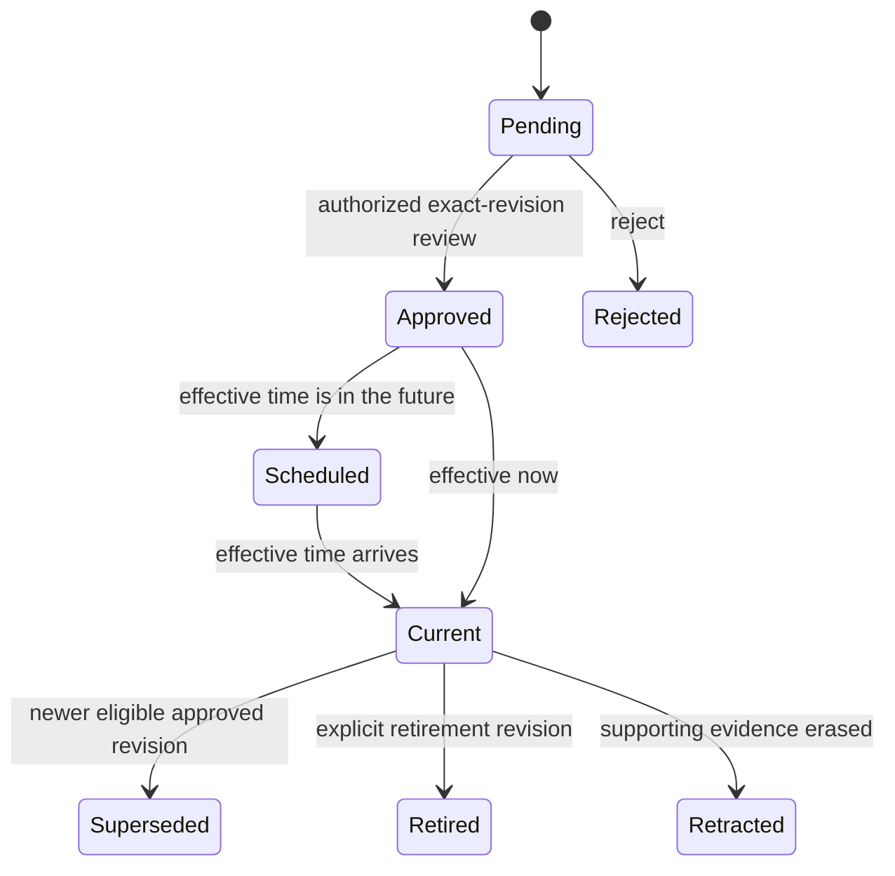

# Versions and history

For exact terminal commands, start with the [history walkthrough](history-walkthrough.md). It creates revisions 1 and 2, compares them, records a context manifest and restores revision 1 as reviewed revision 3 using the released CLI.

| Goal | Operation / guide |
| --- | --- |
| List workflow or skill revisions | `artifacts.history` |
| Read one old revision | `artifacts.get` with `revision` |
| Compare two retained bodies | `artifacts.diff` |
| Restore an approved old body as a draft | `artifacts.rollback`, then authorized review |
| Read a retained document revision | `sources.get` with `revision` |
| Check versions used for one context request | `context.manifest` |
| Inspect permitted change records | `audit.list` |
| Search selected past task outcomes | reports.search / [task history](task-history-and-learning.md) |
| Recover lost installation storage | [Encrypted backup/recovery](backup-and-recovery.md) |

These operations run through `atmet-brain rpc METHOD --params JSON`, REST or Python. Whole-agent profile/release bundles remain proposed; current artifact history does not save an entire agent, conversation or model state.

Several independent versions describe a Brain:

| Version | Tracks |
| --- | --- |
| Engine | Software release |
| Schema | Database representation |
| Source revision | Captured business information |
| Memory revision | Extraction or review state |
| Artifact revision | Policy, workflow, skill, instruction or configuration body |
| Extractor generation | How memory was derived |
| Context manifest | References actually used by one task |

Re-extracting information does not approve an operating policy.

## Artifact lifecycle

Scheduled/current/superseded describe time-based interpretation; approval state is stored separately. The resolver chooses the highest approved eligible revision by revision number. A later retirement or rollback cannot be undone just because an older scheduled revision reaches its date.

Every proposal requires an expected head revision and an idempotency key. Reusing a key with the same request returns the original result. Reusing it with different content is a conflict. Publication rejects a review if another proposal changed the head.

## Effective time and recorded time

`submitted_at` and `reviewed_at` describe what the system recorded. `effective_at` describes when business behavior applies. `artifacts.get` supports `at` for business-effective time and `known_at` for what had been approved by a system time. Historical access requires `history` permission and today's source access.

This temporal API applies to artifacts. Full historical reconstruction of every extraction/index/permission state is outside this first release. Source revisions and memory review metadata remain inspectable through their supported paths. Current task retrieval excludes future-effective source heads. It does not automatically reconstruct an earlier source head for that task; use an explicit historical inspection when needed.

## Rollback

Call `artifacts.rollback` with the retained approved revision to restore, the expected current head, a reason and an idempotency key. It creates a new pending revision. An authorized publisher reviews it before activation. Retained earlier bodies allow exact before/after comparison. The `artifacts.diff` operation returns a unified JSON-body diff between two accessible revisions; it does not invent a prose explanation.

Rollback checks current evidence and dependencies. It cannot restore erased evidence, old credentials or former grants. If a dependency changed, the skill/workflow needs a new reviewed version rather than silently using incompatible instructions.

## Traceability

Task envelopes include a manifest ID. `context.manifest` returns referenced artifact/source versions, hashes, effective settings and the permission-check time for the original principal. Current access still applies. The manifest stores a query hash rather than the complete prompt. It supports inspection, not guaranteed byte-identical model replay.

## Schema 3 upgrade

Engine 0.7.0 introduces company-local password accounts, invitation state, membership-review revisions and persisted sign-in attempts. Existing identity/source/workflow data is preserved; no employee password is invented and no new workspace access is granted by migrating. Supported schema-1/2 installations upgrade in one transaction on first open. Unknown schemas are rejected.

Before the first new command opens an existing Brain, stop old services, workers and MCP processes. Use the currently installed compatible engine to create an encrypted backup and an independent current journal. For an existing 0.6.1/schema-2 Brain, pin npx atmet-brain@0.6.1 for those backup/journal commands; @latest would already open it with the new engine. Use the existing backup procedure and your actual private key/destinations. Do this separately for every company home.

After backup and stopping old processes, open with 0.7.0, check doctor/status and restart all services/clients with the new runtime. Replace old runtime-specific service definitions deliberately; this release does not perform an OS service migration automatically. Do not run a mixture of old/new engines against the migrated database. Older engines cannot open schema 3; no in-place downgrade is supported. To use an old engine, restore its old snapshot into a separate home.

Existing API credentials keep their current scope; password accounts are explicitly enrolled through account setup or an employee invitation. Existing human principals can receive a reset/enrollment invitation while retaining their identity/history. Password sessions use current grants. Backups restored with the new engine are quarantined and old accounts/password verifiers, invitations, sessions and grants stay disabled until deliberate recovery/re-enrollment.

## Schema 2 upgrade

This historical step was introduced by engine 0.4.0; use the schema-3 procedure above for the current engine. Schema 2 for explicit task reporting and separate report-source classification. Supported schema-1 installations upgrade in one transaction while retaining existing identity/source/artifact records. Unknown schemas are rejected. Back up before opening an existing Brain with the new engine, stop old local processes, and restart all local services with the compatible runtime. Older engines cannot open schema 2; there is no in-place downgrade. Restore an old snapshot into a separate home if an older-engine recovery path is needed. Schema-1 backups can also be restored with the current engine, upgraded and quarantined before normal recovery.

For the pre-upgrade snapshot, use your currently installed schema-1-compatible engine. If using npx, pin atmet-brain@0.3.1 for those backup/journal commands rather than @latest. The first 0.4.0 command that opens an existing Brain already performs the migration. Follow the [backup procedure](backup-and-recovery.md) before that first open; use a fresh home when restoring an older snapshot.
